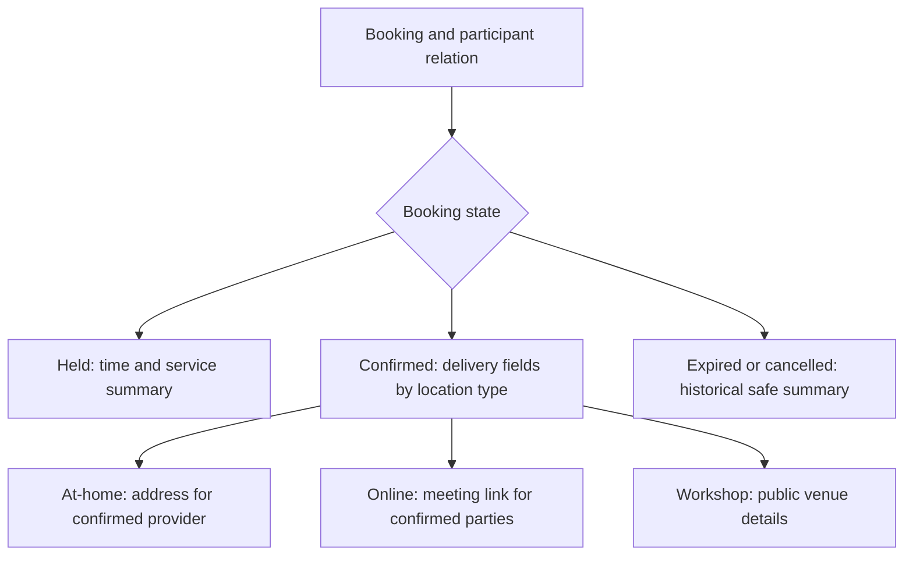

# Share only needed Booking fields

Passing an object-level check does not mean returning every field on that object. Sara owns the provider side of Amal's Booking, but an unpaid hold may not justify showing Amal's home address. After a paid at-home appointment is confirmed, Sara needs the address to deliver it. Omar, another provider, never needs it. The client may see their own address and charge, while a provider may see delivery details but not full payment-provider information. Build explicit response projections rather than serializing an entire Mongoose document.

Most field leaks survive a correct object check. The permission asks "may Sara read this Booking" and the answer is yes, so the handler returns the document and the private parts travel with it. The failure is quiet because nothing looks wrong on the request path. A client's home address appears in a provider agenda response for an unpaid hold. A meeting link appears in a client list for a session the provider has not started. A door code added last week appears everywhere because the serializer spreads the remaining properties. Object authorization decides whether the row may be read; field projection decides what leaves the process, and the second decision is never automatic.



List fields by source and purpose. Booking holds clientId, providerId, Service snapshot, UTC start and end, status, policy snapshot, delivery details and perhaps a history of state transitions. Order holds price and provider share. PaymentAttempt holds Stripe IDs and client-secret handling. A provider Booking response should not include raw PaymentAttempt or another provider's Order. A client response may include their paid amount and refund state but not the provider's private scheduling notes. A public availability response includes computed starts only, never Booking IDs or participant names.

Create named serializers such as `toClientBookingView`, `toProviderHeldView` and `toProviderConfirmedView`. Each uses an allowlist of output fields. Avoid a blacklist that deletes `address` and then spreads every remaining property: a future `accessCode` field could leak automatically. The serializer should receive the authorized relation returned by `assertBookingParticipant`, Booking state and location type. It should never accept a browser-supplied flag like `includePrivate=true` as permission.

Run the same route twice to see the projection do its work. On Monday, Amal has a held at-home Booking at 15:00. Sara opens her agenda and sees the time block, the Service title and the hold expiry, with no address. On Tuesday the payment webhook confirms the Booking, and the same endpoint now returns `visitAddress`, because the state predicate flipped and the location type is at-home. Nothing in the request changed except the Booking status that the server read. That behaviour is the point: the client cannot request the confirmed view early, and Sara cannot receive the address from a stale cache of her Monday response. Cache keys must therefore include status, or a confirmed detail page can be served a held payload. The serializer below shows that shape: one base view for every provider read, then one branch for each confirmed location type.

```ts
function toProviderBookingView(booking, relation) {
  if (relation !== 'provider') throw new Error('Wrong projection');
  const base = { id: booking.id, serviceTitle: booking.serviceTitle,
    startAt: booking.startAt, endAt: booking.endAt, status: booking.status };
  if (booking.status !== 'confirmed') return base;
  if (booking.locationType === 'at-home') return { ...base,
    visitAddress: booking.visitAddress };
  if (booking.locationType === 'online') return { ...base,
    meetingLink: booking.meetingLink };
  return { ...base, workshopLocation: booking.workshopLocation };
}
```

The code is a simplified design. A real product may reveal delivery details a set time before an appointment rather than immediately on confirmation, and may revoke link access after completion. Choose and document that policy. M6 stores location type on Provider and Service; a Booking should snapshot the accepted delivery mode so a later Service edit does not change which private fields are expected. Validate that at-home Bookings have an address from an authorized client input and online Bookings have a link supplied through the provider workflow, rather than returning undefined fields with misleading labels.

## Protect both object and property boundaries

OWASP's API guidance distinguishes [object-level authorization](https://api-security.owasp.org/editions/2023/en/0xa1-broken-object-level-authorization/) from field exposure. Even if Sara may read her Booking, the response must consider whether each property is needed. Do not rely on Mongoose's `select: false` alone; it is useful defense but can be bypassed by an explicit select or aggregation. The route's output serializer is the final boundary. Tests should assert exact keys rather than merely checking that `address` is absent once.

Nested values matter. A provider Order view might embed Booking snapshots that contain client contact data. An error response might echo a rejected request body with an address. A log or analytics event might capture the whole JSON response. Review the serializer's nested objects and error paths. Use fixture values that are easy to spot, such as `PRIVATE_HOME_DOOR_CODE`, and search all response bodies in cross-party tests. This detects accidental propagation through a seemingly unrelated field.

## Choose timing for confirmation

At a held state, the provider calendar can show "temporarily held 15:00 to 15:45" and Service name. It should not imply payment or show private delivery fields. On a trusted payment webhook, the Booking becomes confirmed and the provider response may include address or meeting link according to policy. If the Booking expires without payment, it remains history but the provider public-facing agenda should not reveal that client's address. A support history route may need a protected audit view. Keep the state transition tests aligned with M20's payment confirmation, even if this module is authored earlier in the learner sequence.

Choosing the moment of disclosure is a real product decision with costs on both sides. Revealing the address the instant the Booking is confirmed is simple and gives the provider the most planning time. It also means a provider who has never met the client holds a home address days before the session, which is more exposure than the visit requires. Revealing it a fixed window before the start, for example twelve hours, narrows that exposure but creates a support case whenever a provider needs to plan a route earlier. SkillSlot picks immediate disclosure on confirmation for at-home Services and documents it, because the provider must judge travel time to keep the session on schedule. The window is a policy constant in one place, so the decision can tighten later without touching serializers.

For a cancelled confirmed Booking, decide whether the provider still needs historical address access. A conservative default removes it from ordinary agenda responses while preserving the encrypted or protected source for audited support if necessary. The later cancellation module can refine retention. A serializer should not keep showing a home address simply because it was once confirmed. Record the decision in `docs/AUTHORIZATION.md` and test it.

When a private value reaches a response, debug outward from the fixture token. Search the whole test run for the token, so the failing case names the route rather than only the field. If the token appears in a response for the right participant at the wrong status, the state predicate is missing. If it appears in a denial, an error path is echoing the loaded document. If it appears in an export or a log line, a second serializer or a request logger is doing the writing. Compare the actual keys against the allowlist one route at a time; a snapshot diff tells you which serializer changed, but only an explicit key list tells you whether the new key is allowed.

## Test exact projections

Seed held and confirmed at-home Bookings, a confirmed online Booking and a workshop Booking. Call the same detail route as the client, owning provider, unrelated provider and unrelated client. Assert the exact allowed top-level keys for each positive relation and no private keys in denials. Test list and calendar export paths separately; they may use different serializers or accidentally bypass a helper. A snapshot test can help review the shape, but explicit assertions for `visitAddress`, `meetingLink`, payment token and other sensitive fields are necessary so a broad snapshot update cannot normalize a leak.

Finally, add one new field to a test fixture, `privatePreparationNote`, without changing serializers. It should not appear in any response. This is the advantage of allowlists: new database fields are private until a reviewer deliberately includes them in a view. The gate should ask a peer to explain who may see the address, at what state, through which route, and which test proves it. If the answer is "the UI hides it," the server boundary remains incomplete.

