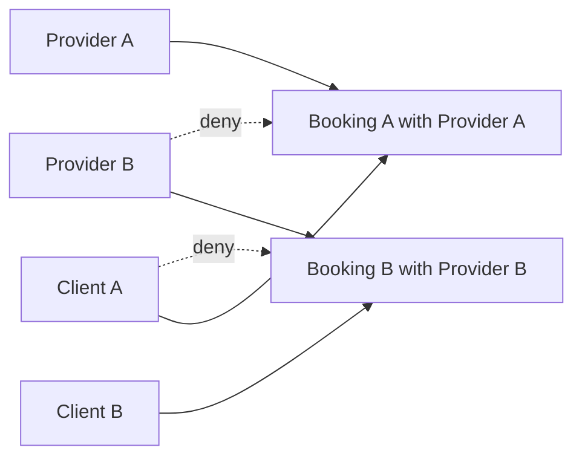

# Test two clients and two providers

Seed Client A, Client B, Provider A and Provider B with distinct accounts and easily recognizable private values. Client A books Provider A; Client B books Provider B. Give the at-home Booking a test address such as `PRIVATE_A_HOME`, and the online Booking a meeting link such as `PRIVATE_B_LINK`. Authenticate each actor independently and call the routes directly, not through a UI that hides buttons. The test suite should prove useful access for rightful participants and denial for every cross-party request in the authorization matrix.

Two shortcuts make a suite look complete while proving nothing. The first is testing through the interface: a client cannot click a Booking that belongs to someone else, so the test passes without ever asking the server. The second is mocking the auth middleware to inject a fake principal. That tests the helper you already trust and skips the wiring you do not, which is the token parsing, the route order and the handler's call to the helper. A real cross-party test signs each actor in through the normal auth path and sends the raw HTTP request. The request has to look exactly like one an attacker would send with a stolen or guessed ID.



Start with Booking detail GET. Client A receives their own Booking and expected client fields. Provider A receives the provider projection. Client B and Provider B receive the documented nonrevealing denial for Booking A. Reverse the pair for Booking B. Then test provider agenda lists, client Booking lists, provider Order share detail, Service update and TimeOff edit. A list route can leak without any guessed individual ID if it accepts `?clientId=` as the base filter, so send malicious query parameters too.

Use a table-driven test whose rows name principal, route, target object, expected status and forbidden token. For every denied response, search the body for `PRIVATE_A_HOME`, `PRIVATE_B_LINK`, another provider's subtotal and any Booking ID. Assert that no protected mutation occurred. A status of 403 or 404 alone is insufficient if an error body echoes the fetched Booking. Also inspect response headers or generated calendar file content when relevant. The HTTP interface is the evidence, not a mocked helper return value.

```ts
for (const testCase of crossPartyCases) {
  const response = await requestAs(testCase.actor, testCase.method,
    testCase.path, testCase.body);
  expect(response.status).toBe(testCase.expectedStatus);
  expect(JSON.stringify(response.body)).not.toContain(testCase.privateToken);
}
```

The outline should be supplemented with exact key checks and database postconditions. For a denied PATCH, reload the Service and verify price, duration and policy did not change. For a denied cancellation, verify Booking status and SlotClaims are unchanged. For a denied reminder request, verify no outbox message was created. A route can return 403 after performing a side effect if its check runs too late; only postcondition assertions catch that failure.

Walk one case from fixture to assertion. The suite signs in Client B and stores the returned token under that actor's name. It reads Booking A's ID from the seed, sends `GET /api/bookings/<booking-a>` with Client B's token, and records the status. Then it stringifies the body and checks that `PRIVATE_A_HOME` is absent, so a 404 that still carries the address fails the case. Finally it reloads Booking A and confirms status and `SlotClaims` are unchanged, which catches a read route that mutates as a side effect. Four assertions, one request, and the test now says something about the boundary rather than about the client code.

## Include dual-role and state cases

Add a User who owns a Provider profile and also books a Service from Provider B as a client. They can read their own client Booking but cannot read Provider B's other clients' Bookings. Their provider role should not suppress their client rights or grant them Provider B's rights. Add a held at-home Booking and a confirmed one for Provider A. The provider may see occupied time in both, but the address appears only in the confirmed view under the chosen need-to-know policy. Advance to expired or cancelled and verify ordinary agenda projections remove delivery details if the policy says so.

Test malformed and unknown IDs alongside foreign valid IDs. A malformed ID must not crash the route or reveal a stack trace. A well-formed unknown ID and a foreign Booking should both follow the documented nonrevealing policy. Do not assert they must take identical milliseconds; assert status, body shape and absence of private fields. Test a logged-out request returns 401 before any participant query. The error handler should not accidentally expose object data while reporting failure.

Two false results are worth knowing by name. A false pass happens when the HTTP client keeps cookies between actors, so the second request silently carries the first actor's session and every denial case tests the wrong person. Build a client per actor, or clear the jar between cases. A false failure happens when the forbidden token search matches something harmless, such as a Booking ID that contains the fixture string or a generic message quoting the field name. Match the exact fixture value and assert on parsed keys where the shape is stable. When a case flips after an unrelated change, check which of these two it is before editing the route.

## Exercise nested relationships

Client A tries to fetch Provider B's Order by ID. Provider A tries to fetch Provider B's provider Order share. Both should be denied, even if the CheckoutAttempt includes multiple providers. A legitimate client who bought from both can see their whole attempt. Provider A can see only their share. Test a Booking export or calendar download through the same relationships; a successful `.ics` response can contain private fields and needs a specific projection. If an export route is planned but not implemented yet, mark the case pending in the matrix rather than claiming it passed.

The M20 payment webhook is intentionally different. It is not authenticated with a user JWT; it verifies Stripe's raw-body signature and maps a known PaymentIntent to the CheckoutAttempt. A direct client request with `paymentState: succeeded` must be denied or ignored. Test that a valid client cannot change their own Booking payment state through an ordinary PATCH. Owning an object does not grant every action on it. This is an important action-level negative case.

## Run a coverage review

Compare the route table in `docs/AUTHORIZATION.md` to the Express router files. Count protected routes, and require one authorization test per route and participant type. If a new route is added later, the table and test must change in the same pull request. A simple string search for `requireAuth` is not enough; an authenticated route may still be vulnerable to object ID swapping. Review the final database query and serializer used by each route.

The coverage number can be honest and still misleading. Ten tests that all target the Booking detail route give the same count as ten tests spread across the router, and only the second version finds the export that skips the helper. Track coverage per route family instead: detail, list, nested Order, write and export. When a family has no red test yet, write the request before writing the assertion, exactly as an attacker would send it, then decide what the correct answer should be. Starting from the expected answer is how a suite ends up documenting the behaviour it already has rather than the behaviour the policy asks for.

Record test fixture IDs and run command in the gate evidence, but redact addresses and links in shared logs. A local test token such as `PRIVATE_A_HOME` is fine in a fixture; a real client address is not. Run the suite on a scratch database so it can freely create two providers and multiple Bookings. A test that reuses one user for all roles cannot prove isolation.

Finally, ask a peer to change exactly one path parameter in a successful request and predict the result before running it. If changing a Booking ID to another person's ID returns data or changes state, the authorization boundary failed. If it returns a denial and rightful participants still work, the matrix, helper and projection are aligned. The checklist will collect that evidence rather than relying on the presence of helper functions in source control.

