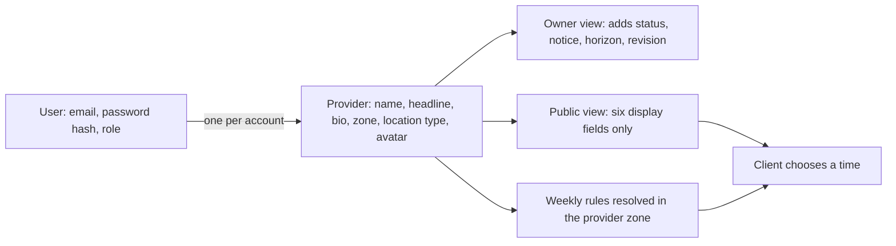

# A provider needs a public profile

A maths tutor in Gaza finishes registration and confirms her email. The dashboard opens on an empty page with no explanation. In the database her account exists: an email, a password hash, a role of `provider`. Nothing in the system says she teaches maths, that her working day sits in `Asia/Gaza`, or that she runs lessons online. A client in Berlin who searches for a maths tutor will not find her, and the empty page will not tell her what is missing.

That gap is what this module closes. Authentication answers who is calling. A Provider record answers what that person offers, which clock their working day belongs to, and which parts of their identity a stranger may read. SkillSlot needs both records, and it needs them separate, because the second one is read by search pages, public profile pages and slot calculations while the first one must never leave the authentication boundary.

## An account is not a profile

A User document holds identity and proof of it. It carries an email, a password hash, a role and a verification flag. Every route in the marketplace uses it to decide who is calling, and two routes use it for nothing else. A public page has no business reading a password hash, and a slot calculation has no business reading an email.

A Provider document holds the practice. It carries a display name, a headline, a short biography, the IANA time zone of the working schedule, a location type and a link to an avatar image. It also carries the rules the server needs before it can offer anything: how much notice a client must give, how far ahead bookings open, and whether the provider has chosen to be listed. Those last fields belong to the owner, not to a browsing client.

Keeping the two apart is not tidiness. It is the difference between a route that can safely serve a stranger and a route that must run an ownership check. When the fields live in one document, every public read becomes a projection problem, and each new private field is one missed `delete` away from disclosure. Two models make the projection decision explicit at the query, where a reviewer can see it.

## Six fields a client needs

Each field on the public profile exists because a client must answer a question before choosing a time. The display name answers who will deliver the session. The headline answers what kind of work it is, in one line. The biography answers whether this person can help with the specific problem. The time zone answers whose clock the working hours follow. The location type answers where the session happens and what delivery detail a confirmed booking will need. The avatar answers the plain human question of whether this is a real practice.

| Field | Shape | What it settles | Public |
|---|---|---|---|
| `displayName` | 2 to 80 characters, trimmed | The name on the listing | Yes |
| `headline` | 3 to 90 characters, trimmed | One line on what is taught | Yes |
| `bio` | Up to 1200 characters, trimmed | Fit for a specific need | Yes |
| `timeZone` | Named IANA zone, for example `Asia/Gaza` | Whose clock the weekly hours follow | Yes |
| `locationType` | `online`, `at-home` or `at-workshop` | What a confirmed booking must disclose | Yes |
| `avatarUrl` | HTTPS image URL or null | Recognition on the listing | Yes |

Five owner-only fields sit beside them. `userId` links the practice to the account that owns it. `status` records whether the provider has chosen to publish. `noticeMinutes` and `horizonDays` set the booking window that the availability engine will apply. `scheduleRevision` counts schedule edits and lets two browser tabs notice that they are about to overwrite each other. A public response omits all five, and the next lesson writes the two projections that enforce that.

The time zone deserves more attention than the other five fields. A weekly rule of "Monday 09:00 to 12:00" is meaningless without a zone. The provider might travel to Doha for a fortnight and still teach at nine in the morning Gaza time, because that is when her students expect her. The profile zone is the answer to "nine in the morning where", and every future AvailabilityRule copies it. A client's own zone is a display preference stored on their profile, and it never replaces the provider zone when the server resolves a rule.

## One profile per account

The database should refuse a second profile for the same account. Two profiles for one tutor split her practice in half. She adds weekly hours to one record and services to the other. A client sees two nearly identical cards, books the first, and the tutor's dashboard shows the booking on a calendar whose rules were never filled in. Search ranking counts her twice. Support cannot tell which record is current.

The rule belongs in an index, not in a controller. A `findOne` before `create` catches the common case and races in the uncommon one: two dashboard tabs submit onboarding at the same moment, both read no profile, and both insert. Only a unique index on `userId` turns "one provider per account" into a database invariant. The route then maps the duplicate key error to a clear conflict, and the second tab reloads the record the first tab created.

That index gives the module its simplest test, and it has the same shape as the booking tests later in the course. Attempt the second insert without a unique key and the test fails. Add the key, wait for it to build, attempt again, and the database returns a duplicate key error that the route has to translate. The test is small, but it is the first place the learner meets the idea that a product rule needs a database backstop, not just a form check.

## Two readings of one document

The same Provider document is read in two ways. A stranger reads the public view: display name, headline, biography, zone, location type and avatar. The owner reads the owner view: those fields plus the account link, the publication status, the notice and horizon settings and the schedule revision. Both views come from one row, so a provider who edits her headline sees the change in both places at once without a second write.

Read the diagram as a boundary, not a duplication. The public view is not a copy of the row stored somewhere else; it is a query with a field list. The owner view is the same row with more fields. The two arrows into the client's choice exist because a client needs both the person and the schedule, and only one of those is visible on the profile page before slots are computed.

The status field makes the boundary a product decision as well as a privacy one. A provider who has not published should not appear in search even if her profile is complete. A provider who is suspended by the platform should not appear even if her status still reads `listed` in an old cache. The public query therefore filters on status and the listing readiness conditions that Module 13 builds. This module stores the status; it does not yet compute readiness, so a route that uses only `status: listed` is a first version with a known gap, not a finished rule.

## What this module does not build

The profile is not a portfolio. Module 14 adds avatar upload and up to six portfolio images with object storage, and it keeps only URLs in MongoDB. For now the avatar field stores a URL that the provider pastes, and the upload path arrives later. Writing a file to the server's own disk and serving it from there would pass a demo and fail on the first redeploy.

The profile is not a review page. Ratings, completed session counts and response times would each need their own source of truth and their own anti-abuse rules. The listing shows what the provider wrote about herself, and the client decides from that plus the service terms.

The profile is also not the place for the price list. A provider sells several Services, each with its own duration, buffer and cancellation policy. Module 12 builds those records. The profile answers who, and a Service answers what and how much.

## Write the decision before the routes

Add a short section to `docs/erd.md` and one paragraph to `docs/AUTHORIZATION.md`. The ERD section states that one User owns zero or one Provider, enforced by a unique index on `userId`, and lists the seven public and private fields with their shapes. The authorization paragraph states the three rules this module has to satisfy: a public read shows only the six display fields, an owner read shows the full row, and a write resolves the provider from the authenticated account rather than from the request body.

Then write the two failure cases you expect the routes to reject, in the order a client would hit them. The first is a second profile for an account that already has one, which must return a conflict instead of creating a duplicate. The second is a provider editing another provider's record by putting a foreign identifier in the request, which must be refused even when the caller has the provider role. Neither case needs code yet. Naming them now means the next lesson writes tests for a decision instead of discovering the decision while debugging.

The next lesson scaffolds the providers module, writes the create, owner-read, public-read and update routes, and connects the zone validator from Module 5 to the profile form. It also builds the two projections, because a projection that arrives after the routes is a projection that will be forgotten on the third route.
