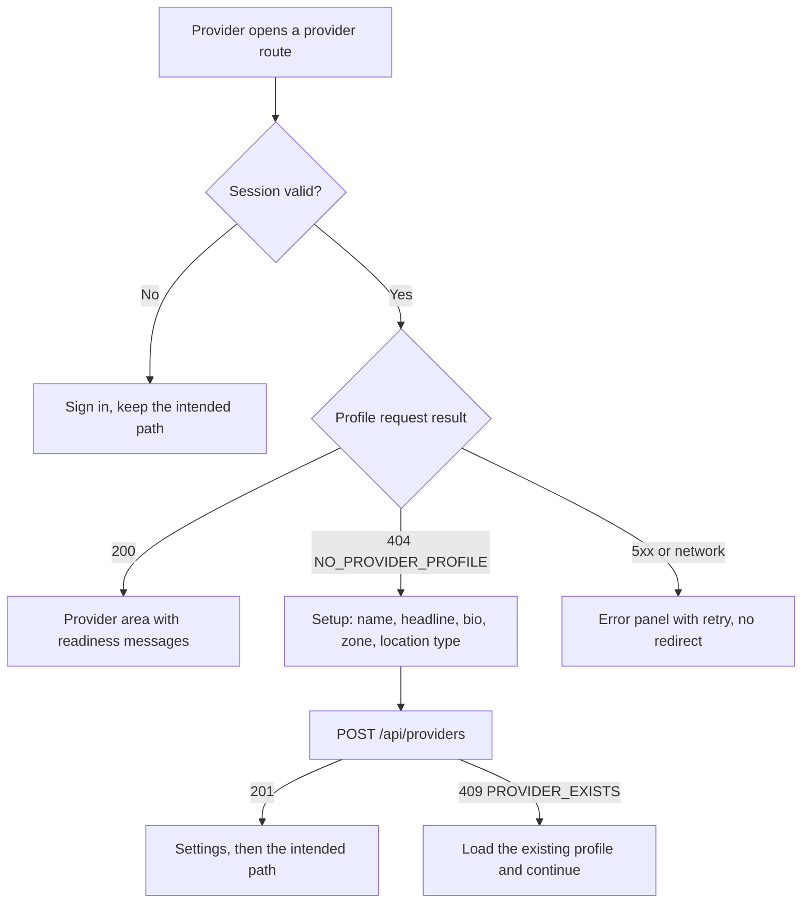

# The provider who has no practice page

A tutor registers on her phone during a break between lessons. She confirms her email, signs in, and the provider area opens on a dashboard with four empty cards: no services, no weekly hours, no upcoming bookings, no earnings. Each card has a button that leads to a form which cannot save, because there is no practice record for the fields to belong to. She closes the tab. Nothing in the product told her that the first step was missing, and nothing told her which step it was.

This module builds the path that starts a provider off correctly. The account exists, and the practice does not. SkillSlot routes that person to a setup page that asks for the profile fields from Module 10, then to a settings page where the practice can be edited. The routing decision is small and mechanical, but it decides whether a new provider gets started or gives up.

## Three states, not two

It is tempting to treat a provider account as either signed in or not. The interface needs three states, and each one has a different next action. The account may have no provider record at all. It may have a record that is incomplete, with a display name but no weekly hours. It may have a record that is complete enough to sell time.

The first state is the one this module handles. A provider with no record has nothing to edit, so every dashboard control is a dead end. The second state belongs to the practice settings page and to the readiness check in Module 13: the profile exists, so it can be edited, but the listing is not ready and the page should say which piece is missing. The third state is what the whole course is working toward, and it arrives when services and rules exist.

The API already tells these apart. `GET /api/providers/me` returns the owner view for the second and third states, and `404 NO_PROVIDER_PROFILE` for the first. The client must read that status as a product fact, not as an error to hide behind a retry button. A network failure is a different fact again, and it deserves a different message: the account might have a practice that the client simply could not read.

| Server result | Meaning | What the provider sees |
|---|---|---|
| `200` owner view | A practice record exists | The provider area, with readiness messages |
| `404 NO_PROVIDER_PROFILE` | No record for this account yet | Redirect to setup, with the reason on the page |
| `401` | The session ended | Send to sign in, then return to the same route |
| `5xx` or a network error | The server could not answer | An error panel with a retry, not a redirect |

Collapsing the middle rows is the mistake that creates a redirect loop. A guard that sends every unsuccessful profile request to setup will send a provider with a valid record to setup whenever the server is briefly unavailable. She fills the form again, submits, and receives a conflict from the unique index. The loop then repeats on the next load, and the fix is not a longer timeout. It is reading the status code properly.

## Why a redirect rather than a banner

A banner above an empty dashboard is cheaper to build and worse for the person reading it. The dashboard's purpose is to show work in progress: services, hours, bookings. When none of that can exist, the page is not a dashboard with missing data, it is the wrong page. The provider needs a form with three or four fields and one clear submit, and the address bar should say so, because a provider who reloads or shares the link should land in the same place.

The redirect also carries a return path. A provider who signs in and lands on setup after typing the address of the weekly hours page should arrive at the hours page once setup succeeds. Store the intended destination in the navigation state, and treat it as a suggestion rather than an authority: after the create call succeeds, send the provider to the page she asked for only if that page is part of the provider area. An untrusted return path can send a person to any URL the link author chose.

The setup page has one job, so it asks for one screen of information. Display name, headline, a short biography, the working time zone, the location type and an optional avatar URL. It then creates the profile and moves on. Asking for weekly hours in the same form would mix two records with different validation and different failure messages, and a mistake in the last field would throw away the first five.

## The zone picker decides where nine in the morning is

The time zone field is the only field on that form a provider can get wrong without noticing. A picker that defaults to the browser's zone is a helpful guess: `Intl.DateTimeFormat().resolvedOptions().timeZone` returns a named zone such as `Asia/Gaza` or `Europe/Berlin`, and most providers will have their phone set correctly. A guess is not a decision, though, so the form must show the value in words before it saves.

Show the zone name, and show the current time in that zone beside it. A provider can read "Asia/Gaza, now 14:20" and notice that her phone says something else. She can then change the picker deliberately. This is the moment the profile zone becomes real for her, because every later weekly rule inherits it. If the picker silently submits the browser zone and she later travels, her practice hours follow the browser rather than the city where her students expect her.

The zone must also be changeable later, and that change has consequences. Module 10 stores it and increments a revision. Module 13 refuses to list a provider whose active rules carry an old zone. The settings page therefore warns before a zone change rather than applying it in the same keystroke, and it explains that published hours need review afterwards.

## Build for a 360 pixel screen first

Most fellows read and build on a phone, so the provider area is designed at 360 CSS pixels before it is checked on a laptop. At that width, the setup form is one column, each label sits above its input, and no element wider than the viewport is allowed to push the page sideways. A horizontal scrollbar on a form is not a cosmetic defect: it hides the submit button, and a provider who cannot see the button submits twice or gives up.

Three concrete constraints follow. Touch targets are at least 44 by 44 CSS pixels, including the zone picker and the location type choices. The save button stays reachable at the bottom of the form, either inline after the fields or in a bar that does not cover the last input. Error text appears under the field it belongs to and never only as a colour change, because colour alone fails in sunlight and for a learner using a screen reader.

Read the diagram as a set of guards, one per outcome. Only one branch redirects. The error branch retries in place, because the account may already own a practice that the client failed to read. The conflict branch is the recovery path for a second tab: another tab created the profile while this one was filling the form, and the correct next step is to load it, not to ask for the same fields again.

## What this module does not decide

The routing gate does not decide whether the practice is ready to sell. That question needs services, weekly rules and a publication status, and Module 13 answers it. A provider who completes setup is routed into a practice area that may still be empty, and the pages there must say what is missing without pretending the account is broken.

The gate also does not decide what a visitor sees. Public verification of a profile belongs to the catalogue and to the public read from Module 10. What changes here is only the provider's own first minutes in the product, and the pages that follow.

The next lesson builds the route group, the guard, the setup form with its zone picker, and the settings page with its zone change warning. It also writes the small tests that catch a redirect loop before a learner meets one.

## Check before moving on

Write the three states of a provider account in `docs/LEARNING-LOG.md` and name the API result that identifies each one. Then write one sentence explaining why a server error must not send a provider to setup. If your answer is "because it looks bad", add the reason that matters: a provider with an existing practice would be asked to create a second one, and the unique index would refuse it.
