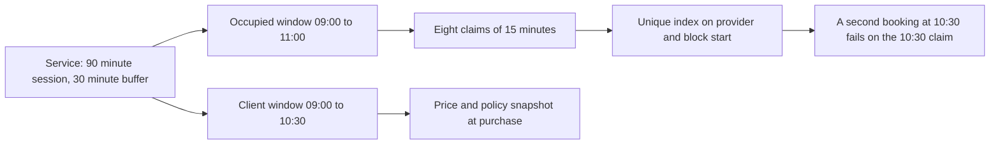

# A service is a priced block of time

A client books a ninety minute design review that starts at 09:00. The provider charges 4500 minor units and needs half an hour afterwards to write her notes before the next session. The client sees a session that ends at 10:30. The provider's calendar is occupied until 11:00. If the system records only the session, a second client can book 10:30, and the provider answers the door while still writing. If the system records only the price as a decimal, a coupon applied later gives a total that does not match the amount the client paid.

A Service is the record that answers four questions at once: how long the session lasts, how much of the provider's calendar that consumes, what the client pays, and what happens if either side changes the plan. It belongs to one provider, it is sold repeatedly, and it never owns a calendar of its own. The provider's time is the scarce thing, so two services sold by the same person compete for the same blocks.

## Duration is counted in blocks, not minutes

SkillSlot's exclusivity model works in fifteen minute blocks. A SlotClaim is one document per provider per block start, and a unique index on the pair is what stops two clients from buying the same hour. A service duration therefore has to land on that grid. Fifteen, thirty, forty five, sixty and ninety minutes all fit. Twenty minutes does not.

The tempting repair is to round. A twenty minute service becomes fifteen or thirty, and the form accepts it with a quiet adjustment. That is the wrong repair for a marketplace that sells time, because the client pays for a length and receives a different one. The provider sets a price for the work she planned to do. Rounding down shortchanges her, rounding up overcharges the client, and neither outcome is visible in a confirmation page that repeats the rounded value.

The other repair is a finer grid, and it costs more than it looks. Five minute blocks multiply the claim documents for every booking, change the unique index key, and require every rule boundary, buffer and duration to be validated against a new unit. The course chooses fifteen minutes because it is coarse enough to keep the claim count small and fine enough for a forty five minute lesson. A service whose duration does not fit is rejected with a field error that names the allowed values, and the provider picks a length that does.

The same rule applies to the buffer, with one difference. A buffer of zero is valid, because plenty of remote sessions need no turnaround. A buffer of fifteen or thirty is common for an electrician's visit or a tutorial followed by another. A buffer of twenty is not valid on the grid, and it must be rejected rather than rounded, because a rounded buffer silently shifts when the provider's next start can be.

## The buffer is provider time the client does not buy

The client buys the session. The provider's calendar holds the session plus the buffer. Those are two different intervals, and confusing them causes one of the two classic booking bugs.

Hold only the session, and the next start can land inside the buffer. The provider's calendar shows a clean gap in the system and no gap in her day. She finishes a lesson at 10:30, needs fifteen minutes to reset the room, and the platform has sold 10:30 to someone else. Hold the session plus the buffer and show the whole interval to the client, and the client sees a session that appears to be longer than the one she chose, which invites a complaint about price.

The resolution is a single record with two intervals. The session interval is what the client reads on the confirmation. The occupied interval is what the claim writer uses. A sixty minute session with a fifteen minute buffer occupies seventy five minutes and needs five claims. A ninety minute session with a thirty minute buffer occupies two hours and needs eight.

Notice where the diagram puts the failure. A second booking at 10:45 does not collide with the client window, which ended at 10:30. It collides with a claim, which is why the buffer has to be part of the claim set rather than a note in the description. The claim is the only record the database enforces.

## Price is an integer in minor units

Money in a booking app is an integer. `priceMinor` stores the smallest unit of the currency, so 4500 means forty five units of a two decimal currency. The reason is arithmetic, not storage. In JavaScript, `45.10 * 100` evaluates to `4509.999999999999`, and a rounding step applied in the wrong place turns that into 4509. A discount of ten percent on a total of 4500 has to give 450 for a refund calculation, and a total built from floating point values will eventually give 449.99999 and a Stripe error about an invalid amount.

The service stores the currency code beside the amount. The course uses one currency for the whole market, and that is a scope decision rather than an internationalization claim. If a provider sells in one currency and the marketplace settles in another, the conversion belongs in a documented pricing policy, not in a service field that a form can change.

The client never sends a price when booking. The server reads the service row, multiplies by nothing at all for a single session, applies any coupon, and stores the result. The service price is the input to that calculation, and the booking keeps a copy of the amount that was charged. When the provider raises her price next month, the copy protects the old receipt and the live service changes the offers.

## The cancellation policy is three numbers

A cancellation policy that lives in prose is not a policy. "Free cancellation up to a day before" reads well and cannot be computed. The service stores three numbers: `freeCancelHours`, the hours before the start inside which a client may cancel for a full refund; `lateRefundPercent`, the share of the amount returned once that window has passed; and `rescheduleCutoffHours`, the last moment a client may move the session.

Each number answers a question a support conversation will ask. A client cancels six hours before a session whose free window is twenty four hours: what does she receive? The late percentage, applied to the amount she paid, in integer minor units. A client asks to move a session two hours before it starts, with a reschedule cutoff of twelve: refused, and the offer to cancel under the policy is the only path left. The refund module later reads these values from the booking snapshot, never from the live service, because a provider who tightens her policy next month should not change an agreement already paid for.

The policy also constrains the provider. A provider who wants to cancel a paid session refunds the full amount regardless of her own late percentage, because the client did not change the plan. That asymmetry is a product decision the course takes deliberately and the cancellation module implements. The service record holds the client side of the policy; the provider side is a platform rule.

## Location type belongs to the service

The provider profile carries a default location type, and each service carries its own, because one tutor may teach online for a client in Berlin and visit a home in Gaza on a different day. The service field decides what a confirmed booking must disclose: a meeting link for an online session, a visit address for an at-home session, a venue for a workshop session.

Putting it on the service rather than only on the profile also lets the booking snapshot it. A provider who stops offering home visits should not change how an already purchased home visit is delivered. The snapshot records what the client accepted, and the delivery field the provider receives at confirmation follows the snapshot.

| Field | Type | Rule | Why it exists |
|---|---|---|---|
| `durationMinutes` | integer | 15 to 240, multiple of 15 | Sets the session the client buys |
| `bufferMinutes` | integer | 0 to 120, multiple of 15 | Sets the provider time around it |
| `priceMinor` | integer | Non negative safe integer | Integer money for payment and refunds |
| `currency` | string | Supported code, one per course | Labels the amount and the refund |
| `locationType` | enum | `online`, `at-home`, `at-workshop` | Decides the delivery detail |
| `freeCancelHours` | integer | 0 to 720 | Ends the full refund window |
| `lateRefundPercent` | integer | 0 to 100 | Sets the refund after that window |
| `rescheduleCutoffHours` | integer | 0 to 720 | Ends the reschedule window |
| `status` | enum | `active`, `archived` | Stops new sales without erasing history |

## Archive, never delete

A service that has been sold cannot be deleted without damaging something. The booking references it, the receipt describes it, and the client may open a link to it months later. Deleting it leaves dangling references and a support case that cannot be answered from the data.

Archiving keeps the row and removes it from new offers. The provider can archive a service that has future bookings, and those bookings survive with their own snapshots and claims. The public listing stops showing it, availability stops offering new starts from it, and checkout refuses a client who still has a stale page open. A restore is possible while the provider changes her mind, and it is a deliberate action with its own confirmation.

The one thing archive must not do is silently cancel clients. A provider who archives her only service still has appointments to keep, and the dashboard should show them before and after the change. Module 13 adds that review panel. This module guarantees the record survives.

## What this module leaves for later

Three pieces are deliberately absent. The availability engine, which turns weekly rules into dated start times, arrives in Module 15 and consumes the duration, buffer and location type defined here. The claim writer, which turns one chosen start into five or eight exclusive blocks inside a transaction, arrives in Module 19. The refund calculation, which reads the policy snapshot, arrives with cancellation.

Before those arrive, write the four rules from this lesson into `docs/erd.md` under the Service entry: whole block duration, integer minor units, buffer inside the occupied interval, and policy copied at purchase. Then write the one sentence you would use to explain to a provider why a twenty minute service cannot be saved. If the sentence is "the system does not allow it", add the reason: the marketplace protects every start with fifteen minute claims, and a length that does not fit cannot be protected without selling a different length.
