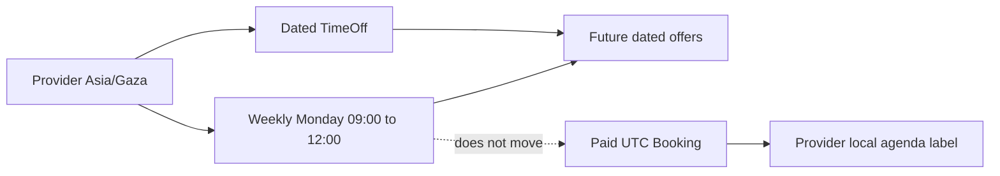

# Run the practice in local time

A tutor in Gaza opens their dashboard and says, "I can teach Mondays from 09:00 to 12:00." The form should let them enter that sentence directly. It should show `Asia/Gaza` beside the hours and save a weekly AvailabilityRule with local weekday and wall times. It should not ask the tutor to calculate a UTC hour for every future Monday. The time-zone rules for a future date may differ from today's offset, and the tutor's intention is a local working rhythm. Module 15 will resolve each dated Monday when it computes bookable starts.

The same dashboard also shows paid Bookings. Those are dated UTC commitments. A provider may see a local label such as "Monday 09:00 Gaza time," but editing their weekly rule must not move a client who already paid. The Bookings and SlotClaims continue to hold their stored UTC instants. If a provider needs to change a paid session, the cancellation or reschedule workflow must ask for and record that decision. A weekly schedule editor has no authority to silently rewrite an appointment.

This module turns the data model into a working provider back office. The provider can create and archive Services, edit weekly AvailabilityRules, add dated TimeOff, and see whether their listing is ready. The server enforces ownership and time validity. The browser gives useful feedback, but it does not decide whether a local time exists on a clock-change date or whether a booking can be moved. Those are server policies with tests.

## Three edits with different consequences

First, the tutor changes their active Service from 60 to 45 minutes for future sales. The new duration must still be a whole 15-minute block, and the availability engine will use it for new offers. Existing Booking snapshots retain the 60-minute duration and their claims. A service form should warn about future bookings, but it should not alter them. Archiving a Service removes it from new purchase paths while preserving receipts and appointments.

Second, the tutor changes Monday hours from 09:00 to 10:00 local starting next month. This is a recurring rule edit with an effective local date. The new rule must not overlap another active rule on the same weekday and effective dates. An existing Booking at the old time remains visible in the agenda. The dashboard should show that a paid commitment now lies outside the new published hours, so the tutor can decide whether to keep or explicitly reschedule it.

Third, a power cut makes the tutor unavailable for the rest of today. The TimeOff editor asks the server to create a dated UTC interval from the server's current instant to the next provider-local day boundary after validating that boundary. It removes new offers that intersect the interval. If a confirmed Booking already lies inside it, the response lists the conflict to the provider. The TimeOff record does not cancel the client by itself. That distinction keeps a real person from being surprised by a silent system action.

These edits share one Provider owner, but they do not share one database operation. The Service API validates commercial terms; the rule API validates recurring local windows; the TimeOff API resolves a dated exception; Booking changes use separate participant and payment policies. A dashboard can put the controls together visually without merging their authority. The user should be able to tell which edit affects new offers and which action is required for an existing appointment.

## The zone is visible, not guessed

Module 6 put `timeZone` on Provider and separately on each client's Profile. The Provider zone is the working zone for rules. A client zone is a display preference. The dashboard should label every weekly hours control with the Provider zone, even if the browser happens to be in that same zone today. A tutor travelling with a laptop should still be editing their Gaza practice hours, not the hotel browser's zone. If they intentionally change the Provider working zone, the dashboard must require review and republishing of active rules rather than silently reinterpreting them.

TimeOff is entered through local date and time controls because that is how a provider thinks about a power cut or holiday. The server calls the tested converter from Module 5 and stores UTC `startAt` and `endAt`. If the entered boundary is nonexistent or repeated on a clock-change date, the server returns a precise validation error. The dashboard points to the affected field and asks for a valid boundary. It should not simply shift the value forward one hour and display a success toast.

## What a provider can and cannot see

The provider dashboard loads Services, rules, TimeOff and Bookings scoped through Provider.userId and the authenticated User. It can show participants for the provider's own confirmed appointments under the need-to-know policy. It must not reveal another provider's order totals or private TimeOff reasons. A public client sees only a listed provider's active Services and computed UTC offers. The same database collections support both views, but the route's authorization and response projection differ.

The UI must handle errors honestly. A stale form version can receive 409 because another tab changed the schedule. A skipped local time can receive 422 with a stable code. A lost session receives 401; a user without Provider ownership receives 403 or a nonrevealing 404 according to the route policy. The form should keep the entered values and show a concrete next action. It should not turn every failed request into "No hours available," because that message implies a valid empty calendar rather than a rejected edit.

## What you will build and prove

By the gate, a provider can create, edit and archive Services; publish nonoverlapping weekly hours in their zone; add a dated TimeOff interval; and see conflicts with already held or confirmed Bookings. A readiness check lists the provider only when their status permits it, at least one active Service exists and at least one valid active rule exists. Tests cover owner scoping, duplicate or overlapping rules, invalid local boundaries, same-day time off, booking conflicts and a provider-zone change. The dashboard shows a visible state for each result.

Before coding, write one sentence in `docs/provider-schedule-decisions.md`: "New availability may change when I edit a rule or Service, while a paid Booking changes only through an explicit booking workflow." Keep it near your API tests. If a test later expects a schedule edit to move a paid UTC start, the sentence makes the contradiction visible.

The next lesson maps server error codes to the provider's actual task. After that, each build lesson adds one screen or route boundary. The work succeeds when a provider can plan future hours without typing UTC and can see existing client commitments clearly when those plans change.

Picture the provider opening the same dashboard from a laptop in Berlin and a phone in Gaza. The weekly grid must show the same Monday 09:00 to 12:00 `Asia/Gaza` rule on both devices. The upcoming Booking agenda may format a confirmed UTC appointment in the provider zone on both devices as well. If the laptop's browser zone silently changes the rule controls to Berlin time, an innocent edit can publish different hours than the provider intended. Add this two-device case to the dashboard review even if your development machine has only one zone; browser emulation or a controlled formatter can reproduce it.

Now compare a TimeOff edit from the same two devices. The provider chooses a dated local 10:00 to 11:00 in Gaza. Both clients send the same local fields and the server resolves them under Provider.timeZone. The stored UTC interval must be identical. The phone's own time-zone setting or current clock should not change the result. That is the practical reason to keep the named zone and server conversion at the API boundary rather than trusting a JavaScript Date serialized by the browser.
