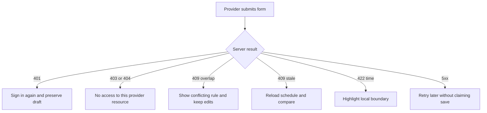

# Turn schedule errors into useful actions

The provider dashboard has forms for Services, weekly hours and TimeOff. All three can reject a save, but the reasons are different. A 422 on `durationMinutes` asks for a whole 15-minute value. A 422 on a repeated local hour asks the provider to choose an unambiguous dated boundary. A 409 on overlapping weekly rules asks them to adjust one of two rules. A 409 on a stale schedule version asks them to reload changes from another tab. If the UI shows the same "Something went wrong" toast for all of them, the provider cannot repair the input and may repeatedly submit the same unsafe request.

Keep a small, stable error contract between API and UI. The server returns an HTTP status, a machine-readable `code`, a short safe message and optional field names. The browser maps those fields to visible inline help. Do not expose a database stack trace, another provider's record or a private Booking detail in a public error. A provider authorized to manage their own schedule may receive their own conflicting Booking IDs and local labels through a protected response, but a client availability GET should never reveal why a slot disappeared.



<TraceRequest title="A skipped local boundary in TimeOff">
  <TraceStep actor="Provider" label="Enters a dated local boundary" detail="Zone is shown beside the input" />
  <TraceStep actor="Server" label="Rejects nonexistent local time" status={422} detail="Code NONEXISTENT_LOCAL_TIME" />
  <TraceStep actor="Dashboard" label="Keeps the form values" detail="Highlights the boundary and explains the date" />
  <TraceStep actor="Provider" label="Chooses a valid time" detail="No guessed UTC value was saved" />
</TraceRequest>

The trace is a product behavior, not just a network state. If the browser clears the form after the 422, the provider has to re-enter a rule that may have many fields. If it silently changes 02:30 to 03:30, it has chosen a different promise without consent. Preserve the draft, keep the named zone visible and explain which local date and boundary failed. The server's stable code lets the UI use accessible copy without parsing a database exception message.

## Define the mapping once

Put a function such as `providerFormError(error)` in a dashboard utility module. It accepts a sanitized API error object and returns a title, field target and next action. The UI can reuse it for a rule editor and TimeOff editor. Keep the HTTP status available for logging and retries, but use `code` for the specific instruction. A 422 `INVALID_TIME_ZONE` differs from a 422 `INVALID_SERVICE_DURATION`, even though both are validation errors.

```js
export function providerFormError(error) {
  switch (error?.code) {
    case 'NONEXISTENT_LOCAL_TIME':
      return { field: error.field ?? 'localTime', text: 'This local time is skipped on that date. Choose another boundary.' };
    case 'AMBIGUOUS_LOCAL_TIME':
      return { field: error.field ?? 'localTime', text: 'This local time occurs twice on that date. Choose a clear boundary.' };
    case 'RULE_OVERLAP':
      return { field: 'hours', text: 'These hours overlap another active rule. Review both windows.' };
    case 'SCHEDULE_VERSION_CHANGED':
      return { field: null, text: 'This schedule changed in another tab. Reload and compare before saving.' };
    case 'SERVICE_HAS_FUTURE_BOOKINGS':
      return { field: null, text: 'Existing bookings keep their accepted terms. Review them before archiving.' };
    default:
      return { field: null, text: 'The change was not saved. Try again or contact support.' };
  }
}
```

Do not use `SERVICE_HAS_FUTURE_BOOKINGS` as a blanket ban on archiving. The product may allow archive while preserving those bookings. The code is included to show a review prompt if a route explicitly requires one. The actual archive policy belongs in the Service route and must be tested. The UI should say what was saved and what remains scheduled, not imply an old client appointment was deleted.

## Handle authorization without leaking ownership

A logged-out provider sees 401 and a sign-in path. After signing in, a provider trying to edit someone else's Service or rule should see a nonrevealing 403 or 404, depending on the existing API policy. Do not show the other provider's rule title in the error. The route resolves the authenticated User's Provider profile and scopes its model query with `providerId`; it does not trust a path ID alone. The UI may hide actions the current account lacks, but server authorization is still required because a client can send direct HTTP requests.

An archived Service submitted from a stale tab may return 409. The dashboard can show that the Service is now archived and offer a read-only view. It should not retry the old update automatically, because that could reverse an intentional archive. A 409 is a state conflict, not a network glitch. By contrast, a temporary 503 may be retryable after the provider reviews that no save was confirmed. If a POST could be repeated, an idempotency key or client request ID prevents duplicate records.

## Preserve focus and screen-reader context

Place a summary message near the top of the form and link it to the relevant field. Move focus to the error summary after a failed submit, then allow the provider to return to the input. Use `aria-describedby` for inline error text and `aria-live` for the save result. Do not rely on red border color alone. A person using a phone in a hurry during a power cut needs the message to say whether the TimeOff interval was stored and whether paid bookings still need attention.

On success, show the saved object and any protected conflict list. A TimeOff response can say "Time off saved; two existing bookings still require action" with links to those provider-owned bookings. It must not say "all appointments cancelled" unless the cancellation workflow actually ran. A weekly hours save can say which local date range the new rule affects. Explicit result copy is as important as error copy because it prevents a provider from assuming a schedule edit changed old promises.

## Test one error from each class

Stub a 422 skipped boundary, a 409 rule overlap, a 409 stale version, a 401 session expiry and a 503 database outage. Assert the form preserves values and the message names a next action. Test that a private conflicting Booking is displayed only in the authenticated provider dashboard response, never in public availability JSON. If the server changes a code, the UI test should fail rather than silently falling back to generic copy for a common repairable condition.

Write the mapping table in `docs/provider-schedule-decisions.md` with code, HTTP status, field and provider action. The next lessons create the routes that emit those codes. Keep the table in sync with tests so the UI never promises a save that the server rejected.

References: [MDN HTTP response status semantics](https://developer.mozilla.org/en-US/docs/Web/HTTP/Reference/Status), [Luxon zoned time APIs](https://moment.github.io/luxon/api-docs/index.html).

## Make field errors testable

Give every API validation error a stable `field` path such as `startLocal`, `endLocal`, `effectiveFrom`, `durationMinutes` or `timeOff.end`. The browser should attach the message to that input and set `aria-invalid`. A general summary at the top can link to it. If one response reports `startLocal` and another calls the same field `startTime`, the form may show only a generic toast. Write a contract test over the serialized error shape, not just the HTTP number, so a refactor cannot silently break repair guidance.

Test an overlap response with the provider's own two rule intervals and effective dates. The provider needs enough information to see why Monday 11:00 to 14:00 conflicts with Monday 09:00 to 12:00 in August. Do not include an entire Mongoose document in the error; project only the safe rule ID, weekday, local bounds and date range. A 409 `RULE_OVERLAP` from another provider's rule would be a scoping defect, so include a Provider B fixture in the route test.

## Distinguish a save from a partial side effect

A TimeOff POST may save the interval and then fail while loading conflicting Bookings. If the route does those steps outside a transaction, a 500 with no context could cause the provider to retry and create a duplicate exception. Prefer a transaction for the save and conflict-read response, or return an explicit partial result with the saved ID and a safe retry of the conflict lookup. The UI must never say "not saved" when it actually was. Include this failure injection in the API test so the message reflects the persisted state.

Similarly, a Service archive may save while the table refresh fails. The form should retain the server's success response and show a separate refresh problem. It should not automatically resubmit the archive. A provider might click again after a network timeout; an idempotency key or state-aware endpoint makes the repeated action safe. These are not exotic errors: a weak phone connection during a power cut is exactly when the TimeOff editor matters most.

When mapping 503, avoid blind retries for a schedule write. Preserve the draft and offer a user-controlled retry with the same request idempotency key. The server may have committed before the response was lost. A new request with a new identity can create duplicate TimeOff. The UI copy should say the result is unknown until it refreshes the saved list, then offer the next action based on what it finds.
