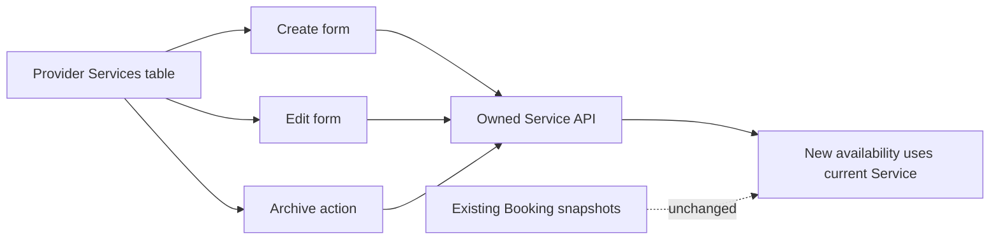

# Manage services without changing old bookings

The provider needs a place to see what they currently sell. Build a Services table and create/edit form in the provider dashboard. The table shows title, duration, buffer, location type, price in minor-unit-derived display format, status and a link to edit. The form validates whole 15-minute duration and buffer values, nonnegative price, supported currency and cancellation policy fields. The provider can archive a Service so no new client can book it, while existing Bookings continue under their purchase snapshots.

Use the Service fields from Module 6 and the owned API from Module 12. Do not build a second browser-only schema that accepts values the server rejects. A shared form validator can provide immediate feedback, but the server repeats validation and ownership checks. A provider opening two tabs may edit a Service in one and archive it in the other; the API response decides which state saved. The UI must not show a success toast just because local React state changed.

The visual separation between current Service and existing Booking is the lesson's core. A 60-minute Service sold last week can be edited to 45 minutes today. The old Booking keeps `purchase.durationMinutes: 60`, its UTC interval and its claims. The new availability engine uses 45 minutes and the current buffer for future offers. Display a warning when an edit affects terms clients may already know, but do not mutate their appointments through this form.

## Build the table around provider scope

The dashboard calls an authenticated `GET /provider/services` endpoint that derives Provider from the session. It does not pass a user-editable provider ID to load records. Show active Services first and archived Services in a separate labelled group or status filter. Each row has an accessible name for its edit and archive action. On a small screen, make the fields stack without hiding the duration or status. A provider deciding whether a service is bookable needs those values visible, not tucked behind hover-only controls.

An empty table should say what action is available: "Add your first Service to make your practice ready for listing." It should not say the marketplace is broken or show a blank grid. If the authenticated user has no Provider profile yet, guide them to create it. If the list request fails, keep an error state with Retry rather than rendering the same empty-table message. Those states correspond to different server facts and should remain distinguishable.

## Validate the form in units the provider understands

The provider enters a price such as 50.00 in the UI, while Service.priceMinor stores 5000. Convert with a decimal-safe form parser for the supported currency rather than multiplying an arbitrary floating-point value and hoping rounding is harmless. For the single USD course fixture, require at most two decimal digits, parse the two parts as integers and produce minor units. Display the currency beside the input. The server accepts integer minor units and computes payment totals from its own Service record.

Duration and buffer inputs should offer 15-minute steps. Still validate typed input, pasted values and API calls. A duration of 20 minutes must show a field error rather than being silently rounded to 15 or 30. The buffer is provider time, so the form should explain that it reduces neighboring starts in the availability engine. A provider who selects 60 minutes plus 15 minutes should see "75 minutes of calendar time" near the control. This preview is explanatory; the server model remains the authority.

Cancellation fields need clear labels: free cancellation hours, late refund percent and reschedule cutoff hours. A provider should be able to read the policy before saving. Avoid a single unexplained JSON field. The purchase snapshot in Booking will copy these exact accepted terms at checkout. If the provider changes them later, existing Booking receipts and refund calculations continue to use the old values. Add a preview sentence with one example, such as "A client who cancels after the free window receives the configured late refund percent."

## Archive with future bookings visible

Before archive, the API may return the count and next date of this Service's future held or confirmed Bookings. Show the provider a review panel: new sales stop, existing appointments remain. Archive only after the provider takes the explicit action. The server updates Service.status to `archived`; it does not hard-delete the Service or its Bookings. If product policy requires extra confirmation when future appointments exist, the route should return a stable code and count, then accept a separate confirmed request. Do not implement confirmation only in the browser; a direct API call must observe the same policy.

After archive, remove the Service from public active lists and availability requests. The provider dashboard may still show it under Archived with read-only history and possibly a deliberate restore action. A client opening an old Service URL should not be able to pay for a new slot, even if a stale browser page still has an Add button. Module 19 revalidates active Service status at claim time.

## Verify a nontrivial edit

Create a 60-minute online tutoring Service with 15-minute buffer, price 5000 minor units and a 24-hour free-cancel window. Capture one Booking purchase snapshot fixture. Edit the live Service to 45 minutes, 30-minute buffer and price 6500. Assert the dashboard row shows the new values and a fresh availability request uses them. Reload the old Booking and assert its duration, buffer, price and policy are unchanged. This test crosses form, route and persistence, so it proves more than a text field rerender.

Try submitting a 20-minute duration and a fractional minor-unit price through the form and a direct API request. Both paths should reject the values. Try editing Provider A's Service while authenticated as Provider B; the owned route should return 403 or nonrevealing 404, and the table should never show A's row. An admin path, if any, is a separate authorization contract. The provider UI must not rely on hidden buttons as access control.

Keep focus on the edited row after save, announce success with `aria-live`, and show field errors through `aria-describedby`. A user using keyboard or assistive technology should be able to create a Service, understand an invalid duration, and archive it without losing context. The table and form should use visible labels, not placeholder text as the only name.

Commit the table, forms and route tests. Record in `docs/provider-schedule-decisions.md` that current Service edits affect future offers, while Booking snapshots protect existing purchases. The following lesson gives those Services weekly working hours. Without a valid rule, an active Service still has no bookable starts.

## Review the price conversion with examples

For the USD course fixture, enter `50`, `50.0` and `50.00` and verify each becomes 5000 minor units. Enter `50.001` and reject it rather than rounding away a digit. Enter a negative value and an amount beyond the server's safe integer bound and expect field errors. Format 5000 as `50.00 USD` when loading an existing Service. Do not feed the formatted label back to the API as a floating-point number. A small parser test protects a real payment invariant before Stripe is introduced.

If a provider changes the cancellation policy while the edit form is open in another tab, show the saved policy version or current values after a 409. The form should not overwrite the newer terms by reusing stale local state. A Booking purchased under the old policy keeps its snapshot either way. This scenario tests two different kinds of consistency: preventing lost Service updates and preserving historical agreement. Give the route an update version or use the existing updatedAt as a compare value with an explicit conflict response.
