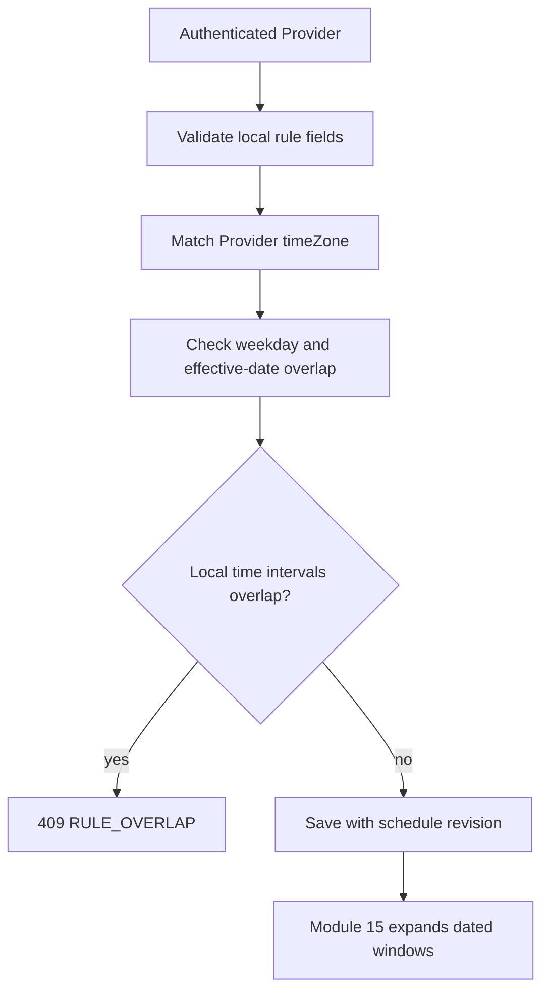

# Publish nonoverlapping weekly rules

The provider's dashboard can now sell Services, but it needs a weekly schedule. Build authenticated create, list, update and retire routes for AvailabilityRule. A rule has providerId, ISO weekday, padded local `HH:mm` start and end, effective local dates, active status and the named working zone. The route derives providerId from the authenticated User, never from a writable request field. It rejects invalid local boundaries and overlapping active rules on the same weekday and effective dates. Module 15 can then expand these rules into dated UTC windows.

Overlapping rules are a product defect even if a later planner deduplicates identical starts. A provider who has Monday 09:00 to 12:00 and adds Monday 11:00 to 14:00 for the same effective weeks may think they created extra capacity, but SkillSlot sells one provider's exclusive time. The editor should show the conflict and ask whether they meant to extend the first rule. Two nonoverlapping windows, such as 09:00 to 12:00 and 14:00 to 17:00, are valid and preserve a break.



## Validate the local contract before querying

Accept weekday 1 through 7, canonical `HH:mm` quarter-hour boundaries, and real `YYYY-MM-DD` effective dates. Reject an end that is not later than start on the same local day; the first course version does not support overnight rules. Reject a rule timeZone that differs from Provider.timeZone. The client need not send a zone at all; the server can copy Provider.timeZone into the new rule. This matches M6's rule snapshot and M15's `RULE_ZONE_MISMATCH` guard. A provider working-zone change requires rule review and republishing, not a silent reinterpretation.

To detect a conflict, compare only other active rules for this provider and weekday whose effective local date ranges intersect. Then use half-open wall-time overlap: `new.startLocal < old.endLocal && old.startLocal < new.endLocal`. The canonical padded strings make lexical comparison valid after validation. Effective date ranges are inclusive at both ends: if one rule ends 2024-06-30 and another starts 2024-07-01, they do not overlap in effective dates. If both include 2024-06-30, they do. On update, exclude the rule's own ID from candidates.

```js
export function rulesOverlap(a, b) {
  if (a.weekday !== b.weekday || !a.active || !b.active) return false;
  const aTo = a.effectiveTo ?? '9999-12-31';
  const bTo = b.effectiveTo ?? '9999-12-31';
  const datesMeet = a.effectiveFrom <= bTo && b.effectiveFrom <= aTo;
  const hoursMeet = a.startLocal < b.endLocal && b.startLocal < a.endLocal;
  return datesMeet && hoursMeet;
}
```

The helper is pure and can be tested with same-day, adjacent, different-weekday and disjoint-effective-date cases. It is not enough by itself under concurrent writes. Two tabs can both read the old rule list, see no overlap and insert conflicting rules. Serialize schedule edits through one Provider schedule revision. Add `scheduleRevision` with default zero to the Provider model at this module, and in a MongoDB transaction touch that Provider document while reading and writing rules. Two concurrent transactions that write the same Provider document cannot both commit the same stale schedule snapshot without one retry or conflict. Return 409 `SCHEDULE_VERSION_CHANGED` to the losing stale form and let it reload.

The same revision is a contract for later checkout coordination. A client checkout must recheck the schedule and exceptions at its claim boundary under a policy that notices concurrent provider edits. This module can serialize provider schedule writes; it cannot claim that the future checkout route already participates. Record the open cross-workflow race in `docs/provider-schedule-decisions.md` and its M19 test plan.

In the transaction, first conditionally increment Provider.scheduleRevision from the revision supplied by the form. If no Provider document matches, return `SCHEDULE_VERSION_CHANGED`. Then load that provider's active rules in the same session, run `rulesOverlap` against the proposed change, and save the rule or retirement in the same transaction. Two requests trying to write the same Provider document contend. If the driver retries a transient transaction after another edit committed, the expected old revision no longer matches, so the stale request must become 409 rather than being replayed as if the provider approved the new schedule.

Add a test that starts two create requests with the same expected revision and overlapping Monday windows. Wait for both. At most one may return success; the other returns a conflict, and a database query shows no overlapping active pair. Then test two nonoverlapping changes from one stale revision. One still needs a reload, because the second form did not see the first edit. That is a deliberate optimistic-concurrency policy, not an overlap false positive.

## Retire instead of deleting a rule

An update to future weekly hours should carry an effective local date. Retire an old rule by setting an effective end or active false and create a replacement rule for later dates. Keep enough history to explain which schedule produced an old offer. Do not edit an old rule in place and pretend it was always different if the product needs auditability. Existing confirmed Bookings remain fixed even when a new rule no longer covers them. The provider dashboard should show them in the agenda, with a warning that future working hours changed.

For a provider-zone change, take a stronger path. Mark Provider listing as draft, retire active rules or require their explicit review, update Provider.timeZone and increment the schedule revision in one transaction. Do not bulk-change rule.timeZone while leaving wall times active. M15 refuses active mismatched rules; the dashboard should give the provider a way to republish them intentionally. Bookings and SlotClaims keep UTC instants. TimeOff already stored as UTC remains a dated interval, though the display label changes in the new zone.

## Keep authorization in the database predicate

A `GET /provider/rules` route resolves the Provider from the authenticated User and filters `AvailabilityRule.find({ providerId })`. A `PATCH /provider/rules/:id` uses both `_id` and providerId. A Provider B request with A's rule ID must not load the rule, run overlap checks on it or reveal its local hours. Treat an unknown ID and a foreign ID consistently with the existing API policy. The browser's providerId, if present for routing, is not evidence of ownership.

Test one valid Monday 09:00 to 12:00 rule; an adjacent 12:00 to 14:00 rule; a conflicting 11:45 to 13:00 rule; the same time on Tuesday; and the same Monday hours in nonoverlapping effective months. Test invalid 09:07, end before start, 2024-02-30 and a mismatched zone. Run two concurrent create attempts against the scratch replica set and assert the schedule revision policy yields at most one conflicting active rule. A unit test of `rulesOverlap` cannot prove the concurrency behavior.

Return a safe 409 with the provider's own conflicting rule ID and local interval, so the dashboard can show both windows. Do not return another provider's rule. For a valid save, return the saved local fields and revision number; do not invent one permanent UTC start. Module 15 will resolve the rule on each dated occurrence and skip invalid transition boundaries with a provider-facing issue.

Commit route, pure overlap tests, transaction test and the decision note. The next lesson handles a different shape: one dated TimeOff exception that removes offers without rewriting the recurring rule or cancelling existing clients.

Keep the rule API response small: saved ID, weekday, local bounds, effective dates, timeZone and new revision. It need not return every computed start. If the provider needs a preview, call a separate dated preview that uses the same converter as Module 15. This makes a rule save test independent of today's claim set and prevents a cache of generated starts from becoming a second source of truth.

Test a rule whose effective range ends on the same local date that another begins. Inclusive effective dates mean the two rules share that date; if their hours overlap, the API must reject the second. Moving its effectiveFrom to the following date makes the date ranges disjoint and permits it. This exact-day case protects the comparison boundary.

References: [MongoDB transactions](https://www.mongodb.com/docs/manual/core/transactions/), [Mongoose atomic find and update behavior](https://mongoosejs.com/docs/tutorials/findoneandupdate.html), [Luxon DateTime](https://moment.github.io/luxon/api-docs/index.html).
