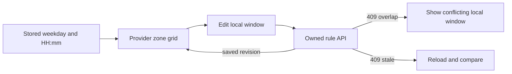

# Edit weekly hours in the provider zone

The rule API accepts local weekday and `HH:mm` values; the provider should be able to edit those through a weekly grid. Build a dashboard section with seven labelled days, each showing one or more working windows and an Add hours action. Show the Provider.timeZone in the section heading and beside each time control. A provider travelling with a phone should still know they are editing their practice in `Asia/Gaza`, even if the browser currently reports a different zone.

Do not build the grid by converting rules to the viewer's zone. The rules are the provider's local intentions and should display their saved `startLocal` and `endLocal` values. Dated previews can appear in a separate panel: choose next Monday, resolve the rule through Module 5 and show its UTC or client-zone offer labels. The editor itself must not replace a weekly 09:00 with an offset-dependent UTC hour. A local weekly grid and a dated preview answer different questions.

The form should let the provider choose weekday, start, end and effective dates. Time options advance in 15-minute steps to match the Service and SlotClaim grid. It must still reject typed or pasted off-grid values. If end is not later than start on the same local day, explain that overnight rules are not supported in this first version and suggest splitting the window. Keep the zone label visible while editing; do not hide it in a settings page.

## Render windows as data, not CSS position alone

You may draw a visual weekly timetable, but also show a text list such as "Monday, 09:00 to 12:00, effective 1 June onward." A narrow phone screen and a screen reader need the same information without decoding bar widths. Use semantic buttons for Edit and Retire with accessible names that include day and time. A color bar can help scanning, but it must not be the only indication that a rule is active or retired.

Group windows by ISO weekday 1 through 7. Sort by startLocal, then effectiveFrom for deterministic display. If two rules share a weekday but have disjoint effective ranges, show their dates clearly rather than merging them into one bar. If two rules have adjacent times on the same effective dates, display them as two windows or offer an explicit merge action. Never silently merge or split saved rules in the browser; that can change the provider's intended audit history.

Use the server's saved `scheduleRevision` in the form. A provider can open two tabs, edit Monday in Tab A and Tuesday in Tab B, then save both. If Tab B submits a stale revision, the API returns 409 `SCHEDULE_VERSION_CHANGED`. Show the newly saved schedule and the unsaved draft side by side or offer a safe reload with values preserved. Do not blindly retry Tab B's old payload, because a new overlapping rule or zone change may have appeared. The provider decides how to reconcile it.

## Preview one dated occurrence

Let the provider choose a local date in their zone and show how one rule would expand. Use the server's rule-preview endpoint or the same tested converter on the server. The preview can show "Monday 09:00 Gaza time" and a UTC ISO value for that date. It should label a skipped or repeated local boundary as unavailable and ask for a valid exception. It must not claim the preview is a bookable slot, because TimeOff, claims, service buffer and notice have not all been applied. Module 15's availability route provides the real candidate list.

Test a historical clock-change week in a known zone. The grid keeps the same local 09:00 rule label on both dated Mondays, while preview UTC values may differ. If the grid itself changes to 08:00 because the browser is in Berlin, the editor has confused viewer presentation with provider working hours. Keep a test that changes the browser zone while asserting saved rule fields and grid text remain identical.

## Handle overlap precisely

Create Monday 09:00 to 12:00 effective through September. Try adding Monday 11:00 to 14:00 effective in August and expect a 409 with the conflicting local rule. Try adding Monday 12:00 to 14:00 for the same dates; half-open hours touch but do not overlap, so it should save. Try 11:00 to 14:00 effective only in October; the date ranges do not meet, so it should save. The UI should not label all same-weekday rules as conflicts. Show the actual intersection of both clock and effective-date ranges.

Retiring a rule should ask which future effective date it stops applying. If the provider is simply closing one dated Monday, direct them to TimeOff instead of retiring every Monday. If they want to change all future Mondays, close the old rule's effective range and create a replacement. These different actions should have separate labels and confirmation copy. A generic Delete button hides the scope of the change and encourages accidental disappearance of future openings.

## Review existing commitments

After a rule edit, query the provider's future held and confirmed Bookings that fall outside the new working window and show them in a protected review panel. Do not change their UTC starts or claims. The panel can say "These paid appointments remain scheduled" and link to a reschedule or cancellation flow. A provider may decide to honor them despite new hours. The dashboard should make the exception visible without overriding a client promise.

The query should be scoped to the authenticated provider. It needs UTC Booking instants and the provider's named zone to display the local labels. Do not decide whether a Booking is outside hours by comparing its displayed `HH:mm` to a rule without checking the dated rule occurrence and service buffer. A later integration test can call the availability engine for that date and inspect the Booking separately; the paid Booking remains authoritative even if no new candidate covers it.

Verify keyboard navigation through all seven days, focus after save, error text linked to the time controls, and a visible zone label at phone width. Test that Provider B cannot fetch or edit Provider A's rules even by guessing IDs. Commit the grid and tests with one before-and-after screenshot or text transcript in `docs/provider-schedule-decisions.md`. The next lesson gives the provider a faster way to block a dated emergency without rewriting the weekly grid.

## Test a zone change without moving a booking

Start with an `Asia/Gaza` Provider and a Monday 09:00 rule. Create a confirmed Booking fixture at one UTC instant. Change Provider.timeZone through the explicit review flow to `Europe/Berlin`. The old rule is retired or marked for review, and the dashboard must not show it as an active Berlin 09:00 rule. The Booking keeps the same UTC instant and its claims. The agenda now formats its label in the provider's new zone, with a note if the product wants to preserve the original purchase-zone wording in the receipt. These are presentation and future-rule effects, not a reschedule.

Check this flow at phone width. The zone name should remain readable above the weekday grid, and a zone-change warning should name the consequence for active rules. A provider who cannot see the zone may save hours under the wrong assumption. The UI should require a deliberate republish action after changing zones, and the public readiness check should reject active rules whose saved zone no longer matches Provider.timeZone.

Keep a visible unsaved-changes indicator while the provider reviews the new zone and affected hours.

Reference: [Luxon DateTime zone and calendar operations](https://moment.github.io/luxon/api-docs/index.html).
