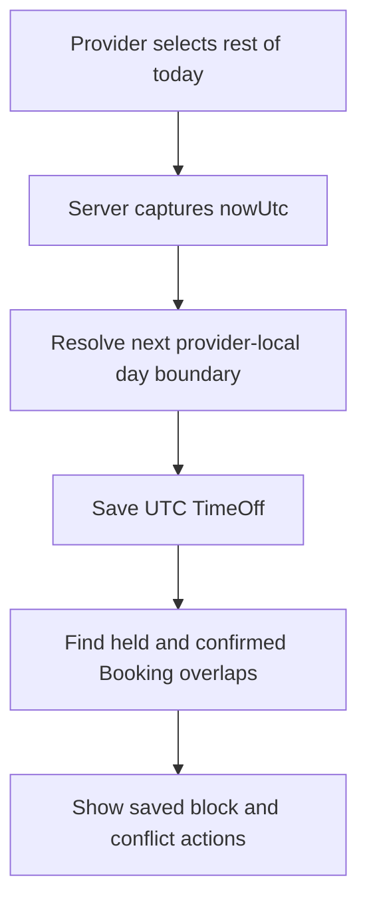

# Block the rest of today safely

A provider loses power at 11:31 and needs to stop new clients booking the afternoon. A form with two date pickers can do it, but an urgent one-tap action is useful. Build a TimeOff editor that supports a deliberate local date/time range and a "Block the rest of today" button. The button sends an intent to the server; the server uses its own clock and Provider.timeZone to determine the UTC start and next local-day boundary. The browser clock is a display aid, not the authority for when the block begins.

TimeOff is a dated exception, not a recurring rule edit. The weekly Monday 09:00 to 12:00 rule remains for next week. Module 15 subtracts the new UTC exception from today's computed offers. Existing held and confirmed Bookings remain as records and claims. The API response lists conflicts for the provider to resolve explicitly. The UI must say "New bookings blocked; existing appointments need action" when conflicts exist, not "All appointments cancelled."

The server chooses the next local day, not "now plus 24 hours." Around a clock change, the remaining part of a local day may have a different elapsed duration. Use a time library to find tomorrow's provider-local calendar date and the Module 5 converter to resolve its midnight boundary. If midnight itself is skipped or repeated under a place's rules, return a specific 422 and offer manual boundaries; do not silently move it. A future implementation could define a reviewed transition policy, but this course keeps the boundary explicit.

## Build the ordinary editor first

Show local start and end date/time controls with `Asia/Gaza` or the Provider's actual zone beside them. Permit an interval across midnight. On submit, call the owned TimeOff API from lesson 13.5 and keep the draft until the server confirms a save. If the converter rejects a gap or overlap, show the exact boundary error and preserve the other fields. A provider should not have to reconstruct a holiday range after one invalid end time.

The list beneath the form shows upcoming active TimeOff intervals in the provider zone with their UTC instants available in a detail view for debugging. It also shows a Cancel action for a future exception with an explicit confirmation. Cancelling TimeOff can make new offers reappear, but it does not retroactively create a Booking. If an old paid appointment was manually cancelled during the exception, removing the exception does not restore that payment or appointment. The UI must keep those histories separate.

## Implement the emergency intent

The browser sends `POST /provider/time-off/rest-of-today` without `startAt` or a client timestamp. The server captures `nowUtc` once through the injected clock, converts it to Provider.timeZone to find the local date, computes the next local date at 00:00 and resolves that boundary to UTC. It saves `[nowUtc, nextLocalMidnightUtc)` as TimeOff, unless the interval is empty. If the provider presses twice, use a request idempotency key or detect an equivalent active interval so the dashboard does not accumulate duplicate exceptions and confusing conflict lists.

Display a confirmation preview: "Block new offers from now until the end of Saturday in Asia/Gaza." The preview can use the last server timestamp and zone, but the final response must show the actual saved UTC interval and its provider-local labels. A weak network can delay the request. The start authority is the server's captured instant when it processed the request, not the time shown on a button before submission. If the delay matters, show it in the confirmation and allow the provider to extend the block backwards through an explicit edit.

## Show existing bookings as work to do

The protected response includes Bookings whose occupied interval intersects TimeOff. Render a list with local start label, Service title, status and a link to the provider's booking detail. Do not expose the list to another provider or in a public availability response. Give each conflict an action such as "Review reschedule" or "Contact client," not an automatic destructive Cancel button in the TimeOff save flow. The provider must follow the policy and participant workflow for an already paid appointment.

Test a 10:00 to 11:00 Booking with 15-minute buffer and TimeOff beginning at 11:05. The booking conflicts through its buffer. Test TimeOff beginning exactly at 11:15; the intervals touch and do not overlap. Test a cancelled Booking and one for another provider; neither appears. After saving, assert Booking.startAt, status, Order and SlotClaims did not change. These assertions guard against a tempting shortcut that deletes or cancels appointments when creating an exception.

## Make the phone flow usable under stress

Put the emergency action in a visible but clearly labelled panel. Use a confirmation that states it blocks new offers and shows whether existing appointments may need attention. The button must have a large touch target and keyboard focus ring. Announce the server result through a live region, including the number of conflicts. If the request fails, keep the provider on the page and say the block was not saved; do not optimistically hide public slots before the server confirms.

If the provider is not yet listed, the action can still save TimeOff, but the UI should not claim the marketplace listing changed. If the server's working zone is invalid or the next local midnight cannot be resolved, show a repair path. Do not fall back to the browser's local midnight. A provider using a travelling phone might be many hours away from their practice zone.

Commit the editor and a fake-clock test for the emergency route. In `docs/provider-schedule-decisions.md`, record the exact server instant, provider local date, resolved UTC end and protected conflict count from a fixture. The next lesson combines Services and rules into a listing-readiness decision, while this TimeOff continues to remove offers for its dated interval.

## Compare an emergency with a planned holiday

For a planned holiday, the provider enters both future local boundaries and can review the range before saving. For a power cut, they send a server-clock intent and review the resulting interval after the server confirms it. Both paths produce the same TimeOff model and the same conflict search. They differ in who chooses the start instant. Write a test that calls both paths with equivalent times under a fixed clock and asserts the stored UTC intervals match.

Then introduce a delayed request. Freeze the browser preview at 11:31 but let the server process the emergency action at 11:33. The stored start must be 11:33 UTC-equivalent under the provider zone, not the stale browser preview. The response should show that actual start and allow an authorized edit if the provider needs to cover the missing two minutes. This test demonstrates why the button sends intent rather than an untrusted client timestamp.

If a provider cancels the emergency TimeOff after power returns, do not restore any Booking that was explicitly cancelled during the outage. Cancelling the exception only changes future offers. The dashboard should keep the conflict history and show which actions were taken on each appointment. A single Cancel TimeOff action must not trigger a refund or reschedule reversal.

Test the emergency action just before provider-local midnight when the server processes it just after midnight. The server's captured instant belongs to the new local date, so the next boundary is the following local midnight. The UI preview may have said "rest of today" for the previous date; the response must show the actual interval and ask the provider to review it. Do not save a zero-length or backward interval to match stale browser wording. A fake clock can reproduce the boundary exactly.

Reference: [Luxon DateTime calendar and zone operations](https://moment.github.io/luxon/api-docs/index.html).
