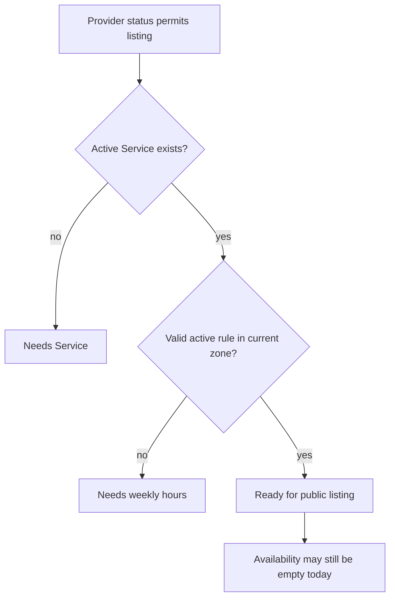

# List a provider only when clients can book

A provider profile can look complete while having nothing a client can book. Maybe they have a public name but no active Service, or a Service with no working rule. Build a readiness check that combines Provider status, at least one active Service and at least one valid active AvailabilityRule in the Provider working zone. Show the missing steps on the dashboard. A public listing and availability route should use the same decision, rather than one checking only `status: listed` while the other checks hours.

The readiness check is about basic setup, not a guarantee of a free start today. A provider with a Service and weekly hours may have every upcoming window claimed or blocked by TimeOff. They can still be a listed provider with no immediate openings, depending on the catalogue policy. Label that state accurately. "Ready for listing" means the profile has a valid offer and schedule; "Next free slot" comes from Module 15's dated calculation.



Use a service function such as `getListingReadiness(providerId)` that returns `ready` and reason codes, not only a boolean. A dashboard card can say "Add an active Service" or "Publish weekly hours" with a link to the right form. The public catalogue sees only the boolean and approved public fields. Do not expose private draft details or TimeOff reasons to clients. If the provider is suspended, no combination of Service and rule should make the profile bookable.

## Validate a rule, not just count it

An active AvailabilityRule counts only if it has a valid weekday, canonical quarter-hour local bounds, a real effective range that includes an allowed future date, and a `timeZone` matching Provider.timeZone. A stale rule saved under an old zone after a working-zone change should not make readiness true. M15's expander returns `RULE_ZONE_MISMATCH`; the dashboard can show "Review your weekly hours in the new zone." If all active rules are expired, the provider needs to publish future hours before listing.

Checking "at least one valid active rule" can still be inexpensive. Query active rules for the Provider and evaluate their shape and effective dates with the same domain validator used by the rule API. Do not trust an imported record merely because it has `active: true`. A readiness endpoint can cache the result briefly for dashboard display, but a publish action must recalculate it against current data before changing Provider.status. Module 15's public availability engine uses its own current read of rules, exceptions and claims.

## Make a status transition explicit

Provider.status starts as `draft`. When requirements are satisfied and the provider chooses Publish, change it to `listed`. If a Service is later archived or all rules retired, readiness becomes false and the public listing should stop offering bookings. The dashboard should show what changed and how to restore readiness. A suspended Provider remains unlisted until an authorized moderation action clears suspension. Do not let a normal provider form flip `suspended` back to `listed` by sending a status string.

```js
export function listingReasons({ status, activeServiceCount, validRuleCount }) {
  const setupReasons = [];
  if (activeServiceCount < 1) setupReasons.push('NEEDS_SERVICE');
  if (validRuleCount < 1) setupReasons.push('NEEDS_HOURS');
  const setupComplete = setupReasons.length === 0;
  const publiclyListed = setupComplete && status === 'listed';
  const reasons = status === 'suspended' ? [...setupReasons, 'PROVIDER_SUSPENDED'] : setupReasons;
  return { setupComplete, publiclyListed, reasons };
}
```

This helper distinguishes setup completeness from the explicit listed state. Before a provider presses Publish, `status: draft` with service and hours is prepared but not publicly listed. The dashboard can show "Ready to publish" while the public route reads `publiclyListed: false`. Suspension blocks the public state even if Service and rule data are complete. Use these same names in tests and API copy so one boolean does not carry two meanings.

## Test each missing piece

Create a draft Provider with no Service or rule. It is not public. Add one active Service: still not ready to list because there are no hours. Add a valid future rule with matching zone: setup is complete, but the profile remains draft until Publish. Publish it: the public catalogue may include it. Archive the only Service: it must stop offering new bookings. Restore Service and retire the only rule: it must stop again. Suspend the Provider: even complete setup must not bypass moderation.

Add a TimeOff that covers all of this week's openings. The provider may remain listed with a "No openings this week" result, while the availability endpoint returns an empty start list. This test prevents readiness from being incorrectly tied to one short view of the calendar. If the product wants to hide providers without any future opening, that is a separate catalogue ranking or filter rule and needs its own horizon and tests.

Test a mismatched rule zone after a provider-zone change. The dashboard should show a repair reason and keep the provider out of public booking paths until rules are republished. Confirm existing Bookings keep UTC starts. The readiness function should not mutate anything; it reads records and reports reasons. A separate publish or unpublish action changes status with authorization and a schedule revision check.

For public response shaping, verify the readiness endpoint does not return private TimeOff reason, all rule documents or the identity of clients with claims. Public listing can show the practice name, category, location type and perhaps a next free UTC start from Module 15. That start remains advisory until checkout. Dashboard diagnostics can show more to the owner under authentication.

Commit the readiness function, route tests and dashboard card. In the decision note, write which conditions make a profile eligible for listing and which conditions merely remove particular dated offers. The gate will ask you to prove both with a provider who has an active Service and rule but a blocked afternoon.

## Keep preparation and publication separate

For the dashboard, compute `setupComplete` from an active Service and valid future rule. Compute `publiclyListed` from setupComplete plus permitted Provider.status. A draft provider with complete setup should see a Publish action, not appear in search immediately. A listed provider whose last Service is archived should see a repair reason and leave public booking paths until another active Service exists. This two-value model prevents the word "ready" from meaning both "has enough data" and "has consented to appear publicly."

Test a provider who has only an archived Service and an active rule. The rule alone cannot make a sale. Test a provider with an active Service but a rule whose effectiveTo was yesterday. The rule alone is not future availability. Test a provider with both but a mismatched rule zone after a zone change. The three cases should produce different dashboard repair messages while all remain unbookable. A count-only query would incorrectly pass two of them.

The public catalogue should use this predicate as one gate, then let Module 15 calculate a next free start for display. A provider can be listed yet have no starts in the next seven days because of TimeOff or existing claims. Do not flip Provider.status to draft every time the seven-day result is empty. That would make a holiday look like a failed business setup and force the provider to republish after returning.

If an index or database read fails while computing readiness, return an error rather than treating the provider as ready by default. For a safe public response, failing closed can hide a provider temporarily; the dashboard should show a service problem, not instruct them to recreate valid rules. The distinction between a true missing prerequisite and a failed read belongs in the API result and UI copy.

Simulate the rule repository throwing while the Service query succeeds. Assert the public route fails closed and the provider dashboard reports a temporary check failure. It must not return `NEEDS_HOURS`, because the provider may have valid hours that could not be read.
