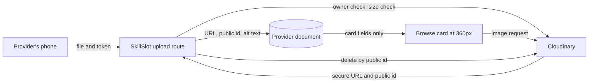

# A client hires evidence, not a list

A client in Berlin opens SkillSlot on her phone with 40 percent battery and a slow connection. She searches for an English conversation tutor and gets three cards. Each says "patient, experienced, friendly". Each costs the same, offers the same 60 minutes and shows the same next free evening. Nothing on those cards tells her which person will actually help her speak. Then she opens the fourth profile, and it holds three photographs: a whiteboard with a sentence corrected in red, a lesson plan with sticky notes, and a student's exercise book with the tutor's margin notes. She books that provider, and she never reads the other three again.

That is the whole argument for this module. A client is not buying a service description, because every competitor can write the same description. She is trying to predict whether one hour with this person will be useful. Words she cannot check do not answer that question. A photograph of real work does. The portfolio is not decoration on the profile; it is the part of the profile that carries evidence.

## What a listing without images costs

Remove the images and see what the marketplace becomes. A client compares price and duration, picks the cheapest, and hopes. The tutor who just finished a teaching diploma has no way to show it against a provider with a nicer headline. New providers stay invisible until someone takes a chance on them, and the platform slowly fills with cheap listings that nobody can tell apart.

There is a second cost, and it lands on the provider. A provider who has spent two years building a practice has actual material: marked homework, a design file before and after, a repaired laptop with a clean boot screen. That material is sitting on her phone already. If SkillSlot gives her nowhere to put it, she will write a longer biography instead, and the client will read a longer claim rather than seeing evidence.

## Three constraints you will feel while building

The first is size. A photograph taken on a phone is often 3 to 5 MB. Mobile data in Gaza is metered and expensive, and a client browsing on a weak connection should not download a gallery to answer one question. Every image in this module has a job and a budget, and the card image will be 360 pixels wide, not 3000.

The second is trust. An upload turns a private file into a public URL. Whatever sits inside the frame becomes public too: a student's full name on a whiteboard, a home address on a delivery label in a repair photo, a passport page used as a document. The provider must be able to publish her work without leaking a third person's details, and the platform must give her a field to describe the image so a screen reader user receives the same information as everyone else.

The third is ownership. Only the provider who owns a profile may add, replace or remove an image on it. A route that trusts a provider identifier from the request body will one day let one provider overwrite another provider's portfolio. That is the same object-level authorization rule you wrote in Module 9, applied to a file instead of a document.

## Why the bytes do not go in MongoDB

The first instinct is to accept the file, convert it to a long text string, and store it on the Provider document. It works on a laptop with four test images, and it fails everywhere else.

Base64 encoding adds about a third to the size. A 4 MB photo becomes a 5.3 MB string inside the document. MongoDB's document limit is 16 MB, so a provider with six portfolio images and one avatar can approach the ceiling with nothing but pictures. Every read that includes those fields pulls megabytes out of the database and into the Node process, whether or not the client ever displays the image, because the field is part of the document. A browse page that lists 12 providers would need those documents, and the response would be tens of megabytes over a connection that struggles with 400 KB.

The alternative is object storage. The bytes go to an image host, and MongoDB keeps a small record: the HTTPS URL to read the file and a public identifier that lets you find and delete it later. The client's browser downloads image bytes directly from the host, never through your API, so your server does not become a file proxy and your database does not become a photo album.

Read the diagram in two directions. The write path runs from the provider's phone through your API, because the API is the only place where ownership can be checked before a file leaves your control. The read path skips your API entirely: the browse card carries a URL, and the browser fetches the bytes from the image host. That is why a card stays small when the photos are large.

## What the database keeps, and why the identifier matters

The URL alone is not enough. If a provider replaces her avatar, you have a new URL and an old file. If you cannot name the old file, you cannot delete it, and it stays public and billable forever. So each upload stores two values: the URL to read, and the public identifier the host assigns, which you need in order to delete or transform that exact asset. The identifier is not a secret. It is a filing reference, and without it the delete route has nothing to act on.

The stored record also carries the alt text and the pixel dimensions. Dimensions let the browser reserve space before the image loads, so the card does not jump while a client is tapping a button. Alt text is required, and the next lesson explains why it is validated rather than encouraged.

## The 360 pixel budget

A browse card on the smallest phone we support is about 328 pixels of usable width inside a 360 pixel viewport, after the page margins. A photograph served at 360 wide fits that column exactly, and a 1:1 crop fills the avatar slot without distortion. A 30 to 60 KB file at that width is enough to judge a face or a piece of work. The same photo at full camera resolution is 3 to 5 MB, which is roughly a hundred times the data for no visible gain at that size.

The full image is still useful. A client who opens the provider page and looks at a design portfolio needs detail, so that page asks for a larger width, and only the images actually scrolled into view are requested. This is a rendering decision as much as a storage decision: the card asks for the small file, the detail page asks for the larger one, and neither asks for the camera original.

Store the original once and let the host produce the widths you need. Do not upload three copies of every photo from the provider's phone, because the provider is paying for that upload in data too.

## Alt text is content, not a checkbox

A screen reader user cannot see the photograph. The alt text is the sentence that replaces it, and it should say what the image shows and why it matters here. "Photo of my work" is not alt text, because it describes the file rather than the content. "A page of a Year 9 algebra test with three corrections in red pen" is alt text, and it lets a reader judge the same thing a sighted reader judges.

Because the provider is the only person who knows what is in her own photograph, she writes the alt text. The platform keeps the field required, limits it to about 140 characters, and shows it publicly, because a required field that is invisible in the public response is a field nobody can check. It is also a place where a provider might accidentally type a client's name, so the upload form says plainly that alt text is public and offers the provider a chance to describe the work rather than the person.

## Replace, delete and the order of writes

Replacing an avatar touches two systems, and the order matters. If you delete the old file first and the database write then fails, the provider has no image and no record of the one she had. If you write the new record first and the delete fails, you have a short-lived orphan file that costs a few kilobytes and can be cleaned later. Write the reference first, then delete the old asset, and log a failed delete instead of failing the whole request.

Deleting an image follows the same logic in reverse. Remove the record from the provider document, then delete the asset. If the asset delete fails, the provider's page is already correct and the orphan is a housekeeping problem, not a broken profile.

One thing must stay true through all of this: no Booking references an image. A confirmed Booking keeps its own service, price and time snapshots, so a provider who removes a portfolio photo does not change a single paid appointment. That separation is what makes deletion safe.

## Two image fields with different jobs

The avatar is one square image that appears beside the provider's name in browse results and on the profile. It answers the plain human question of whether this is a real person with a real practice, and it is the image a client sees most often. The portfolio is up to six images that show the work itself, ordered by the provider, and it appears on the provider page where there is room to look.

Six is a deliberate limit, not a technical one. A page with thirty photographs is a gallery that costs data and delays the decision. Six is enough to show range and small enough that a client on a weak connection can still reach the booking button.

## What you build in this module

The next lesson extends the Provider model with an avatar URL and public identifier, a portfolio of up to six images with URL, public identifier, alt text, dimensions and order, and the routes that create, replace and delete them under an ownership check. It also builds the small provider-facing panel where the images are uploaded and described.

The gate asks for evidence rather than a working form: an upload that lands in object storage and not in MongoDB, a second provider refused when targeting the first provider's profile, an alt text field that refuses to be empty, a delete that removes both the reference and the asset, and one photograph verified at 360 pixels wide with a recorded file size.

## A five minute practice

Before you write code, answer these four questions in `docs/portfolio-decisions.md`. What does a client need to see on a browse card without opening the profile? What does she need on the provider page that the card cannot hold? Which value must be stored so a file can be deleted later? Which single check decides who may change an image on a given profile?

If your answer to the last question names a field in the request body rather than the authenticated session, revisit Module 9 before you build the route.

## Check before moving on

A provider uploads a 6 MB photo of a marked essay. Name the two records the system keeps after the upload succeeds, the field that lets the platform delete the photo later, and the width the browse card should request. The expected answer is a URL, a public identifier, the alt text and the dimensions on the provider record, with a 360 pixel transformation for the card. The image bytes are in none of those fields.

References: [Cloudinary upload documentation](https://cloudinary.com/documentation/upload_images), [Cloudinary transformation URL reference](https://cloudinary.com/documentation/transformation_reference) and [MDN on alternative text](https://developer.mozilla.org/en-US/docs/Web/API/HTMLImageElement/alt).
