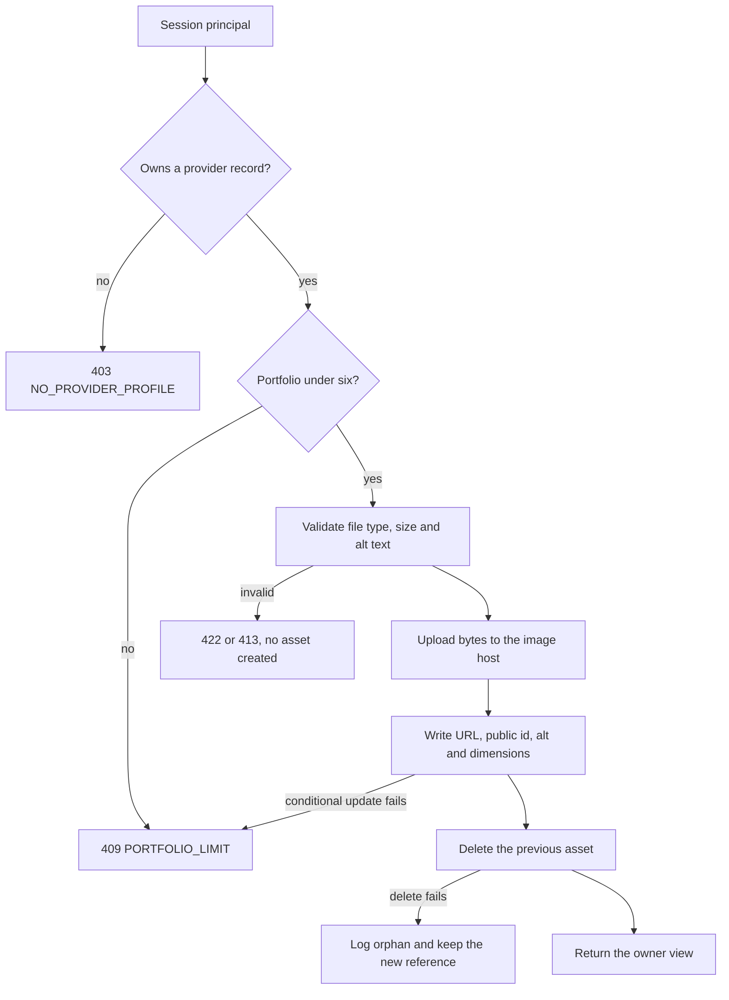

# Portfolio photos, avatar and ownership

The Provider record from Module 10 already stores `avatarUrl` as a text field that the provider pastes into a form. That was enough to finish the profile module and it is not enough now. A pasted URL cannot be validated, cannot be deleted, and usually points at a file on someone else's server that disappears in a month. This lesson replaces the pasted link with a real upload and adds the portfolio, six images that show the work.

Start by naming the two jobs this storage must do. It must let a client see evidence quickly on a small screen, and it must let the provider change that evidence without breaking anything that has already been sold. Every rule below follows from one of those two jobs.

## Extend the provider schema

Add four fields to the Provider model and one subdocument array. Keep the naming from Module 10 for everything else so the public projection stays recognisable.

```js
// server/src/modules/providers/provider.model.js
const portfolioImageSchema = new Schema({
  url: { type: String, required: true },       // https URL the browser can load
  publicId: { type: String, required: true },  // needed to delete or transform this exact asset
  alt: { type: String, required: true, trim: true, minlength: 8, maxlength: 140 },
  width: { type: Number, required: true, min: 1 },
  height: { type: Number, required: true, min: 1 },
  order: { type: Number, required: true, min: 0, max: 5 },
}, { _id: true });

providerSchema.add({
  avatarUrl: { type: String, default: null },
  avatarPublicId: { type: String, default: null },
  portfolio: { type: [portfolioImageSchema], default: [] },
  imagesUpdatedAt: { type: Date, default: null },
});
```

The `publicId` is the field that most learners leave out, and it is the only field that makes a delete possible. The image host does not accept a URL as a delete request, because URLs can be transformed, signed or rewritten. It accepts the identifier it issued. If you skip it, your first replacement leaves a public file you cannot name, and you will pay for it every month.

`order` is stored rather than derived from array position. A provider who reorders images is making a statement about which piece of work leads, and an array that gets rebuilt by a query should not silently change that statement. Keep `order` unique per provider and renumber it on write.

The array is capped at six. Enforce the cap in the service that writes it and return `409 PORTFOLIO_LIMIT` with the current count. A schema validator can also enforce it, but the service check is what produces a message the provider can act on.

## The upload routes

Two routes, one shape. Both are authenticated, both resolve the provider from the session, and both accept exactly one file.

| Method and path | Who may call | Success | Main failures |
|---|---|---|---|
| `POST /api/providers/me/avatar` | Owner of the provider record | `200` owner view | `403 NO_PROVIDER_PROFILE`, `422 INVALID_IMAGE`, `413 FILE_TOO_LARGE` |
| `DELETE /api/providers/me/avatar` | Owner | `200` owner view | `404 NO_AVATAR` |
| `POST /api/providers/me/portfolio` | Owner, under six images | `201` owner view | `409 PORTFOLIO_LIMIT`, `422 ALT_REQUIRED`, `422 INVALID_IMAGE` |
| `PATCH /api/providers/me/portfolio/:imageId` | Owner | `200` owner view | `404 IMAGE_NOT_FOUND`, `422 ALT_REQUIRED` |
| `DELETE /api/providers/me/portfolio/:imageId` | Owner | `200` owner view | `404 IMAGE_NOT_FOUND` |

Notice that no path contains a provider identifier, and no body field may carry one. Consider what happens with `POST /api/providers/:providerId/portfolio`: the route now has to compare the path identifier with the session owner, and that comparison is exactly where the Module 9 defect lived. Removing the identifier from the path removes the opportunity. If your application already uses path identifiers for the provider dashboard, keep them, but resolve the owner first and write with both identifiers in the filter, as Module 10 showed.

The diagram below is the order the route must keep. The ownership check comes before the file is accepted, the alt text is validated before the host is called, and the reference is written before any old asset is removed. If you reorder those steps, the failure you get is not an error message but a provider with a broken profile and a file you cannot name.



The conditional update near the end of the flow is the interesting one. It is also the step that makes the six image limit true when two browser tabs submit at the same moment.

```js
router.post('/api/providers/me/portfolio', requireAuth, requireRole('provider'),
  uploadSingle('image'), async (req, res) => {
    const provider = await assertProviderOwner(req.principal);
    if (provider.portfolio.length >= 6) throw conflict('PORTFOLIO_LIMIT', { count: 6 });
    const file = validateImageFile(req.file);           // type, size, one file only
    const alt = requireAltText(req.body.alt);            // trimmed, 8 to 140 characters
    const asset = await storage.upload(file, { folder: `skillslot/providers/${provider._id}` });
    const image = { url: asset.secureUrl, publicId: asset.publicId, alt,
      width: asset.width, height: asset.height, order: provider.portfolio.length };
    const updated = await Provider.findOneAndUpdate(
      { _id: provider._id, userId: req.principal.userId, 'portfolio.5': { $exists: false } },
      { $push: { portfolio: image }, $set: { imagesUpdatedAt: new Date() } },
      { new: true, projection: OWNER_PROJECTION },
    ).lean();
    if (!updated) throw conflict('PORTFOLIO_LIMIT', { count: 6 });
    res.status(201).json(toOwnerView(updated));
  });
```

The filter `'portfolio.5': { $exists: false }` is the concurrency guard. Two browser tabs can both read five images and both decide there is room for a sixth. The conditional update lets only one of them match, and the loser gets the same conflict a single tab would get. This is the same shape as the slot claim logic you meet in Module 19: let the write decide, not the earlier read.

A losing request has already sent its bytes to the image host by then, so delete that new asset before returning the conflict. Otherwise every losing tab leaves an orphan that nobody will ever look at again.

`validateImageFile` must check more than the extension. Accept `image/jpeg`, `image/png` and `image/webp`, cap the file at 4 MB, and reject a request that carries two files. Do not trust the browser's declared content type on its own; read the first bytes and confirm the signature, or let the image host reject the file and map its error. Never write the uploaded bytes to the application's own disk, because a container redeploy deletes them and a second instance cannot see them.

## Alt text validation with a real message

Alt text is required at the schema, at the route and in the form. The route trims the value, rejects an empty string, rejects fewer than eight characters, caps it at 140 and refuses a short list of non-descriptions that people type when they are in a hurry.

```js
const USELESS_ALT = new Set(['image', 'photo', 'picture', 'my work', 'portfolio', 'screenshot']);

export function requireAltText(raw) {
  const alt = String(raw ?? '').trim().replace(/\s+/g, ' ');
  if (alt.length < 8 || alt.length > 140) throw validation('ALT_LENGTH');
  if (USELESS_ALT.has(alt.toLowerCase())) throw validation('ALT_NOT_DESCRIPTIVE');
  return alt;
}
```

The list is deliberately short. It catches the obvious non-answers and it does not try to judge a sentence, because a model or a rule cannot tell whether a description is accurate. The provider can, and the form shows the public preview beside the field so she can see what a reader will get.

## Replace and delete in the right order

Replacing the avatar is a two-system write. Write the new URL and identifier, then delete the previous asset, and treat a failed delete as a logged cleanup task rather than a failed request.

```js
export async function replaceAvatar(principal, file) {
  const provider = await assertProviderOwner(principal);
  const asset = await storage.upload(file, { folder: `skillslot/providers/${provider._id}`, square: true });
  const updated = await Provider.findOneAndUpdate(
    { _id: provider._id, userId: principal.userId },
    { $set: { avatarUrl: asset.secureUrl, avatarPublicId: asset.publicId, imagesUpdatedAt: new Date() } },
    { new: true, projection: OWNER_PROJECTION },
  ).lean();
  if (provider.avatarPublicId) {
    await storage.delete(provider.avatarPublicId).catch((error) => {
      logger.warn({ event: 'avatar_orphan', publicId: provider.avatarPublicId, error: error.message });
    });
  }
  return toOwnerView(updated);
}
```

Deleting a portfolio image runs the mirror image: pull the subdocument, renumber the remaining `order` values, then delete the asset. If the asset delete fails the provider's page is already correct, and the orphan is a housekeeping problem.

Renumbering matters more than it looks. If a provider deletes image two of five, the remaining order values can read 0, 1, 3 and 4. The array now holds four entries, so the next insert computes `order: 4` from the length and collides with the 4 that is already there. Two images end up sharing a position and the card order becomes a matter of document order. Renumber inside the same update so the array is always dense.

## Serve 360 pixels to the card

The stored URL is the full asset. The card URL is derived from it at render time, so the transformation stays in one function.

```js
// server/src/modules/providers/image-url.js
export function cardUrl(url, width = 360) {
  if (!url) return null;
  return url.replace('/upload/', `/upload/w_${width},c_fill,q_auto,f_auto/`);
}
```

Two honest limits. First, this string replacement assumes the host's URL layout, so it belongs in exactly one file; switching hosts changes this function and nothing else. Second, `q_auto,f_auto` lets the host choose quality and format, which is why a 360 pixel card image usually lands between 20 and 60 KB. Measure one file and write the number down rather than trusting the estimate.

The avatar uses the same helper with a square crop. The provider page asks for a wider version, around 900 pixels, and loads it with `loading="lazy"` so images below the fold cost nothing until the client scrolls. The camera original never reaches a browser.

## Write the failing tests first

Each test below fails before the route exists, and fails again if a later refactor removes the rule it protects.

- `upload_stores_reference_not_bytes` uploads a file, then reads the raw provider document and asserts that no field contains more than 500 characters and that `avatarPublicId` is present.
- `portfolio_limit_returns_409_on_the_seventh_image` seeds six images and expects `409 PORTFOLIO_LIMIT` with no seventh entry written.
- `provider_b_cannot_write_provider_a_images` calls the avatar route as provider B and expects provider A's `avatarUrl` and `imagesUpdatedAt` to be unchanged.
- `empty_alt_text_is_rejected` posts an image with `alt: ''` and expects `422 ALT_REQUIRED`, and no asset count increase.
- `delete_removes_reference_and_asset` deletes one image, then asserts the array length and that the storage client received exactly one delete call for that identifier.
- `public_view_returns_card_url_not_original` asserts the browse projection contains a 360 transformation and no `publicId`.

```js
test('provider_b_cannot_write_provider_a_images', async () => {
  const before = await Provider.findById(providerA).lean();
  const response = await request(app)
    .post('/api/providers/me/avatar')
    .set('Authorization', `Bearer ${tokenB}`)
    .attach('image', 'fixtures/board.jpg')
    .field('alt', 'A whiteboard with a corrected sentence');
  assert.equal(response.status, 200);                       // provider B updates her own record
  const after = await Provider.findById(providerA).lean();
  assert.equal(after.avatarUrl, before.avatarUrl);          // provider A is untouched
  assert.equal(after.imagesUpdatedAt?.toISOString(), before.imagesUpdatedAt?.toISOString());
});
```

The interesting assertion is the second call, not the first. A route that returns 200 for provider B while writing provider A is worse than a route that returns 403, because nobody notices. Reload the record you did not mean to touch.

## A trade-off you should be able to defend

Three upload patterns are in common use. A server-mediated upload, the one above, streams the file through your API, which checks ownership before the bytes leave your control and keeps the secret key on the server. A presigned direct upload hands the browser a short-lived signed permission to write one object, so the file never touches your API; it scales better and costs more code and more trust in the signing step. An unsigned upload preset lets the browser post straight to the host with no signature at all, which is the fastest to build and the easiest to abuse, because anyone who reads your client bundle can upload to your account.

This course uses the server-mediated path because the ownership check has to happen before the file is stored, and because a 4 MB cap is easy to enforce when the request passes through your handler. Switch to presigned uploads when image traffic starts to dominate your API's egress or when uploads need to survive a slow connection with resumable chunks. Do not switch to unsigned presets for a write that changes a public profile.

```quiz
type: mcq
id: services-portfolio-q1
question: "A provider replaces her avatar. Which write order keeps the profile usable if the second step fails?"
options:
  - "Delete the old asset, then store the new URL and public identifier"
  - "Delete both assets first, then upload the new file and store its URL"
  - "Store the new URL only, and let the old asset expire on its own"
  - "Store the new URL and public identifier, then delete the old asset"
correct: 3
explanations:
  - "A failed database write after the delete leaves the profile with no image and no record of the old one."
  - "Deleting both assets before the new upload risks ending with nothing at all."
  - "An asset with no stored identifier cannot be found again to delete or account for."
  - "The profile is correct as soon as the reference is written, and a failed delete is a logged cleanup task."
```

```quiz
type: mcq
id: services-portfolio-q2
question: "Why does the provider record store a public identifier beside every image URL?"
options:
  - "It proves to a client that the image was uploaded rather than pasted"
  - "It replaces the URL so the browser has a shorter value to download"
  - "The image host needs it to delete or transform that exact asset"
  - "It hides the real URL from clients who inspect the page source"
correct: 2
explanations:
  - "A client cannot verify provenance from an identifier, and the profile does not need it to."
  - "The browser still loads the URL; the identifier is not a download address."
  - "Deletion and transformation are addressed by identifier, so without it the file becomes unnameable."
  - "The URL is public by design, and the identifier is a filing reference, not a secret."
```

## Verify, then hand over to the gate

Run the flow by hand as two providers. Upload an avatar as the tutor and confirm that the Compass document holds a short URL and an identifier while the image host shows the file. Replace the avatar and confirm the old identifier is gone from the host. Upload a 6 MB file and expect `413 FILE_TOO_LARGE` before any asset exists. Post an empty alt text and expect `422 ALT_REQUIRED`. Then sign in as the designer and try to delete the tutor's portfolio image by sending the tutor's image identifier; expect `404 IMAGE_NOT_FOUND` and confirm the tutor's array still holds six entries.

Finally, measure the card image. Open the browse card at a 360 pixel viewport, read the transferred size in the network panel, and write the number in `docs/portfolio-decisions.md` beside the width and format you requested. A card that transfers 400 KB is a card you have not finished.

The next lesson is the module gate, which asks for this evidence together with a written answer about why no Booking references an image.

References: [Cloudinary upload documentation](https://cloudinary.com/documentation/upload_images), [Cloudinary transformation reference](https://cloudinary.com/documentation/transformation_reference) and [Mongoose subdocuments](https://mongoosejs.com/docs/subdocs.html).
