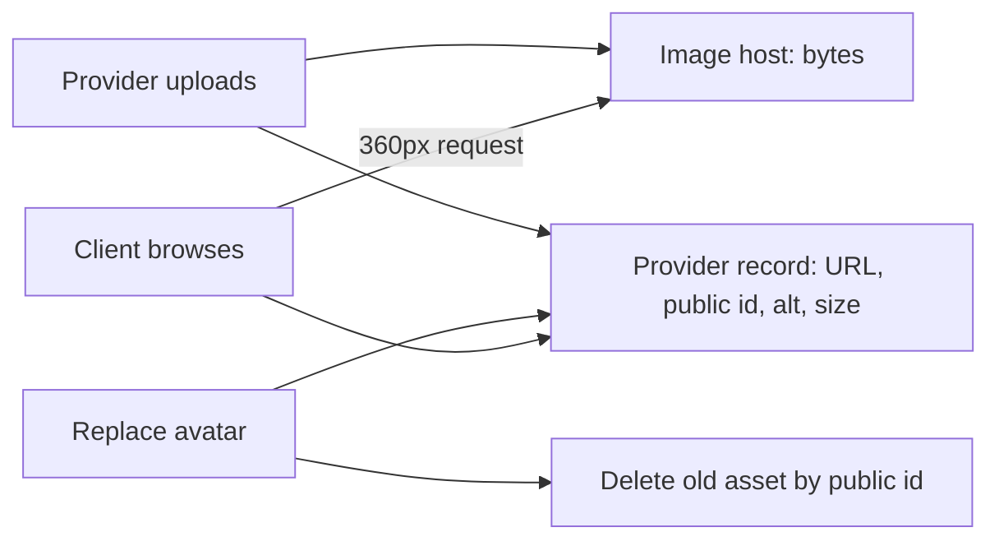

# Portfolio gate

This gate is not a screenshot of a working upload button. It asks you to show where the bytes went, which fields the database kept, and what happened when a second provider aimed at the first provider's profile. A mentor should be able to open your database, read one provider document, and explain without help why the image is not in it.

Run the whole flow as two seeded providers before you claim the gate. Sign in as the tutor, upload an avatar and two portfolio images, then replace the avatar. Sign in as the designer and attempt to delete one of the tutor's images by sending the identifier you copied from the tutor's document. Reload both records afterwards and compare them with the values you wrote down before the attempt.

## What the evidence has to show

Keep `docs/portfolio-decisions.md` beside the code. It needs five things: the field list you chose with the reason for each, the folder convention and the public identifiers of one avatar and one portfolio image, the measured transfer size of one 360 pixel card image, the exact status and error code for four failure cases, and the storage state after one replacement.

For the replacement case, show the identifier of the old asset, then show that a request for that identifier at the image host now fails and that the provider document holds only the new one. A delete that removed the database reference but left the file is the most common half-finished version of this feature, and the document alone will not reveal it.

The diagram is the evidence map. Every arrow into the database carries a small value, and every arrow that carries a large value ends at the image host. If you cannot point to the arrow that removes the old asset, you have not finished the replace flow.

## Gate checklist

- [ ] The Provider record stores `avatarUrl`, `avatarPublicId` and a portfolio of at most six images, each with URL, public identifier, alt text, width, height and order.
- [ ] No image bytes, base64 strings or local file paths are stored in MongoDB, and no upload is written to the application's own disk.
- [ ] The upload routes resolve the provider from the authenticated session and refuse a caller without a provider record.
- [ ] Provider B cannot add, replace or delete an image on Provider A, by path, body or identifier guessing, and Provider A's document is unchanged after the attempt.
- [ ] A seventh portfolio image returns `409 PORTFOLIO_LIMIT`, and the conditional update also holds when two tabs submit the fifth and sixth image at once.
- [ ] Empty, too short and non-descriptive alt text returns `422` with a code the form can display, and the public response includes the alt text.
- [ ] A file over the size cap returns `413` before any asset is created, and a second attached file is rejected.
- [ ] Replacing an avatar writes the new reference first, then deletes the previous asset by identifier, and a failed delete is logged rather than hidden.
- [ ] Deleting a portfolio image removes the reference, renumbers the remaining order values, and deletes the asset.
- [ ] The browse card requests a 360 pixel wide version, the measured transfer is recorded, and no page requests the camera original.
- [ ] The public provider view contains the URL and the alt text and none of the public identifiers or owner fields.
- [ ] Committed evidence includes the route tests, one before and after document read, and the recorded card image size.

If a box cannot be ticked with a command output or a document read, leave it open. A green upload form does not prove that the file left your server, and a passing delete test does not prove that the asset was removed from the host.

## Run the failure paths on purpose

Most learners test the happy upload and stop. Test the four refusals instead, because each one protects a different promise. Send a 6 MB file and watch the request stop before the image host is called, so a rejected upload costs no storage and no quota. Send a text file renamed with a `.jpg` extension and confirm the signature check or the host rejects it, because the browser's declared type is a claim rather than a fact. Send an image with `alt: "photo"` and read the error the form will show. Then send a request with two attached files and confirm exactly one is refused rather than silently keeping the first.

Each refusal should leave no trace: no asset, no array entry, no change to `imagesUpdatedAt`. Query the document after the failed call and compare it with the value you recorded before it. A route that uploads first and validates second will pass a form test and fail this one, and the candidate will never know because the provider only sees the happy path.

## What this module does not cover

There is no moderation queue here. Nothing in this module checks whether an uploaded image is appropriate or whether the provider had permission from the people in the frame. The form asks the provider to confirm that she has the right to publish the image and to describe the work rather than the person, and the platform trusts her. A real marketplace adds reporting, review and takedown, and that work needs its own scope decisions. Say so in your decision note rather than implying the checkbox is a safety system.

There is also no metadata scrubbing that you can assume. Phone photographs often carry location data, and whether your image host strips it depends on the upload options you chose. Decide the policy, test it with one file that has a known location tag, and record the result. If the tag survives, either change the upload options or tell the provider plainly that location data may be published with her photo.

## Learning log

1. A provider replaces her avatar on a weak connection and the browser loses the response. What is stored, what might still exist at the image host, and what does the provider see when she reloads?
2. Why does no Booking reference an image, and what would break if a Booking stored an image URL so the client's confirmation page could show the provider's work?
3. A client on a 360 pixel viewport opens the browse page. Name the value the card downloads, the value it does not download, and the single function that decides the difference.
4. Provider B sends the tutor's image identifier to the delete route. Which filter decides the outcome, and what does the response reveal about whether that identifier exists?

Answer with field names and status codes. If an answer says the database holds the photo for speed, revisit the document size and read cost arguments in 14.01. If an answer says the delete route should return `403` only when the identifier exists, reread the Module 9 rule about not confirming another account's records.

## Before you close

Ask the mentor to open one provider document in Compass and one asset in the image host console. They should be able to match the stored public identifier to the hosted file, then ask you to delete that image through the API and confirm both sides changed. That pairing, a small record and a hosted file that disappear together, is the whole module.

Write down one defect the review found and the change you made. A checklist with twelve ticks and no document read does not pass this gate.

The next module turns the Services and weekly rules into dated UTC starts, and Module 16 will put one of those starts beside the avatar on a browse card. Keep the card image small; that slot is the first thing a client sees and the last thing you want to make expensive.
