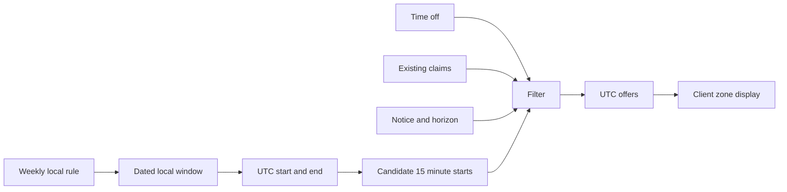

# From provider rules to bookable starts

A tutor in Gaza sets Monday hours from 09:00 to 12:00. A client in Berlin opens the tutor's page on Sunday evening. What should the server send? It should send dated UTC start instants for the service the client selected, after considering the tutor's current hours, time off, existing reservations and minimum notice. It should not send the bare rule "Monday nine" and ask the browser to decide which appointment can be sold. The browser may display the returned starts in Berlin time, but it is not the authority for eligibility.

This module builds the function that turns a provider's intention into a short list of candidates. The word candidate matters. A client can see a start at 09:00 while another client is about to reserve it. The list is a display snapshot. Module 19 performs an atomic SlotClaim write before an appointment becomes a hold. This engine makes honest offers from the state it read; the claim transaction decides who actually wins a race. A green slot button is never itself a lock.

Look at the arrows from right to left. The displayed label is derived from a UTC instant. The UTC instant is derived from a dated rule occurrence, not from adding seven days to last week's UTC start. The filter needs current exceptions and claims, not just the original rule. If the provider blocks Monday morning for a power cut, the same recurring rule should produce fewer starts for that date. If a client reserves one hour, neighboring starts that would overlap must disappear from the next response.

## Why a permanent Slot collection is the wrong default

You could generate a document for every 15-minute start for the next year. That sounds convenient until the provider edits a rule, takes time off, changes a service buffer or the local offset changes. Which generated documents remain correct? You would need a repair job for every rule mutation, a policy for existing paid bookings and a way to distinguish stale generated rows from real claims. A generated slot is a calculation. A paid Booking and its SlotClaims are durable facts. Store the durable facts and compute the offer list when asked.

This is a design for SkillSlot's seven-day horizon, not a claim that materialized availability is always wrong. A very large calendar service may cache or precompute offers for display. Even then, checkout must revalidate and claim against authoritative data. Module 23 can cache this engine's output for a short time, with clear invalidation and a warning that cached availability is advisory. The unique claim index still protects the provider's time.

The engine takes one provider, one active service, a start date and a seven-day maximum range. It returns compact UTC starts and a server timestamp. It does not return a list of every AvailabilityRule, TimeOff reason or other client's Booking. Public clients need bookable choices, not a provider's private calendar details. The route layer will check that the provider is listed and the service belongs to that provider before calling the engine.

## Four kinds of data with different authority

An AvailabilityRule is a weekly template in the provider's local wall clock. It includes a weekday, local start and end, effective dates and the provider's IANA zone. It may be changed for future offers. A TimeOff record is a dated exception with resolved UTC start and end. It removes offers that intersect it. A SlotClaim is a currently occupied UTC block, linked to a hold or booking. It removes any candidate whose full service interval, including cleanup buffer, needs that block. A Booking is the client's appointment record. It is not regenerated when the weekly rule changes.

Picture a 60-minute lesson with a 15-minute cleanup buffer. A 09:00 start occupies five 15-minute blocks: 09:00, 09:15, 09:30, 09:45 and 10:00. A 09:15 start needs 09:15 through 10:15. If the first is claimed, the second is unavailable even though no claim exists exactly at the second start's end. A search that checks only whether the candidate start key is free would be wrong. The engine must test all required blocks. The later checkout transaction must insert that same set. One shared block-expansion helper prevents the display and write paths from disagreeing.

Minimum notice removes starts too close to the server's current instant. If the provider requires two hours' notice and the server clock says 08:00 UTC, a 10:00 UTC start is at the boundary. This course treats the boundary as closed: only a start strictly after 10:00 is offered. That choice matches the earlier time module's `isAfterNotice` test. The booking horizon removes starts beyond the allowed future window. Both checks use one injected server clock, never the client's device clock. A client changing their laptop time must not make a sold slot appear eligible.

## What the learner will build

You will implement a pure planner that expands local rules over dated days, converts each boundary through the tested time helper, steps in absolute UTC minutes, and filters candidate starts. A repository adapter fetches one range of TimeOff and one range of SlotClaims for the whole request. The API route returns a small response rather than a calendar dump. A fake clock test will cover a clock-change week, an afternoon off, a service buffer, a fully booked day and the exact notice boundary.

The build order is deliberate. First, draw and test the transformation without a database. Next, connect the batched reads. Only then expose the route. If the route is written first, it is tempting to put date arithmetic and MongoDB queries directly in an Express handler. That makes clock-change behavior hard to isolate and encourages one query per candidate. A small pure core gives the route a clear contract and gives a mentor something meaningful to review.

Before proceeding, write one prediction: If the provider blocks 10:00 to 11:00 and the service needs 60 minutes plus a 15-minute buffer, which starts near 09:00 remain possible? Try 09:00, 09:15 and 10:45. The occupied interval is half open, so 09:00 to 10:15 intersects the time off; 09:15 to 10:30 does too; 10:45 to 12:00 begins after the exception but may fail if the rule closes at 12:00 and the buffer must fit. The answer depends on the entire occupied interval, not only the displayed lesson duration. Keep this prediction for the engine tests.

Also write what changes when the provider edits next Monday's weekly hours. New candidates can change, but a confirmed Booking's UTC interval cannot silently move. That distinction is the contract carried from Modules 3 and 5 into this engine. If the engine returns a candidate that conflicts with a paid booking because it read only weekly rules, the model has lost a durable fact. If it mutates the Booking to match the new rule, it has broken the client's promise. The engine reads bookings through claims; it does not rewrite them.

The next lesson states the algorithm precisely. You will see why local calendar days and absolute UTC minutes belong at different steps, and why the query range must include blocks beyond the last displayed start. The implementation will be useful only when those boundary details are written down before code.

Keep one question visible while you build: "Would I tell a client this start is free if one of its later blocks is occupied?" If the answer changes depending on whether the blocker is a booking, a hold or provider time off, write the lifecycle rule explicitly. For this course, a live claim occupies the provider block until the hold or booking workflow releases it, and time off occupies the interval named by the provider. Those facts have different origins but the same effect on an overlapping candidate.
