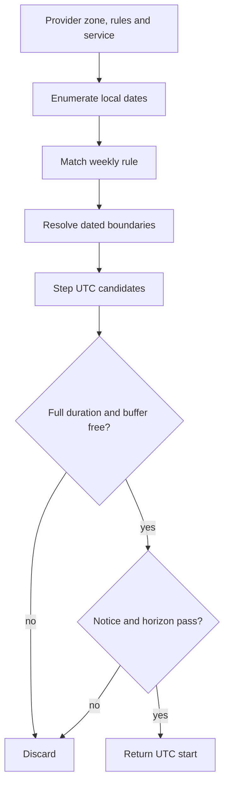

# The availability algorithm

An availability engine is a pipeline, not one clever database query. Its input combines a date range, a provider zone, local weekly rules, a service duration and buffer, dated time off, occupied claim blocks, a booking horizon and one server clock. Its output is an ordered list of UTC start instants. Each stage should have a narrow job, because a slot can disappear for several different reasons. If all of those reasons are buried in one loop, a failed clock-change test gives you no clue which boundary was wrong.

Use seven stages. Validate the provider, service and requested range. Enumerate the local calendar dates in the provider's zone. Select rules whose weekday and effective range include each date. Resolve each rule's local start and end to UTC instants. Step from the UTC start on the 15-minute grid. Reject any candidate whose full occupied interval meets time off or a claimed block. Finally, reject starts that fail notice or horizon, sort and deduplicate the remaining UTC ISO strings. The API may then format a label for a viewer, but the engine's result remains UTC.

The pipeline draws a hard line between calendar arithmetic and elapsed-time arithmetic. Add days to a local date to find the next Monday. Do not add 24 hours to a UTC instant and assume it remains the same local hour. Once a dated local window has been resolved, add absolute minutes to its UTC start to enumerate candidate instants. On a clock-change night the local clock can skip or repeat an hour while UTC keeps a single order. The boundary converter from Module 5 rejects a nonexistent or ambiguous local boundary; the engine must not silently publish a partial window when one endpoint fails.

<TraceRequest title="A Monday tutor rule becomes a client offer">
  <TraceStep actor="Rule" label="Monday 09:00 to 12:00" detail="Provider IANA zone and effective dates" />
  <TraceStep actor="Engine" label="Choose the dated Monday" detail="Resolve both local boundaries to UTC" />
  <TraceStep actor="Engine" label="Step UTC starts" detail="Every 15 minutes, while occupied interval fits" />
  <TraceStep actor="Filter" label="Remove blocked candidates" detail="Time off, claims, notice and horizon" />
  <TraceStep actor="API" label="Return UTC ISO starts" detail="Client formats one chosen start in their own zone" />
</TraceRequest>

## Bound the request before doing work

The public route accepts a provider ID, service ID and optional start date. It should allow at most seven local dates and cap the number of rules and starts it will evaluate. A malicious or buggy client must not ask for ten years of quarter-hour candidates. Reject an invalid date string rather than letting `Date` guess a zone. The requested start date is a calendar date in the provider zone, not a browser-local timestamp. The route checks that the selected service belongs to this provider and is active. A provider's private TimeOff reason and other clients' booking details remain behind the adapter.

Make the engine inputs explicit enough for a pure test: `zone`, `dates`, `rules`, `timeOff`, `claimedBlocks`, `durationMinutes`, `bufferMinutes`, `noticeMinutes`, `horizonDays` and `nowUtc`. The database adapter can load those arrays; the planner should not call `Date.now()` or Mongoose by itself. A fake clock may produce `nowUtc`, and tests can supply tiny arrays. This separation allows the same planner to run against a seeded database response and against a fixture with no database at all.

## Convert a whole local window

For each matched rule, construct local start fields and local end fields on the same provider date. Module 13 rejects an end that is not later than the start for this first version, so overnight rules are not accepted. Pass each boundary to `localToUtc` and parse the returned UTC ISO string. If the end instant is not after the start instant, skip that occurrence and report a provider-facing rule error. The public response should not expose a speculative start from an invalid occurrence. The conversion must use the provider's IANA zone, not the client's and not a numeric offset saved last week.

An ordinary Monday 09:00 to 12:00 rule may resolve to different UTC hours on two dates. The local hours remain 09:00 to 12:00. That is the provider's intention. The engine stores neither version as a permanent weekly UTC schedule. A paid Booking still stores its specific UTC start and end. The two types of record are allowed to diverge when a rule changes or time-zone data is updated; the paid appointment is a separate contract.

## Fit the full occupied interval

Suppose the window resolves to 08:00 through 11:00 UTC and the service lasts 60 minutes with 15 minutes of buffer. A candidate at 09:45 occupies `[09:45, 11:00)` and fits exactly. A candidate at 10:00 ends at 11:15 and must be rejected even though its client-facing session would end at 11:00. The buffer is provider time too. Tests should assert both sides of that boundary. If a TimeOff interval begins at 10:30, the 09:45 candidate intersects it. If a claim occupies block 10:00, every candidate whose block set includes 10:00 is unavailable.

Use half-open intervals `[start, end)`. They permit one appointment to end at exactly the next start when no buffer remains. For intervals A and B, overlap is `A.start < B.end && B.start < A.end`. Do not use inclusive comparisons at both ends or you will remove a legitimate adjacent start. Claim blocks are generated for every 15-minute start strictly before the occupied end. This one convention must appear in the pure helper, the time-off check and the later claim writer.

The database adapter should fetch all time-off intervals that may intersect the requested windows with one range query, and all SlotClaims in one block range query. A claim query limited to candidate starts is too narrow. A 10:45 candidate with a 75-minute occupied interval may need the 11:45 block beyond the last start shown. Compute the widest occupied end first, or conservatively query through the final window end. Filter the returned claims in memory with a set of provider/block keys. A single range read prevents one database round trip for every candidate.

## Notice and horizon are about the server clock

The minimum notice boundary is `nowUtc + noticeMinutes`. In this course, a start at the exact boundary is not offered, so compare with `>` rather than `>=`. The horizon boundary is a product policy measured from `nowUtc`, with a documented inclusive or exclusive edge. For this implementation, use an exclusive upper bound: a start must be strictly before `nowUtc + horizonDays` in absolute time. Decide separately how the seven provider-local dates shown on the page are chosen. These two caps answer different questions: the route's seven-day view prevents a huge response, while the booking horizon prevents a provider from selling too far ahead.

If the client sees a start one second before another request claims it, the read response can be stale. Return a server timestamp for the display and tell the client to refresh after a 409 from checkout. Do not put a "reserved" flag in the response unless an actual hold exists. The engine filters the claims that were visible to its read; it cannot promise no new claim will be written before checkout. That is why the unique SlotClaim index and transaction remain central.

Before coding, calculate one path by hand. Choose a 09:00 to 11:00 UTC window, a 60-minute service and 15-minute buffer. Candidate 09:00 needs blocks 09:00 through 10:00. Candidate 09:15 needs 09:15 through 10:15. Put one TimeOff interval at 10:30 to 11:00. Both of those early candidates remain possible with respect to that exception; 09:30 needs a 10:30 block and fails. Then put a claim at 09:45. Both 09:00 and 09:15 now fail. The resulting set is evidence that the filter checks all occupied blocks and both kinds of blocker.

Keep the calculation in `docs/availability-decisions.md` with your chosen notice and horizon boundaries. The next lesson lets you place occupied blocks on a grid. If its visible decision disagrees with your hand calculation, stop before wiring a route. A disagreement at this stage is cheaper than a double booking after payment.

References: [Luxon DateTime documentation](https://moment.github.io/luxon/api-docs/index.html), [MongoDB read operations](https://www.mongodb.com/docs/manual/tutorial/query-documents/) and [unique compound indexes](https://www.mongodb.com/docs/manual/core/index-unique/).
