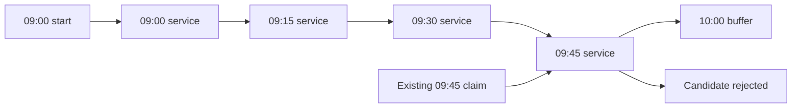

# See the blocks behind a slot

The availability engine returns start times, but a start time alone does not describe all the provider time the service occupies. A 60-minute language lesson at 09:00 with a 15-minute cleanup buffer occupies `[09:00, 10:15)` in UTC. On SkillSlot's 15-minute grid, it needs five block starts: 09:00, 09:15, 09:30, 09:45 and 10:00. A rival appointment with a claim at any one of those starts makes the 09:00 candidate unavailable. This lesson lets you move the requested start and see the entire block set rather than guessing from a calendar label.

The grid shows one provider's 09:00 to 11:30 UTC window. Start with the 09:00 candidate and an existing 09:45 claim. Predict the outcome before touching a control. The requested service includes the 09:45 block, so the candidate collides. The fact that its `startAt` is not 09:45 is irrelevant. A database query that asks only whether the 09:00 key is empty would return the wrong answer. The engine must expand the full service and buffer interval into every block it would need.

The 10:00 block is easy to miss. The client-facing lesson ends at 10:00, but the provider's cleanup buffer occupies the next fifteen minutes. A second client asking for 10:00 would overlap that provider time. By contrast, a start at 10:15 may be adjacent to the first occupied interval if its own rule window permits it. The interval is half open: 10:15 is the end boundary, not another block claimed by the 09:00 appointment.

<InteractiveCanvas slug="skill-slot-block-claims" />

## Run three controlled changes

First, leave the existing 09:45 claim on and move the requested start to 10:00. The new service needs 10:00, 10:15, 10:30, 10:45 and 11:00. The old 09:45 claim lies outside that set, so the candidate fits the visible claims. The important phrase is "visible claims." A concurrent checkout can insert a new 10:30 claim after the canvas or API read. This display is a calculation, not a reserved hold. The checkout route must revalidate and insert the required set using a transaction and the unique index.

Second, turn on the 10:30 existing claim while keeping the 10:00 start. The candidate now collides. Identify the exact shared key rather than answering that the calendar looks busy. If you were writing a test, you would expect the 10:30 claim to be in both the candidate's needed set and the existing set. You would also expect the engine to omit 10:00 from the offers while leaving a candidate that does not need 10:30, if one fits the rule window.

Third, turn both existing claims off and move the requested start to 10:15. The occupied interval ends at 11:30, exactly at the provider window boundary. Its last claim starts at 11:15. That candidate fits; a 10:30 start would end at 11:45 and must not be offered. The canvas bounds its start slider accordingly. In the real engine, a conditional `candidateStart + duration + buffer <= windowEnd` implements the same rule. Do not subtract the buffer only after you have already published the start.

## Use the grid as a test oracle

Write a table in `docs/availability-decisions.md` with columns `startAt`, `occupiedEnd`, `neededBlocks`, `existingBlocks` and `result`. Fill one row for each of the three changes. Use UTC ISO strings or clearly labelled UTC times. The table is a small oracle for the helper you will write in lesson 15.8. If your code says the default 09:00 candidate fits, compare its generated set to the five blocks above. If it generates only four, it probably omitted the buffer. If it generates six, it may have included the exclusive end boundary.

Do not create a SlotClaim document for every display candidate. The grid's blue service and buffer tiles are proposed occupied time. Only the existing claim tile represents a durable reservation in this model. The later checkout transaction inserts the candidate's blocks after revalidating current state. A list of colored cells in the browser has no authority to decide who paid for an appointment. This distinction is why the canvas deliberately labels its result a candidate fit rather than a booking confirmation.

The MongoDB uniqueness rule is per scalar key. A unique compound index on `providerId` and `blockStartAt` prevents two documents for the same provider and block start. It does not automatically understand that 09:00 to 10:15 overlaps 09:45 to 10:30. Our block-expansion function creates common keys when those intervals overlap on the agreed grid. That is a product design and an application invariant. If one route uses 15-minute blocks and another uses 30-minute blocks, the unique index cannot repair the inconsistency.

Test the boundary with a different provider. An existing 09:45 claim for Provider A should not block Provider B at 09:00. The compound key includes the provider. A client can book two different instructors at the same UTC time if the product allows it; the exclusive resource is each provider's time. If group sessions are introduced, this single-claim model would need an explicit capacity design. Do not quietly remove the provider key to make all appointments globally unique.

Now test a 45-minute service with a 15-minute buffer on paper. A 09:00 start needs 09:00, 09:15, 09:30 and 09:45. A start at 10:00 needs 10:00 through 10:45. Those sets do not overlap. The canvas fixes its service at 60 minutes so you can see one rule clearly, but the helper in the engine receives duration and buffer as inputs. Its tests must cover other whole-block values. The same helper should be used to filter offers and to create claims in checkout. If two copies of the algorithm drift, the system can display a candidate it cannot safely hold.

Before leaving the lesson, answer this transfer question without looking at the diagram: A 60-minute service begins at 09:30 and has a 30-minute buffer. Which block starts are needed, and does a claim at 10:45 collide? The occupied interval is `[09:30, 11:00)`, so the required starts are 09:30, 09:45, 10:00, 10:15, 10:30 and 10:45. Yes, the 10:45 claim collides even though the client session ended at 10:30. If your answer stopped at 10:15, you counted neither the whole service nor the buffer correctly.

The following quiz checks the distinction between a display candidate and a database hold. The build lessons then implement the two halves of this view: generating candidate starts from dated local rules and filtering them against all occupied blocks. Keep the three-row table nearby. It is more useful than a screenshot because you can compare it directly with a test failure.

## Transfer the grid to a provider with two windows

Imagine the same provider works 09:00 to 11:30 and 14:00 to 16:00 on one date. The first window's last 60-minute service with a 15-minute buffer can begin at 10:15. A service at 11:15 would end at 12:30, outside that rule even if the provider has no existing claims. The afternoon window is a separate dated range; do not bridge the lunch gap by stepping from 11:30 to 14:00 and offering a start that straddles both. Generate candidates within each resolved window, then combine and deduplicate the starts.

Now put a TimeOff interval at 10:00 to 10:30. A 09:00 start is removed because its occupied set includes the 10:00 block. A 10:30 start would be clear of that exception but still fail the morning window because its occupied end is 11:45. The reasons are different. The canvas isolates claim collisions, while the full engine must apply the window fit, TimeOff, claims and notice filters in that order. Keeping the reasons distinct makes a failing test actionable.

The grid also shows why a 15-minute buffer cannot be represented by a label such as "cleanup after class" alone. If the provider gives that time to one client session, another client cannot buy it. The occupied interval drives both display filtering and database claims. Document the buffer with the service's duration and include it in every endpoint that calculates availability. If a provider edits the buffer later, old paid bookings keep the terms they were sold under; the engine uses the current Service for new offers.

Reference: [MongoDB unique compound index behavior](https://www.mongodb.com/docs/manual/core/index-unique/).
