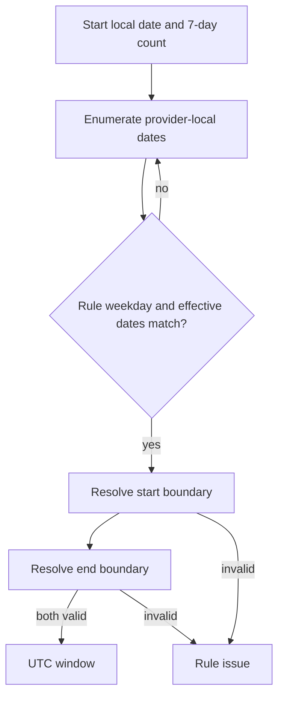

# Expand rules into dated windows

The provider saved a weekly rule, not seven UTC intervals. The engine's first build step is to create a dated occurrence for each matching local day. Write this step as a pure function in `server/src/modules/availability/engine.js`. It receives rules, a provider zone and an explicit `startDate` such as `2024-03-10`; it returns windows with UTC millisecond boundaries and a list of rule occurrences that could not be resolved. Do not read MongoDB or the current clock here. The function's job is calendar expansion, which is already complex enough to test alone.

Use the `localToUtc` helper from Module 5 for both boundaries. That helper rejects a nonexistent or repeated local time instead of silently picking an instant. A weekly rule can be valid on most Sundays but have an ambiguous or skipped endpoint on one dated Sunday. The engine must omit that occurrence and report its date and rule ID for the provider dashboard. It must not send a client a half-window with a guessed end. The next module gate will test a historical transition date and confirm the provider-facing issue is visible.



The important detail is that `plus({ days: 1 })` is applied to a calendar date in the provider zone. Adding `86_400_000` milliseconds to a UTC start is not the same operation around a clock change. Luxon can enumerate local dates with a named zone. The code below keeps each rule's local `HH:mm` fields and parses them only after it has chosen a date.

## Write a strict rule-expander

Use the rule fields agreed in Module 6: `id`, ISO weekday from 1 to 7, `startLocal`, `endLocal`, `effectiveFrom`, optional `effectiveTo`, and `active`. If your Mongoose schema uses `_id` instead of `id`, map it once in the repository adapter. Do not scatter both shapes through the pure planner. Module 13 should reject overnight rules for this first version, so `endLocal` must be later on the same local date. The helper below throws on malformed rule fields rather than treating them as an empty calendar.

```js
import { DateTime } from 'luxon';
import { localToUtc } from '../../shared/time.js';

function parts(hhmm) {
  const match = /^(\d{2}):(\d{2})$/.exec(hhmm);
  if (!match) throw new Error('Rule time must be HH:mm');
  const hour = Number(match[1]);
  const minute = Number(match[2]);
  if (hour > 23 || minute > 59) throw new Error('Rule time is outside a day');
  return { hour, minute };
}

function localBoundary(date, hhmm, zone) {
  const { hour, minute } = parts(hhmm);
  return Date.parse(localToUtc({
    year: date.year, month: date.month, day: date.day,
    hour, minute, zone,
  }));
}

export function expandWindows({ startDate, days, zone, rules }) {
  if (!Number.isInteger(days) || days < 1 || days > 7) throw new Error('Expected 1 to 7 days');
  const first = DateTime.fromISO(startDate, { zone }).startOf('day');
  if (!first.isValid || first.toISODate() !== startDate) throw new Error('Invalid provider-local startDate');
  const windows = [];
  const issues = [];
  for (let offset = 0; offset < days; offset += 1) {
    const date = first.plus({ days: offset });
    const dateKey = date.toISODate();
    for (const rule of rules) {
      if (!rule.active || rule.weekday !== date.weekday) continue;
      if (dateKey < rule.effectiveFrom || (rule.effectiveTo && dateKey > rule.effectiveTo)) continue;
      if (rule.timeZone !== zone) {
        issues.push({ ruleId: rule.id, localDate: dateKey, code: 'RULE_ZONE_MISMATCH' });
        continue;
      }
      try {
        const startMs = localBoundary(date, rule.startLocal, zone);
        const endMs = localBoundary(date, rule.endLocal, zone);
        if (!Number.isFinite(startMs) || !Number.isFinite(endMs) || endMs <= startMs) throw new Error('Invalid dated rule interval');
        windows.push({ ruleId: rule.id, localDate: dateKey, startMs, endMs });
      } catch (error) {
        if (error?.name !== 'TimeInputError' && error?.message !== 'Invalid dated rule interval') throw error;
        issues.push({ ruleId: rule.id, localDate: dateKey, code: error.code ?? 'INVALID_RULE_WINDOW' });
      }
    }
  }
  return { windows, issues };
}
```

Keep the `parts` validation consistent with the editor's quarter-hour rule. This snippet validates the clock shape, while the rule API from Module 13 should ensure boundaries lie on the chosen 15-minute grid. If older seed data contains 09:07, the expander should not hide it. Decide whether to reject it at the adapter boundary and report a rule issue. Do not round a provider's saved time without telling them. Later claim math assumes aligned candidate starts.

The rule's saved `timeZone` must match the Provider working zone passed into this first-version planner. A provider-zone change requires review and republishing of active rules, as Module 6 records. A mismatched old rule becomes a provider-facing `RULE_ZONE_MISMATCH` issue rather than being silently reinterpreted under the new zone. If a later product chooses multiple working zones per provider, this contract must change deliberately, with each rule carrying its own zone and a route that knows which zone defines the requested local dates.

The catch is intentionally narrow. A `TimeInputError` from the converter or an interval whose end does not follow its start becomes a dated rule issue. A programming error, missing import or database problem should still fail loudly. An unconditional `catch { continue; }` would make a broken engine look like a provider with no hours. That is a dangerous false answer when clients are trying to book a service.

## Test one ordinary date and two transition dates

Create `server/src/modules/availability/engine.test.js` with Node's `node:test` and `node:assert/strict`, matching Module 5. Start with a Berlin Monday 09:00 to 12:00 rule on two March dates around the historical 2024 spring transition. Both occurrences should keep `09:00` in Berlin when formatted back, but their UTC start hours should differ. Assert the exact UTC values only after checking the installed runtime's zone data, and record the Node/Luxon versions. A test that only checks two windows exist would not detect a fixed-UTC-week bug.

For a window whose start and end are individually unambiguous but span a clock change, use a historical New York Sunday from 01:00 to 04:00 on 2024-03-10. Its UTC boundaries are 06:00 and 08:00, two elapsed hours even though the wall labels cover three clock hours. A fall example from 00:00 to 03:00 on 2024-11-03 spans four elapsed UTC hours. Those examples prove you are converting each endpoint and letting elapsed time emerge, rather than subtracting local clock labels.

Add a rule starting at New York 02:30 on 2024-03-10 and expect one issue with no window. The local boundary does not exist. Add an autumn rule starting at 01:30 on 2024-11-03 and expect the ambiguity policy from Module 5 to reject that occurrence. Do not generalize from those US dates to future Gaza dates; time-zone rules are political data that can change. The engine will query its runtime's IANA data for each real future occurrence.

Finish by logging one example result: `localDate`, `ruleId`, `startMs` formatted as UTC ISO, and `endMs` formatted as UTC ISO. Show the issue list separately. The public availability route will return only valid UTC starts, while the provider dashboard can show the issue. Commit the pure expander and tests before adding candidate stepping. This creates a known-good boundary for the next lesson.

The later reference build must connect the helper to the actual M13 rule model. If its field names differ, write an adapter mapping and test it with a seed document. Do not create a second competing AvailabilityRule schema just to make this snippet compile. This module builds the planner; it does not replace the earlier data-model decisions.

## Check the effective-date edge separately

Make a rule effective from 2024-03-10 through 2024-03-17 and ask for seven days beginning 2024-03-08. The rule should appear only on matching weekdays inside the inclusive effective range. Ask for the next week and verify it stops after the final date. A common error compares the server's UTC date to the provider's local effective date. Around midnight those can differ. The rule's effective fields are provider-local calendar dates, so compare them to `dateKey` from the zone-aware enumeration, not to `new Date().toISOString().slice(0, 10)`.

Then deactivate the rule and assert no windows appear even if its dates and weekday match. Add another active rule for a different weekday and make sure it is not selected by a matching UTC weekday in another zone. `date.weekday` belongs to the provider-local date you are visiting. If a test uses only one zone on a midday date, it may never reveal this error. Choose a boundary near midnight and record both UTC and provider-local dates in the failure message.

## Decide how a provider learns about a bad occurrence

The public route should omit a dated window whose endpoint is skipped or repeated. An empty public list alone is not enough feedback for the provider. Add a provider dashboard notice containing the rule ID, local date and a stable error code. Do not put a guessed UTC time in the notice. The provider can edit that day's exception or move the boundary to a valid local time. A support log can add the runtime time-zone data version, but it should not include a client's private information.

Test that an unexpected exception is not converted to a rule issue. For example, temporarily make `localToUtc` undefined in a test harness. The expander should throw, not return seven days with no openings. Restore the import after confirming the test catches the defect. This mutation protects the narrow catch block. It is possible for a system to look healthy while every rule fails internally; distinguishing invalid provider input from broken code keeps that failure visible.

Finally, compare two ways to represent the weekly intention. A stored fixed offset says "always UTC+2" and loses the named zone's future rules. A stored IANA zone with local fields says "09:00 according to this provider's civil clock on each date." The second is the product promise. Write that sentence beside the schema mapping so a future migration does not replace `zone` with a current offset to save one field.

References: [Luxon DateTime calendar methods](https://moment.github.io/luxon/api-docs/index.html) and [MDN's historical gap and overlap examples](https://developer.mozilla.org/en-US/docs/Web/JavaScript/Reference/Global_Objects/Temporal/ZonedDateTime).
