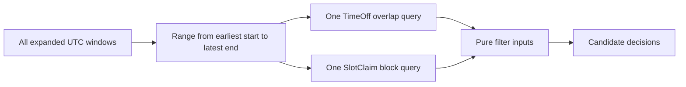

# Load time off and claims once

You can now generate UTC candidates from weekly rules. Before offering them, load the dated facts that block them. A provider may have TimeOff for an afternoon or for a whole day, and paid or held bookings own SlotClaim blocks. The naive implementation queries MongoDB once for each candidate. A seven-day range with four providers and dozens of quarter-hour starts would create many unnecessary round trips. This lesson makes one bounded read for TimeOff and one for SlotClaim for the selected provider and full window range.

The query boundary must include every block a candidate could need, including its cleanup buffer. If the last candidate starts at 16:45 and occupies until 18:00, querying claims only through 16:45 can miss a 17:30 conflict. The simplest safe interval is from the earliest expanded window start to the latest expanded window end. Candidates never extend beyond their window end, so every needed block lies inside that interval. For time off, query any exception that intersects the same range. A TimeOff that started before the first window but ends inside it must be included.



The adapter can use your Module 6 Mongoose models. Keep its file separate from `engine.js`, for example `server/src/modules/availability/availability.repository.js`. The engine should receive plain objects so unit tests do not need a database. Use the provider ID in every query. This is both a performance filter and a data isolation boundary. A claim for another tutor at 09:15 must not erase this tutor's 09:15 offer.

## Write the range adapter

Map the exact model import paths to your existing M6 files. The example below assumes `TimeOff` has `startAt` and `endAt` UTC Date fields and `SlotClaim` has a scalar `blockStartAt` Date. Do not create duplicate models if your files have another name. Normalize the returned values at this adapter so the pure engine can use numbers and sets.

```js
// availability.repository.js
import { TimeOff } from '../time-off/time-off.model.js';
import { SlotClaim } from '../bookings/slot-claim.model.js';

export async function loadBlockers({ providerId, fromMs, toMs }) {
  if (!Number.isFinite(fromMs) || !Number.isFinite(toMs) || toMs <= fromMs) {
    throw new Error('Invalid availability read range');
  }
  const [timeOffDocs, claimDocs] = await Promise.all([
    TimeOff.find({
      providerId,
      startAt: { $lt: new Date(toMs) },
      endAt: { $gt: new Date(fromMs) },
      status: 'active',
    }).select('startAt endAt').lean(),
    SlotClaim.find({
      providerId,
      blockStartAt: { $gte: new Date(fromMs), $lt: new Date(toMs) },
    }).select('blockStartAt').lean(),
  ]);
  return {
    timeOff: timeOffDocs.map((item) => ({ startMs: item.startAt.getTime(), endMs: item.endAt.getTime() })),
    claimedBlocks: new Set(claimDocs.map((item) => item.blockStartAt.getTime())),
  };
}
```

Check the M6 TimeOff schema before copying `status: 'active'`. If the earlier model represents deletion or closure differently, use the actual active predicate and add a test. The query must not include inactive exceptions as blockers, but it also must not ignore a real blocked interval because of a guessed field name. The SlotClaim query treats a document as occupying its key. An expired hold's claims must be deliberately released by the expiry workflow; a timestamp saying it should have expired does not make a unique index entry vanish. Do not filter claims by an expiry date in this read while the claim document still exists and can block checkout.

The interval condition for TimeOff is half-open overlap: `startAt < to` and `endAt > from`. A TimeOff ending exactly when the query range begins does not overlap. A TimeOff beginning exactly when the range ends does not overlap. These same strict inequalities will be used against each candidate occupied interval. The provider's private reason field is not selected. The public engine only needs the interval. A route response should not reveal whether a candidate vanished because of a holiday, illness or another client's booking.

## Prove it is a bounded read

Add a repository test with a scratch database or a stub that records calls. Create TimeOff from 08:30 to 09:30, one from 11:30 to 12:00, and one for another provider from 09:00 to 10:00. Query 09:00 to 11:30 for the selected provider. The first must be returned despite beginning before the query. The second must not be returned because it starts at the exclusive end. The other provider must not be returned. Add a claim at 11:15 and verify it is returned when the latest window ends 11:30. A query that ends at the last candidate start would miss it.

Count calls as well as results. The engine should call `TimeOff.find` once and `SlotClaim.find` once for the whole seven-day request, not inside a loop over starts. If your Mongoose layer already batches reads through a repository abstraction, instrument that boundary rather than mocking every Mongoose method. The test should fail if someone later moves the read back into `candidateStarts`.

For a large provider schedule, one range query may still return many claims. Give the seven-day route a maximum and use indexes supporting `providerId` plus `blockStartAt`, and `providerId` plus the TimeOff range fields. The unique compound SlotClaim index already provides a useful lookup prefix. Confirm with `explain` on representative seeded data before claiming performance. Do not present a small local test as proof of production latency. This module's target is a bounded query shape, not a benchmark number.

## Keep the read advisory

The adapter returns a snapshot of blockers visible at read time. Another checkout can insert a claim after the query. That does not make the engine useless: it gives the client a current list and avoids offering obviously occupied time. It does mean the checkout path must attempt the full claim set under the unique index. After a 409, the client fetches a fresh list. A read followed by a button click is not a transaction across the user's thinking time.

The adapter also should not query Booking documents as a second occupancy source unless your data model has a clearly defined migration or repair need. The M3 design says live SlotClaims are the exclusive occupancy keys. Keeping a separate Booking overlap query as an alternate truth source creates disagreement after cancellation or expiry. If a Booking and its claims disagree, file a consistency defect and repair the state; do not silently pick whichever result makes a slot available.

Write the query range and its two boundary cases in `docs/availability-decisions.md`. Run the repository test on the same replica-set setup used for transaction smoke tests. Then pass the normalized `timeOff` and `claimedBlocks` into the pure planner. The next lesson tests every candidate against those arrays and keys. Keep the adapter small enough that a reviewer can verify its provider scope and range predicates in one screen.

References: [MongoDB query documents](https://www.mongodb.com/docs/manual/tutorial/query-documents/) and [Mongoose lean queries](https://mongoosejs.com/docs/tutorials/lean.html).

## Check the database type boundary

Mongoose documents may expose `Date` values, while a test stub may pass ISO strings. Do not let that inconsistency reach the engine. In the adapter, assert that each selected `startAt`, `endAt` and `blockStartAt` is a valid Date before calling `getTime()`. If a corrupt record has an invalid date, fail the request and log the record ID for repair. Turning it into `NaN` would make comparisons silently false and could show a candidate that should be blocked.

For claims, check that every `blockStartAt` is aligned to the 15-minute UTC grid. A misaligned claim cannot be matched by the pure engine's generated keys. It is a data-integrity defect, not a reason to round it to the nearest block while serving a request. Add a repository test with one deliberately corrupt claim and assert that the adapter reports an error. The checkout writer should prevent such a document, but the read path must not quietly treat old corrupt data as free time.

Consider a TimeOff that crosses midnight in the provider zone. Because the adapter reads resolved UTC instants, its overlap query does not need a special midnight branch. It needs only `startAt < to` and `endAt > from`. A separate provider calendar view can format those instants back into local date labels. This is a reason to normalize dated exceptions at write time: the availability filter should not reinterpret a human's wall-time input on every read.

Finally, verify the response is not tied to query result order. Reverse the arrays returned by a stub adapter and run the pure planner again. The UTC start list should be identical. TimeOff is a set of blocking intervals and claims are a set of occupied keys; neither should depend on which document MongoDB happened to return first. This test catches an accidental early return after the first blocker or a planner that mutates its inputs.
