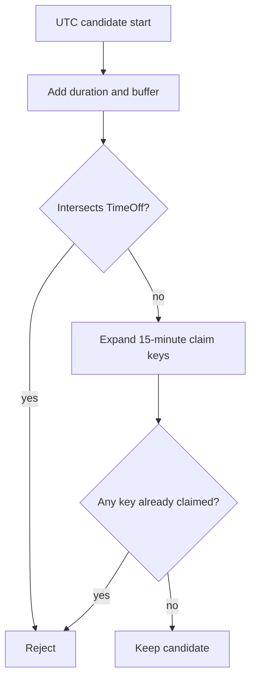

# Fit the full service and buffer

The engine has candidate starts and a set of blockers. Now decide which candidates are free for the selected service. For each start, calculate the occupied interval through `durationMinutes + bufferMinutes`. Check half-open interval overlap with every relevant TimeOff record. Generate every 15-minute block start inside the interval and reject the candidate if any key is in the claimed set. This is the same block expansion that checkout will use when it writes SlotClaim documents. Keep it exported and tested, so the two paths can share one implementation instead of maintaining matching copies by memory.

Use numbers for UTC milliseconds inside the pure planner. The database adapter has already converted Date fields to numbers. The API will convert accepted starts to ISO strings. This avoids comparing ISO strings with local labels or repeatedly constructing Date objects for each claim. The values are instants; their display in a provider or client zone happens after the decision.



## Implement one block-expansion helper

Add the following code beside `candidateStarts` in `engine.js`, reusing its `BLOCK_MS` constant rather than declaring it again. An invalid or off-grid start is a programming error here. The public route never passes raw browser starts into this helper. The rule expander and stepper have already produced aligned candidates. Checkout should call the same helper only after validating its requested UTC start. Rounding at this boundary would let a request for 09:07 reserve 09:00 without the client's consent.

```js
export function blocksFor(startMs, durationMinutes, bufferMinutes) {
  if (!Number.isSafeInteger(startMs) || startMs % BLOCK_MS !== 0) throw new Error('Off-grid start');
  if (!Number.isInteger(durationMinutes) || durationMinutes <= 0 || durationMinutes % 15 !== 0) throw new Error('Invalid duration');
  if (!Number.isInteger(bufferMinutes) || bufferMinutes < 0 || bufferMinutes % 15 !== 0) throw new Error('Invalid buffer');
  const endMs = startMs + (durationMinutes + bufferMinutes) * 60_000;
  const blocks = [];
  for (let at = startMs; at < endMs; at += BLOCK_MS) blocks.push(at);
  return { endMs, blocks };
}

export function overlaps(aStart, aEnd, bStart, bEnd) {
  return aStart < bEnd && bStart < aEnd;
}

export function candidateIsFree(startMs, service, timeOff, claimedBlocks) {
  const { endMs, blocks } = blocksFor(startMs, service.durationMinutes, service.bufferMinutes);
  if (timeOff.some((item) => overlaps(startMs, endMs, item.startMs, item.endMs))) return false;
  return blocks.every((at) => !claimedBlocks.has(at));
}
```

The two validation functions in 15.6 and 15.8 can be refactored to share a private `assertBlockMinutes` helper. What matters is that neither path silently accepts a fractional block. Do not leave two inconsistent block sizes in production. Define one `BLOCK_MINUTES` constant imported by both candidate stepping and `blocksFor`, and let checkout import the exported helper. A model test should compare the engine's `blocksFor(09:00, 60, 15)` result to the keys the checkout writer attempts.

The `overlaps` formula permits adjacent intervals. TimeOff `[10:15, 11:00)` does not block a candidate whose occupied interval ends at 10:15. It does block one ending at 10:30. A claim on the 10:00 block affects every candidate whose own occupied set includes 10:00. The helper asks about all blocks, including a provider buffer. Checking only `Booking.startAt` or only a candidate's first block will miss real overlaps.

## Write cases that expose a weak filter

Test a 09:00 to 10:15 occupied interval with TimeOff starting at 10:00. It must fail even though the client-facing session ends at 10:00, because the provider's buffer intersects the exception. Move TimeOff to 10:15 and it should pass. Now remove TimeOff and add a claim at 10:00. It must fail. Move the claim to 10:15 and it should pass. These four cases isolate the two blocker mechanisms and the exclusive end boundary.

Add a service with a 45-minute duration and 30-minute buffer. It still needs five blocks. Then use a 60-minute service with no buffer; it needs four. A helper hard-coded for the canvas's 60-plus-15 case would fail one of these. The module's product constraint is whole 15-minute increments, not one fixed service size. A 20-minute service should be rejected at service creation in M12 and at this defensive helper if corrupt data reaches it.

Test a fully booked day. Populate the claimed set with every block in a window and assert that no candidate remains. Test a provider with no claims and no time off: the filter should preserve every candidate that already fits the rule window. These ends of the range catch filters that accidentally invert the predicate or mutate the shared set while iterating.

For time off, test an exception crossing two rule windows. A provider might work 09:00 to 12:00 and 14:00 to 17:00 while TimeOff spans 11:00 to 15:00. The same interval should remove the last morning candidates whose buffer enters it and the early afternoon candidates whose service intersects it. The adapter fetched the exception once; the pure filter applies it to each candidate. Do not clip the TimeOff record to one rule window and lose its effect on the other.

## Remember what this filter cannot guarantee

Suppose the client receives the 10:00 offer at 09:01. Another client pays at 09:02 and takes its 10:15 block. The engine was correct at the moment it read claims, but the display is stale now. Module 19 must call `blocksFor` again, insert every block in a transaction, and map a duplicate-key conflict to 409. The filter improves the offered list; it is not a reservation. Keep this limit in the code comment and response documentation so nobody later treats a cache hit as a lock.

Likewise, a provider may add TimeOff after the read. The unique claim index alone does not coordinate a rule or TimeOff edit with a checkout. The product needs a version or write-boundary policy for that race, recorded in M3's open decisions. In this module, re-read the current rule and exceptions when claiming and never rely solely on an old public response. The exact coordinated write is part of the checkout reference build, not a property of `candidateIsFree`.

Commit the helper with tests and one text transcript showing the 09:00 five-block set, the 10:00 claim conflict, and the 10:15 adjacent pass. A mentor should be able to inspect that transcript and see the half-open convention. The following lesson adds notice and horizon, two filters driven by the server's current instant rather than provider exceptions.

Reference: [MongoDB unique compound indexes](https://www.mongodb.com/docs/manual/core/index-unique/).

## Apply the filter to a real-looking morning

Take a provider rule that resolves to 08:00 through 11:00 UTC. The selected service lasts 60 minutes and requires a 15-minute buffer. Without blockers, starts from 08:00 through 09:45 fit. Now add TimeOff from 09:30 to 10:00. The 08:00 candidate occupies through 09:15 and survives. The 08:15 candidate occupies through 09:30 and also survives because the two half-open intervals touch. The 08:30 candidate occupies through 09:45 and intersects TimeOff, so it fails. This sequence tests the exact boundary instead of only an obvious middle overlap.

Next, keep the TimeOff and add a claim at 08:45. The 08:00 candidate's needed blocks include 08:45, so it now fails even though it did not touch TimeOff. The 08:15 candidate also needs 08:45 and fails. A 10:00 candidate begins after TimeOff but needs to fit through 11:15, past the rule end, so it was never a candidate. The resulting list can be empty for three different reasons. Keep one test assertion for each reason so a future failure does not invite a blanket change to the loop condition.

Write the expected block sets next to this fixture. For 08:15, they are 08:15, 08:30, 08:45, 09:00 and 09:15. For 08:30, they are 08:30 through 09:30. The latter includes the first TimeOff block, but overlap is checked as an interval and does not require TimeOff itself to be grid-aligned. A provider might block 09:37 to 09:52; the interval formula still removes any occupied service interval that intersects it. Claims need grid keys, while TimeOff can remain an arbitrary dated interval.

Add a test with that 09:37 exception. Do not round it down or up just to fit the claim grid. An 08:30 service plus buffer ends 09:45, so it intersects 09:37 to 09:52. An 08:15 service ends 09:30, so it does not. This is why the engine uses two blocker checks rather than trying to convert every provider exception into SlotClaim documents. The product can represent time off precisely without changing the exclusive booking grid.
