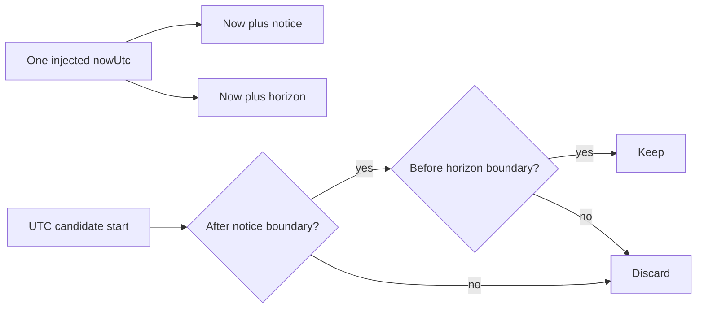

# Apply notice and booking horizon

A candidate can fit the provider's rule and avoid every claim, yet still be too soon for the provider to prepare. Another may be so far in the future that the provider has not opened bookings for that period. Minimum notice and booking horizon are product constraints. Apply them after the time and occupancy checks using a single server instant captured for the request. Do not call `new Date()` inside the candidate loop. If time advances halfway through a seven-day calculation, two adjacent starts could be judged against different versions of "now."

Module 5 introduced an injectable clock. Use it here. The route obtains `nowMs = clock.now().getTime()` once, then passes it to the pure planner. An API test supplies a fixed instant. The browser may display a countdown based on a server time offset, but its clock cannot make an otherwise ineligible slot pass the server's notice rule. A client can change a laptop clock, reload an old tab or send a handcrafted request. The server still checks its own instant again at the hold boundary.



The two comparisons have explicit edges. SkillSlot requires a start strictly later than the minimum-notice boundary, matching the exact-boundary test in Module 5. It requires a start strictly before the horizon boundary. This is a course policy, not a property of JavaScript or MongoDB. A product team could choose equality differently, but then the API, checkout, tests and UI copy must all agree. Never let one controller use `>=` while the engine uses `>`.

## Implement a pure boundary filter

Add this helper in `engine.js` and call it after you have a candidate UTC millisecond. The notice period is measured in absolute minutes. The horizon is measured in absolute days from the server instant for this first version. The seven provider-local dates requested by the route are a separate response-size bound. These two limits can overlap without being the same thing.

```js
export function passesBookingWindow(startMs, { nowMs, noticeMinutes, horizonDays }) {
  if (!Number.isSafeInteger(startMs) || !Number.isSafeInteger(nowMs)) throw new Error('Expected UTC instants');
  if (!Number.isInteger(noticeMinutes) || noticeMinutes < 0 || noticeMinutes > 30 * 24 * 60) {
    throw new Error('Invalid notice period');
  }
  if (!Number.isInteger(horizonDays) || horizonDays < 1 || horizonDays > 365) {
    throw new Error('Invalid booking horizon');
  }
  const earliest = nowMs + noticeMinutes * 60_000;
  const latest = nowMs + horizonDays * 24 * 60 * 60_000;
  return startMs > earliest && startMs < latest;
}
```

The maximum values above are defensive bounds for the pure helper; choose tighter values in provider settings if the product requires them. An invalid setting should produce a visible provider configuration error, not a public list of no slots. Do not catch all errors and return `[]`. An empty list says the engine checked valid inputs and found no offers. A bad notice setting means the data needs repair.

Use a fixed clock at `2024-01-15T08:00:00.000Z` and notice of 120 minutes. Assert a 09:59:59.999 start fails, 10:00:00.000 fails, and 10:00:00.001 passes this helper. A quarter-hour candidate grid would not produce the millisecond case in normal operation, but the unit test proves the comparison itself. With a seven-day horizon, assert the instant exactly seven elapsed days later fails and the instant one millisecond before passes. Then ensure the route's seven local dates do not accidentally promise that every instant inside the pure horizon is in its current page.

## Decide what happens across a local date boundary

The route may display the provider's next seven local calendar dates, while the horizon is an absolute elapsed-time limit. Suppose the provider is in Gaza and the client in Berlin. The client may be on a different calendar date when they request the page. The API must interpret its `startDate` in the provider zone and cap it against the server's current instant; it must not let a Berlin browser's midnight redefine the provider's week. The response returns UTC starts and the provider zone so the client can display both labels.

For a provider rule near midnight, an absolute seven-day horizon may cut through a provider-local day. That is acceptable if the product says "up to seven days from now" rather than "through the end of the seventh calendar day." Put that wording in `docs/availability-decisions.md`. If the product instead wants full provider-local days, change the horizon calculation to resolved local-day boundaries and add clock-change tests. Do not implement one interpretation in code while the UI promises the other.

An existing paid Booking is unaffected when the clock crosses a notice boundary. Notice filters new offers and new holds. It does not cancel a valid booking because it is now fewer than two hours away. This distinction is easy to lose if a route reuses the availability filter to decide whether to show an upcoming booking. The client's agenda reads Booking records. The slot picker reads computed offers.

Likewise, a pending hold created before cutoff can continue through a payment flow according to its hold-expiry policy. The engine's current offer list does not decide whether an already held booking remains valid. Module 19 must choose a state policy and enforce it. A displayed start that vanishes after one minute of notice is not proof that an existing hold should be deleted. Separate read eligibility, hold validity and payment confirmation in the state machine.

## Compose the pure planner

At this point, `expandWindows` yields UTC windows; `candidateStarts` yields aligned starts; `candidateIsFree` removes time off and claims; and `passesBookingWindow` removes starts outside notice and horizon. Write a small composition function that flat-maps windows to candidates, applies both predicates, sorts numbers and deduplicates exact instants. Return an array of UTC milliseconds and the rule issues separately. Make the provider and service adapter call that function with one captured `nowMs` and one batched blocker read.

Test the composition against an empty week, a no-blocker week and a day whose only candidate is exactly at notice. An empty week should return `starts: []` without error. The no-blocker week should return the expected ascending instants. The exact-notice day should return no start at the boundary. Include the server timestamp in the route response later, but do not let a client-supplied `now` query parameter override it.

Finally, run the test under two process `TZ` settings. The pure planner uses explicit UTC instants and provider-local expansion, so its output must not depend on the server host's default zone. If it changes, search for a `new Date('YYYY-MM-DD')` interpretation or implicit string formatting. The next lesson exposes this composed result through a public route with strict provider and service scoping.

## Keep one timestamp through the response

Use the captured `nowMs` not only for filtering but also for the response's `generatedAt`. If the route calls the clock again after calculation, it can claim a newer generation time than the instant used to decide the notice boundary. The difference is usually small, but an exact-boundary test can expose it. Passing one instant through the service makes the response honest and makes a support report reproducible.

Imagine a client receives a page at 09:59:59 UTC with a 10:15 candidate and a fifteen-minute notice policy. The candidate passes because it is strictly after 10:14:59. At 10:00:00 it is exactly at the boundary and disappears on refresh. Neither response changes a paid Booking. The lesson's test should fix the server clock on both sides of that second and assert the two outputs. A browser countdown may help the client see urgency, but checkout uses the server's current policy again.

If the provider edits their notice requirement from two hours to four hours, future offers may disappear immediately. Do not recalculate already confirmed bookings. If an active hold exists, the hold state machine decides whether it can finish payment under its original terms. This is another example of why an availability GET is a view of new purchase eligibility, not a general definition of whether every appointment in the system is valid.
