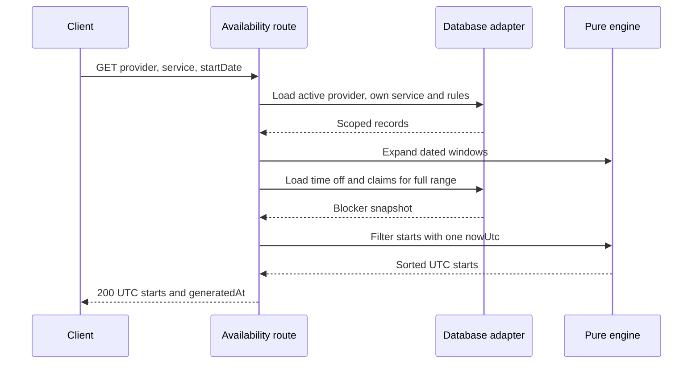

# Return the next seven days of starts

The planner is ready to sit behind an API. Add `GET /providers/:id/availability` with `serviceId` and an optional provider-local `startDate` query parameter. The response contains the provider ID, service ID, provider IANA zone, `generatedAt` in UTC and a sorted array of compact UTC start strings. It does not contain a TimeOff reason, another client's Booking, or the full weekly rule table. Public clients need choices; private calendar details stay inside the provider account.

Do not let the route decide availability by itself. Its responsibility is validation, ownership, loading a bounded data set, calling the pure planner and shaping a safe response. Use the models and auth utilities already built in Modules 6, 9, 10, 12 and 13. If those modules use different file names, adapt imports in one service file. Do not create a second Provider or Service model for this route. The route should remain small enough that a reviewer can see the provider and service scoping before the planner runs.



The sequence shows two database phases because the blocker range depends on expanded windows. Both phases are bounded. The planner can first produce windows and calculate the earliest start and latest end. The adapter then fetches TimeOff and SlotClaims once for that range. A final pure pass produces offers. If there are no windows, skip blocker reads and return an empty start list with the same response shape. That is a valid outcome, not a 404.

## Validate and scope every input

The `:id` route parameter must be a valid provider ID. The `serviceId` query parameter is required and must be a valid service ID. Reject malformed IDs before querying. Load the provider with its public/listed status and zone. Load the service with both `_id: serviceId` and `providerId: id`; then require it to be active. This combined filter prevents someone from asking Provider A's route to calculate Provider B's service against A's hours. Return 404 for unavailable public resources. A 200 with an empty list would imply the service exists but happens to have no openings, which is a different state.

The optional `startDate` is `YYYY-MM-DD` in the provider's zone. If omitted, derive today's provider-local date from the one captured server UTC instant and the provider's IANA zone. If provided, validate the exact shape and parse it in that zone. Allow only a bounded seven-date view inside the booking horizon. A browser in Berlin should not be allowed to redefine "today" for a provider in Gaza. Never accept a client-supplied `now` or `zone` as the basis for eligibility.

## Compose the engine without hidden reads

Write a service function that receives dependencies, so a route test can replace the database without changing the planner. The excerpt below shows the order and response shape. `getProvider`, `getServiceForProvider` and `getRules` are adapter functions over your existing models; `loadBlockers` is the bounded adapter from 15.7. `planStarts` composes the pure helpers from 15.5 through 15.9.

```js
export async function getAvailability({ providerId, serviceId, startDate, clock, repository }) {
  const nowMs = clock.now().getTime();
  const provider = await repository.getPublicProvider(providerId);
  if (!provider) return null;
  const service = await repository.getActiveServiceForProvider(serviceId, providerId);
  if (!service) return null;
  const localStartDate = startDate ?? repository.localDateForInstant(nowMs, provider.timeZone);
  repository.assertStartDate(localStartDate, provider.timeZone, nowMs);
  const rules = await repository.getActiveRules(providerId);
  const { windows, issues } = expandWindows({ startDate: localStartDate, days: 7, zone: provider.timeZone, rules });
  const blockers = windows.length
    ? await repository.loadBlockers({ providerId, fromMs: Math.min(...windows.map((w) => w.startMs)), toMs: Math.max(...windows.map((w) => w.endMs)) })
    : { timeOff: [], claimedBlocks: new Set() };
  const starts = planStarts({ windows, service, ...blockers, nowMs, noticeMinutes: provider.noticeMinutes, horizonDays: provider.horizonDays });
  repository.reportRuleIssues(providerId, issues);
  return {
    providerId, serviceId, providerZone: provider.timeZone,
    generatedAt: new Date(nowMs).toISOString(),
    starts: starts.map((ms) => new Date(ms).toISOString()),
  };
}
```

Import `expandWindows` and `planStarts` from `engine.js` in the actual file. Make `reportRuleIssues` a controlled provider notification or log, not a public response. Decide whether it is synchronous or a queue call; a notification failure should be observable but should not fabricate slots. The example shows its place in the flow, not a requirement to expose private rule details. `repository.assertStartDate` should throw a typed validation error that the Express error mapper turns into 422. An invalid date must not become an empty list.

Implement `planStarts` by flat-mapping each window through `candidateStarts`, applying `candidateIsFree` and `passesBookingWindow`, sorting numeric values and using a `Set` to remove duplicate instants. Cap the result count and fail visibly if corrupt rules exceed it. Do not slice silently. The response order should remain deterministic even if MongoDB returns rules in a different order. The client can then render one UTC start in Berlin, Gaza or Qatar without changing its identity.

## Add the HTTP contract

An ordinary response can be as small as:

```json
{
  "providerId": "p123",
  "serviceId": "s456",
  "providerZone": "Asia/Gaza",
  "generatedAt": "2024-01-15T08:00:00.000Z",
  "starts": ["2024-01-16T07:00:00.000Z", "2024-01-16T07:15:00.000Z"]
}
```

The example timestamps illustrate the response shape, not a current Gaza offset promise. Verify any dated local conversion against the installed IANA data before using it in a test. Add `Cache-Control: no-store` for the first version. Module 23 may introduce a short display cache with invalidation, but it must keep the advisory semantics and never let checkout trust a cached result. A response must not say "guaranteed" or "reserved" because no SlotClaims were inserted by a GET.

Return 422 for a malformed date or an unsupported query range, 404 when the public provider or scoped service does not exist, and 200 with `starts: []` for a valid provider and service with no bookable starts. If a database read fails, return a server error rather than an empty list. Those distinctions let the client show the right action: correct input, choose another provider, try another date, or retry a temporary failure. A single fallback to `[]` for every exception would conceal outages and calendar bugs.

## Verify from both sides of the API

Call the route with a seeded Gaza provider and active service. Inspect that each `starts` value ends in `Z`, is sorted and belongs to a valid provider-local rule after formatting in the provider zone. Call it with a service belonging to another provider and expect 404. Call it with an invalid date and expect 422. Add TimeOff to remove a morning and verify the public response omits those starts without exposing the TimeOff reason. Add a SlotClaim for a middle block and verify starts whose full occupied sets touch it vanish.

Record one sample response and the request parameters in `docs/availability-decisions.md`. Include the Node and Luxon versions so a mentor can reproduce the time-zone conversion. Do not put private customer identifiers into the sample. The next lesson automates this evidence across a clock-change week and a fully booked day. This route is ready when the pure planner and the HTTP boundary agree on the same UTC starts, not when it merely returns status 200.

The API still cannot promise a slot remains free until payment. State that in the client copy and in the route comment. A new claim can appear between this GET and checkout. The later checkout must recalculate the needed block set and attempt the unique inserts under a transaction. A 409 there is a normal outcome of two people choosing the same time, even if both saw this response.

## Trace one request through the adapter

Use a seven-day request beginning on a provider-local Monday. Log a trace ID, the provider ID, service ID, start date, number of matched rule windows, number of returned starts and elapsed time. Do not log a client's token, a provider's TimeOff reason or every raw claim. A count gives support enough to see whether the engine found zero windows or filtered all candidates, while the private details remain in controlled diagnostics. If the response is unexpectedly empty, compare those stage counts before changing the algorithm.

For a provider with no active weekly rule, the route returns 200 and an empty `starts` array if the profile and service are otherwise public. For a provider with one invalid dated occurrence, the engine omits that occurrence, logs the issue and can still return starts from other valid dates. For an invalid IANA zone on the Provider itself, do not treat it as a week off. That is corrupt provider configuration; fail visibly and direct the provider to repair it. These cases all look like "no slot" in a careless implementation but require different actions.

Add a response-size assertion. Seven days of quarter-hour starts cannot be allowed to become an unbounded JSON array if corrupt overlapping rules are imported. The planner should enforce a maximum, deduplicate exact UTC instants and return a controlled error for pathological input. Do not silently take the first hundred starts, because the client could interpret the omitted later days as fully booked. A bounded route protects both latency and the meaning of an empty result.
