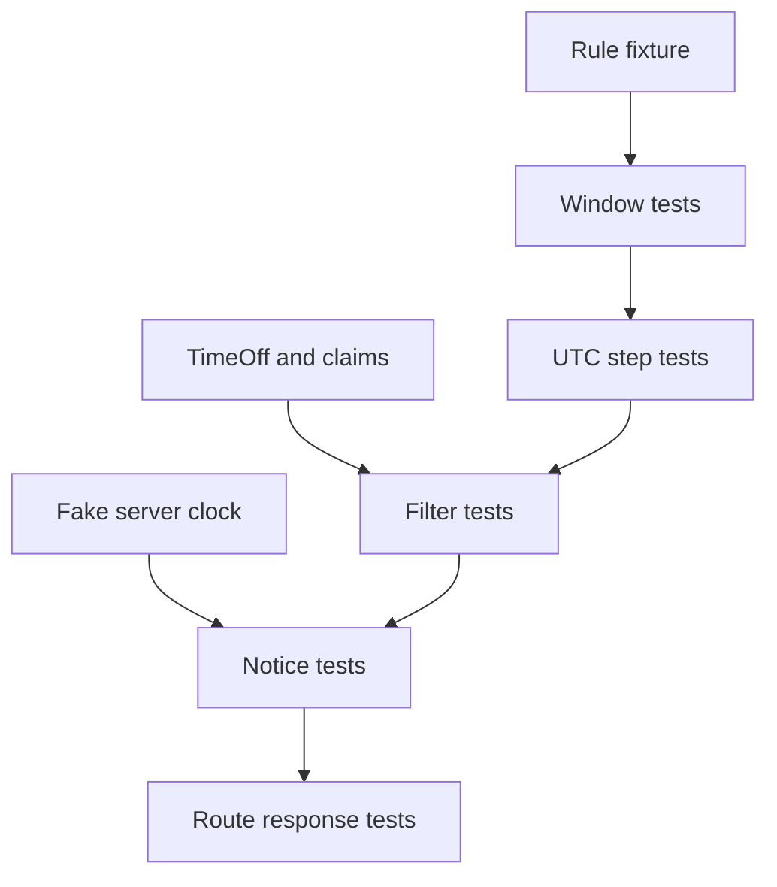

# Prove the engine on hard dates

A slot engine can pass a normal Tuesday test and still fail during a clock change, a partial day off or a buffer boundary. This lesson builds a test suite that would have caught those mistakes. Run pure tests against the planner and integration tests against the route and database adapter. Keep the clock fixed in every case. A test that uses the machine's current time may pass today and fail next week for no product reason.

The suite must cover at least five independent risks: provider-local weekly expansion across an offset change; UTC stepping through a spring or fall transition; subtraction of TimeOff and all needed SlotClaim blocks; strict notice and horizon boundaries; and correct HTTP scoping with a service that belongs to a different provider. A fully booked day should yield an empty list without throwing. A database failure should throw or become a server response, not masquerade as a valid empty day.



## Make fixtures that say what they prove

Use `node:test` and `node:assert/strict` to match Module 5. Put pure tests beside `engine.js` at `server/src/modules/availability/engine.test.js`. Define helpers for a weekly rule and for a UTC instant, but keep each test's date and zone visible. Avoid a fixture named `defaultRule` that silently changes between tests. A reviewer should be able to see the provider zone, date, service duration, buffer, blocker and expected starts without opening five files.

Start with the New York historical spring case because its expected elapsed interval is easy to inspect. A Sunday 01:00 to 04:00 local window on 2024-03-10 resolves to 06:00 to 08:00 UTC. For a 60-minute service plus a 15-minute buffer, assert the candidate set is 06:00, 06:15, 06:30 and 06:45 UTC. The same local labels on a normal Sunday may produce a different count. Do not test a future Gaza transition date with a hard-coded offset, because the time-zone rules may change after the course is published.

```js
import test from 'node:test';
import assert from 'node:assert/strict';
import { expandWindows, candidateStarts, blocksFor, candidateIsFree, passesBookingWindow } from './engine.js';

test('spring change is stepped in elapsed UTC time', () => {
  const rule = { id: 'r1', active: true, weekday: 7,
    startLocal: '01:00', endLocal: '04:00',
    timeZone: 'America/New_York',
    effectiveFrom: '2024-01-01', effectiveTo: '2024-12-31' };
  const { windows, issues } = expandWindows({ startDate: '2024-03-10', days: 1,
    zone: 'America/New_York', rules: [rule] });
  assert.deepEqual(issues, []);
  assert.equal(new Date(windows[0].startMs).toISOString(), '2024-03-10T06:00:00.000Z');
  assert.equal(new Date(windows[0].endMs).toISOString(), '2024-03-10T08:00:00.000Z');
  assert.deepEqual(candidateStarts(windows[0], 60, 15).map((ms) => new Date(ms).toISOString()), [
    '2024-03-10T06:00:00.000Z', '2024-03-10T06:15:00.000Z',
    '2024-03-10T06:30:00.000Z', '2024-03-10T06:45:00.000Z',
  ]);
});

test('a buffer block is occupied, but the exclusive end is not', () => {
  const start = Date.parse('2024-01-15T09:00:00.000Z');
  const { endMs, blocks } = blocksFor(start, 60, 15);
  assert.equal(new Date(endMs).toISOString(), '2024-01-15T10:15:00.000Z');
  assert.deepEqual(blocks.map((ms) => new Date(ms).toISOString().slice(11, 16)),
    ['09:00', '09:15', '09:30', '09:45', '10:00']);
  assert.equal(candidateIsFree(start, { durationMinutes: 60, bufferMinutes: 15 }, [], new Set([Date.parse('2024-01-15T10:00:00.000Z')])), false);
  assert.equal(candidateIsFree(start, { durationMinutes: 60, bufferMinutes: 15 }, [], new Set([endMs])), true);
});
```

Do not copy only these two tests and call the engine proved. Add a fall transition window whose boundaries are unambiguous and whose elapsed UTC span is longer than its wall-label subtraction suggests. Add a gap boundary and an ambiguous boundary that create issues with no public windows. Run those tests under `TZ=UTC` and a second process zone; the UTC results should match. Record the runtime versions. A failure after an IANA update deserves investigation rather than an automatic expected-value edit.

## Test blockers and capacity semantics

Add TimeOff `[10:00, 11:00)` and test a candidate whose session ends at 10:00 but buffer continues to 10:15. It must fail. Move TimeOff to `[10:15, 11:00)` and the same candidate should pass. Add a claim on its final buffer block and it must fail. These tests should fail if someone changes `candidateIsFree` to inspect only the service duration or only the candidate start.

Populate the claimed set with every 15-minute block in one dated window, then run the composed planner. Assert `starts` is empty and `issues` is empty. That proves a fully booked day is a normal result. Clear the set and assert the expected sorted starts return. Put a claim for another provider in the database integration fixture and verify the selected provider's starts do not change. The pure engine receives one provider's set; the adapter is responsible for scoping it.

Test exact notice with the fixed clock from Module 5: now 08:00 UTC, 120 minutes notice. The 10:00 start fails, a later aligned 10:15 start passes if the rule and blockers allow it. Test horizon exactly at its exclusive upper boundary too. If a test merely checks that a start tomorrow passes, it will not protect the disputed edge where controllers often disagree.

## Test the adapter and route separately

On a scratch replica-set database, seed two providers, one active service each, one TimeOff and one SlotClaim. Query the selected provider's availability. Assert the response contains only `providerId`, `serviceId`, `providerZone`, `generatedAt` and `starts`, with UTC `Z` strings sorted ascending. Assert the TimeOff reason and other client's ID are absent from JSON. Query Provider A with Provider B's service ID and expect 404. Send an invalid `startDate` and expect 422. Make the repository throw once and expect a server error, not `starts: []`.

Instrument the blocker adapter to assert one TimeOff query and one SlotClaim query for the full request. This is a behavior test, not an implementation mirror: it protects against a future N+1 query per candidate. Seed a claim near the last window end so a too-short query range would miss it. If the test runs in memory with stub arrays, it cannot prove the MongoDB predicate; run at least one integration case against the same model indexes used by the app.

Add a mutation check. Temporarily change the candidate condition from `start + duration + buffer <= window.end` to `start + duration <= window.end`. The latest-start test should fail. Restore the code. Then temporarily change the TimeOff overlap operator from `<` to `<=` at one end; the adjacent-interval test should fail. If either test stays green, strengthen it before trusting the suite. A good test suite detects a plausible bug, not just a missing import.

Run `TZ=UTC npm test` and `TZ=Asia/Qatar npm test` using the project's test script. Verify the output names the new engine and route tests; a zero exit with zero matching tests is not evidence. Save the commands and results in `docs/availability-decisions.md`, along with the sample route response. The module gate checks that this file and the tests are committed. The next module can safely build a slot picker only when the engine's dated and occupied-time semantics are repeatable.

Even a green suite does not make a GET response a reservation. A concurrent client may claim a block after the engine's read. Module 19's parallel checkout test is the final write-boundary evidence: one request may win the unique claim, and the others receive conflicts. Keep that separate from this module's read-path tests so each test proves the guarantee it actually owns.

References: [Node test runner](https://nodejs.org/api/test.html), [MongoDB unique indexes](https://www.mongodb.com/docs/manual/core/index-unique/) and [Luxon DateTime](https://moment.github.io/luxon/api-docs/index.html).

## Review failures as product symptoms

When a transition test fails, do not immediately change a hard-coded UTC expectation. Print the provider-local fields, zone, runtime versions, resolved start and end, and candidate UTC list. If the converter changed because IANA data was updated, compare the old and new result to an authoritative time-zone source and decide whether future unbooked offers should move. Existing paid Bookings keep their stored UTC instants. A test correction is justified only after that decision is recorded.

When a blocker test fails, inspect whether the candidate was never generated or was generated and then removed. A 10:30 start after a 09:00 to 11:30 rule with a 75-minute occupied interval should never reach the blocker filter because it does not fit the window. A 09:00 start with a 10:00 claim should be generated, then filtered. Distinguishing those paths makes debugging faster and prevents a test from passing for the wrong reason, such as an accidental notice rejection.

When the HTTP scoping test fails, check the query predicate before changing authorization middleware. A service ID should be loaded with its provider ID in the same condition. Filtering by service ID alone and checking provider ownership only after calculating slots is too late: the route may already have read or timed another provider's private schedule. Keep the scope at the data access boundary and assert that the repository never requests blockers for an unmatched service.

Finally, add one performance-shaped fixture with several rules and many candidate starts. Assert the number of blocker database reads stays at two, independent of candidate count. The test need not assert a millisecond threshold on a developer laptop. Its job is to prevent the structural N+1 regression. A separate production measurement can later decide whether the seven-day response needs caching or a different index.
