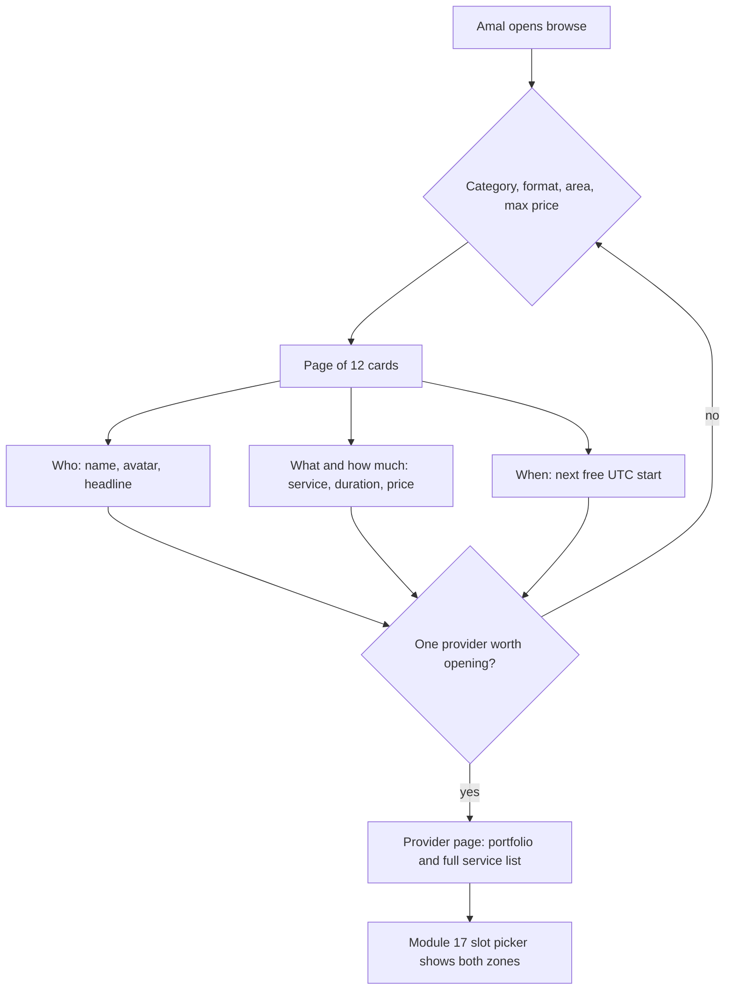

# Clients search for a person and a time

Amal opens SkillSlot on Thursday evening. She needs two things this week: an English conversation tutor before her interview on Monday, and someone to look at a laptop that stopped charging. She has twenty minutes and a phone. The browse page answers with a list, and that list decides whether she books or closes the tab.

Her question is never "which providers exist". It is narrower and more practical: who can help with this, who is free when I am free, and what will it cost. A page that cannot answer those three questions per card forces her to open twelve profiles to discover that eleven cannot help. A page that answers them well lets her choose in two taps.

## What a card has to prove

A card holds a small amount of information, and every field has to earn its space at 360 pixels wide. The provider's display name and avatar answer who this is. The headline and category answer what kind of work this is. The cheapest active service price and one service duration answer whether it is in range. The provider's location type answers whether the session happens online or at her home. The next free start answers the question the other fields cannot: when could this actually happen.

That last field is the one that turns a directory into a booking marketplace. Two tutors with identical prices and headlines are not interchangeable if one is free tomorrow evening and the other is free in eleven days. Without a free time on the card, Amal must open each profile, pick a service, load a seven day calendar, and go back. Four profiles later she has spent her twenty minutes and booked nothing.

## Filters that earn their place

SkillSlot has four filters in this module. Category narrows to tutoring, design or repair. Location type narrows to online, at the provider's workshop, or a home visit. Service area answers a narrower question for home visits: a provider who travels only within one area is useless to a client outside it. A maximum price filters by the cheapest active service, so a client who can pay 2000 minor units does not see a provider whose entry price is 9000.

Each filter is a promise about the result set. If Amal chooses online, she does not expect a card that only offers a home visit. If she sets a maximum price, she expects no card above it. A filter that only sorts, or that quietly ignores an unsupported value, breaks that promise without telling her. The route therefore validates each parameter and rejects an unknown value with a message the interface can show, rather than returning whatever it found.

Two filters are deliberately absent. There is no map or radius search, because in-person services use a list of service areas and a map would need a geocoder and a location permission that this course does not teach. There is no ranking by rating, because SkillSlot has no reviews yet, and a fake rating is worse than no rating. Both omissions are honest scope decisions, and both belong in your decision note.

## Why sorting needs a tiebreaker

Default sort is soonest available first, because a client who wants a lesson this week cares about the next free time more than anything else. Providers with no free time in the booking horizon go last, not first, and not missing. Amal should be able to see that a provider exists and is currently full, because she might check again later.

Sorting by a field that many providers share creates a quiet bug. If eight providers are all free at the same Monday evening instant, and the route sorts only by that instant, the database is free to return them in any order on each request. Page one and page two can then contain the same provider, and one provider can never appear at all. Every sort order in a paginated list needs a unique tiebreaker, and the identifier is the field you already have. Write it as two sort keys, not one.

## Pagination without lying about totals

The browse page shows 12 cards per page and accepts a page number. It returns the page size, the total number of matching providers, and a flag that says whether another page exists. The client uses the flag for the next button and the total for the "37 providers" line.

Two costs hide in that response. Counting matches runs the filter again with a count operation, which is cheap on an indexed field and expensive on an unindexed one. Skipping deep pages makes the database walk past every earlier document, so page 40 costs more than page 1 for the same result. Both are acceptable at this size, where a seeded marketplace has tens of providers, and both become the reason to move to a cursor when the catalogue grows. Cap the page size at 24, refuse a page size above it, and write the reason beside the constant so a future reader does not raise it because a design asked for 100 cards.

## One response, two clients, two zones

The browse route returns the next free start as a UTC instant, not as a formatted label. Amal in Berlin and a client in Gaza receive the same bytes for the same provider, and each browser formats the instant in its own zone. This is the Module 5 decision applied to a list: the server owns the instant, the viewer owns the label.

If the route formatted the time on the server, it would need to know which zone to use. Reading the client's zone from a header, an address or a guess produces a page that is wrong for the traveller and wrong for the client whose profile zone differs from their current location. Returning the instant and the provider's zone name keeps the API correct for everyone and lets Module 17 render both labels side by side.

## The public view is a decision, not a filter

A browse response is readable by anyone, including someone who never signs in. That makes it the easiest place in the application to leak private data by accident, because the convenient query returns whole documents.

A provider record holds fields a stranger must never see: the account identifier, the publication status, the schedule revision, the notice and horizon settings, and the exact street address used for home visits. A service record holds the buffer minutes, which describe how the provider works rather than what the client buys. A time off record holds a reason, which is nobody's business. A booking record holds another client's name and the meeting link for a session that has nothing to do with this reader.

The fix is an allow list. The route projects exactly the fields it means to publish, and a test asserts the sorted key list of the response so that adding a field to the model does not silently add it to the public response. A deny list fails here, because the next field someone adds is a field nobody remembered to deny.

Read the diagram as a funnel with one loop. The filters narrow a large set to a page, the card answers three questions, and the loop back to the filters is the normal outcome: a client changes the price ceiling, or switches from home visit to online, and tries again. The funnel ends at a real choice, and the slot picker is where that choice becomes a time.

## The expensive field

The next free start is the most valuable field on the card and the most expensive to produce. The availability engine you built in Module 15 takes a provider, a service and a date range, loads weekly rules, time off and claimed blocks, and returns sorted UTC starts. Running it once for one provider and one service is a reasonable amount of work. Running it for every card on the page, once per service, is a different order of cost.

Suppose a page shows 12 providers and each offers three services. A naive implementation calls the engine 36 times and loads rules, time off and claims alongside each call. The response is correct and the page takes seconds to appear on a phone. That gap between correct and usable is the subject of the next lesson, and the fix is not a faster engine. It is storing the answer and keeping it fresh.

## What this module builds

The build lesson adds `GET /api/providers` as a public, filtered, paginated list with a stored `nextAvailableAt` field, extends the single provider route to include services and portfolio images, and logs a query count as gate evidence. It also adds the refresh helper that updates a provider's next free start when the schedule or the claims change.

The gate asks for three things: a logged query count that does not grow with the page size, a filter that returns exactly what it promises, and a response body that contains no private field for any provider.

## Check before moving on

Amal filters for online tutors under 3000 minor units and sees twelve cards. She reloads and sees the same twelve in a different order, with one provider repeated on both pages. Which two things are wrong with the query, and which one would a total count alone have hidden?

The expected answer names a missing unique tiebreaker in the sort and a missing stable sort order across requests. A total count can stay correct while the pages overlap, which is why the pagination test in the gate checks identifiers rather than counts.

References: [MongoDB skip and limit](https://www.mongodb.com/docs/manual/reference/method/cursor.skip/), [MongoDB sort and index use](https://www.mongodb.com/docs/manual/reference/method/cursor.sort/) and [Mongoose query projections](https://mongoosejs.com/docs/api/query.html).
