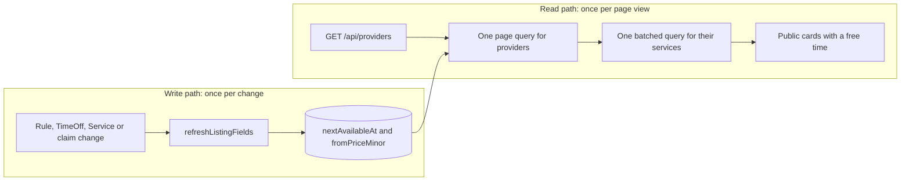

# Browse providers, next free slot and the N+1 trap

The project now has everything a browse page needs and nothing that serves it. The Provider record from Module 10 holds the name, headline, category, location type, service area and zone. Module 12 gives each provider a set of Services with duration, buffer and price. Module 13 adds weekly rules and time off. Module 15 turns those into sorted UTC starts for one provider and one service. This lesson exposes a public list that answers Amal's three questions in one request, without asking the database the same question once per card.

Start with the version that works and measure it. Then fix it. Learners who jump straight to the aggregate usually cannot explain what they avoided.

## The version that works and does not scale

```js
// GET /api/providers  (first version, do not ship)
const providers = await Provider.find({ status: 'listed' }).limit(12).lean();
for (const provider of providers) {
  provider.services = await Service.find({ providerId: provider._id, status: 'active' }).lean();
  for (const service of provider.services) {
    const availability = await getAvailability({
      providerId: provider._id, serviceId: service._id, startDate: null, clock, repository,
    });
    if (!provider.nextAvailableAt && availability.starts.length) {
      provider.nextAvailableAt = availability.starts[0];
    }
  }
}
res.json({ providers });
```

Count the round trips for one page. One query loads the providers. Twelve queries load their services. Each availability call loads active rules, then a blocker range of time off and claims, then runs the planner. With three services per provider that is 12 source queries plus roughly 36 engine data loads, and the engine work on top of that. On a laptop with a local database the page arrives in 80 ms and looks fine. On a phone in Gaza against a hosted database, each round trip is tens of milliseconds before any work happens, and the page takes seconds.

The growth is the real problem, not the constant. Raise the page size from 12 to 24 and the query count doubles. Add a fourth service to every provider and it grows again. A page whose cost is proportional to the number of cards cannot be made fast by buying a bigger database, because the number of trips is the cost.

## Fix one: load the page, then batch its services

The provider name is already on the Provider document, so no join is needed for it. That is worth saying out loud, because the reflex from other projects is to denormalise the provider name onto every Service to avoid a join. SkillSlot does not need that copy: the list query already returns the provider, and the services hang off its identifier.

What does need a batch is the service list. Read the page first, collect the identifiers, then load every service for those providers in one query.

```js
const providers = await Provider.find(filter, PUBLIC_LIST_PROJECTION)
  .sort({ nextAvailableAt: 1, _id: 1 }).skip(skip).limit(limit).lean();   // nulls first: fixed below
const ids = providers.map((provider) => provider._id);
const services = await Service.find(
  { providerId: { $in: ids }, status: 'active' },
  'providerId title durationMinutes bufferMinutes priceMinor locationType cancellationPolicy',
).sort({ priceMinor: 1, _id: 1 }).lean();
const byProvider = new Map();
for (const service of services) {
  const list = byProvider.get(String(service.providerId)) ?? [];
  list.push(service);
  byProvider.set(String(service.providerId), list);
}
```

Two queries, and the second one is bounded by the page, not by the catalogue. If you prefer one round trip, an aggregation with `$lookup` and a `pipeline` that filters on the active service status and sorts by price gives you the same result in one operation. The aggregation is harder to read and it keeps the pagination correct only if `$match`, `$sort`, `$skip` and `$limit` all run before the `$lookup`. Put `$limit` after `$lookup` and you have joined the whole collection before throwing most of it away.

## Fix two: store the next free start

Availability cannot be batched across providers, because the engine reads each provider's own rules, time off and claims and steps each provider's own grid. There is no single query that answers "the next free start for each of these twelve providers" without doing the work per provider somewhere.

So do the work once, off the read path. Add three fields to the Provider document and refresh them when the inputs change.



The two lanes are the whole design. Every write that can change a provider's free time ends at the same stored pair of fields, and every page view reads those fields instead of asking the engine. Notice that the read lane has no arrow into the availability engine at all. That absence is what keeps a page of twelve cards cheap.

| Field | Type | Meaning |
|---|---|---|
| `nextAvailableAt` | Date or null | Earliest bookable UTC start across the provider's active services inside the booking horizon |
| `fromPriceMinor` | Number or null | Lowest `priceMinor` among active services, used by the price filter |
| `listingComputedAt` | Date | When these two values were last recalculated |

```js
export async function refreshListingFields({ providerId, clock, repository }) {
  const provider = await repository.getProvider(providerId);
  if (!provider) return;
  const services = await repository.getActiveServices(providerId);
  if (!services.length) {
    return Provider.updateOne({ _id: providerId },
      { $set: { nextAvailableAt: null, fromPriceMinor: null, listingComputedAt: clock.now() } });
  }
  let earliest = null;
  for (const service of services) {
    const availability = await getAvailability({
      providerId, serviceId: service._id, startDate: null, clock, repository,
    });
    const first = availability?.starts?.[0];
    if (first && (!earliest || first < earliest)) earliest = first;
  }
  const fromPriceMinor = Math.min(...services.map((service) => service.priceMinor));
  return Provider.updateOne({ _id: providerId },
    { $set: { nextAvailableAt: earliest ? new Date(earliest) : null, fromPriceMinor, listingComputedAt: clock.now() } });
}
```

This function is allowed to be slow, because it runs once per provider change rather than once per page view. Call it after the writes that can change the answer: a weekly rule saved or retired, a time off interval added or removed, a service created, archived or re-priced, a provider published or unpaused, a hold created or released, and a booking cancelled. That is a long list, and missing one call site is the defect this design invites.

Handle the missing call site in the read path rather than pretending it cannot happen. A `nextAvailableAt` in the past is not a bookable time, so the serializer returns null for it and the card says "check availability" instead of showing a stale evening that has already gone. And a card whose time was taken between the refresh and the click costs a `409` at checkout, not a double booking, because the claim decides ownership in Module 19. A stored display value can be wrong for a minute; the write path must never be wrong.

In Module 24 this refresh moves into a queued job so a busy hour of holds does not hold up the request that created them. For now, synchronous is honest and simple, and you can time it and write the number down.

## Filters, sort and the page

Build the filter object from a fixed set of query parameters, and reject anything outside it.

```js
export function parseBrowseQuery(raw) {
  const page = integerInRange(raw.page ?? '1', 1, 500);
  const limit = integerInRange(raw.limit ?? '12', 1, 24);
  const filter = { status: 'listed' };
  if (raw.category) filter.category = oneOf(raw.category, CATEGORIES, 'INVALID_CATEGORY');
  if (raw.locationType) filter.locationType = oneOf(raw.locationType, LOCATION_TYPES, 'INVALID_LOCATION_TYPE');
  if (raw.serviceArea) filter.serviceArea = oneOf(raw.serviceArea, SERVICE_AREAS, 'INVALID_SERVICE_AREA');
  if (raw.maxPriceMinor) filter.fromPriceMinor = { $lte: integerInRange(raw.maxPriceMinor, 0, 10_000_000) };
  const sort = raw.sort === 'price' ? { fromPriceMinor: 1, _id: 1 } : { sortKey: 1, _id: 1 };
  return { page, limit, skip: (page - 1) * limit, filter, sort };
}
```

The default sort object names `sortKey`, which does not exist in the document. It is added by the aggregation in the next paragraph, after the filter and before the sort. The price sort does not need it, because `fromPriceMinor` is a stored number.

The default sort needs a computed key, because MongoDB orders null before any date in an ascending sort. Sorting on `nextAvailableAt` directly puts providers with no free time first, which is exactly backwards. Add the key in the aggregation, or store a sentinel:

```js
// inside the aggregation pipeline, before $sort
{ $addFields: { sortKey: { $ifNull: ['$nextAvailableAt', new Date('9999-12-31T00:00:00.000Z')] } } }
```

The `_id` in every sort object is the tiebreaker from 16.01. Without it, providers who share a start instant can swap places between page loads and appear twice.

The total comes from a separate count with the same filter. Return `page`, `limit`, `total` and `hasMore`, and compute `hasMore` as `page * limit < total`. Do not return a total without a filter, and do not count on every keystroke; the interface asks once per submitted filter change.

## The response contract

Write the shape before the handler. The list view and the detail view share most fields, so the detail view extends the list view rather than repeating it.

```ts
export interface PublicServiceSummary {
  id: string;
  title: string;
  durationMinutes: number;
  priceMinor: number;
  locationType: 'online' | 'at-home' | 'at-workshop';
}

export interface PublicProviderCard {
  id: string;
  displayName: string;
  headline: string;
  avatarUrl: string | null;
  category: string;
  locationType: 'online' | 'at-home' | 'at-workshop';
  serviceArea: string | null;
  providerZone: string;
  nextAvailableAt: string | null;   // UTC ISO, null when nothing is bookable
  fromPriceMinor: number | null;
  services: PublicServiceSummary[];
}

export interface PublicProviderPage {
  page: number;
  limit: number;
  total: number;
  hasMore: boolean;
  providers: PublicProviderCard[];
}
```

The list deliberately omits `bio` and the portfolio images. Both are large, both belong to the detail page, and a page of twelve biographies is a page nobody finishes scrolling on a phone.

## The private fields that stay out

Build the public projection as an allow list and keep it in one exported constant, so the list route, the detail route and the serializers all read the same definition.

```js
export const PUBLIC_LIST_PROJECTION = {
  _id: 1, displayName: 1, headline: 1, avatarUrl: 1, category: 1, locationType: 1,
  serviceArea: 1, timeZone: 1, nextAvailableAt: 1, fromPriceMinor: 1,
};
```

Six fields must never appear in a public browse response: `userId`, `status`, `noticeMinutes`, `horizonDays`, `scheduleRevision` and `listingComputedAt`. Four more belong to someone else entirely: a provider's street address and phone number, a time off reason, and any booking, hold or claim belonging to another client. A provider's notice period is also a scheduling detail that clients cannot act on, and publishing it invites "why can I not book tomorrow" conversations that the interface cannot answer.

The serializer renames `timeZone` to `providerZone` on the way out, so the card and the availability response use one key for the same value. One rename beats two names for one idea, and the client code that reads a zone never has to ask which endpoint it came from.

A test that asserts the sorted key list of one card is the cheapest protection you can buy. When a teammate adds a field to the model six months from now, that test fails and someone has to decide whether the field is public.

## Write the failing tests first

- `list_page_uses_at_most_three_queries_with_40_providers` counts reads for a 12 card page and asserts `count <= 3`, then repeats with `limit=24` and asserts the count did not grow.
- `public_card_returns_exactly_the_allow_list` asserts the sorted key list of `providers[0]` and, separately, the key list of `providers[0].services[0]`.
- `no_private_provider_field_anywhere_in_the_body` walks the JSON for the forbidden key names, so a nested leak fails the test too.
- `filters_combine` sends `category=tutoring&locationType=online&maxPriceMinor=3000` and asserts every card satisfies all three.
- `unknown_filter_value_returns_422` sends `category=childcare` and expects `422 INVALID_CATEGORY` rather than an empty page.
- `page_two_does_not_repeat_page_one` seeds four providers with an identical `nextAvailableAt` and compares identifier sets across two pages.
- `claim_on_provider_a_changes_only_provider_a` creates a claim on a provider's first free block, calls the refresh for that provider, and asserts the other providers' `nextAvailableAt` values are unchanged.
- `past_next_available_at_is_serialized_as_null` sets the value to an hour ago and expects `null` in the response.

```js
test('list_page_uses_at_most_three_queries_with_40_providers', async () => {
  await seedProviders(40);
  const stop = startCounting();
  const response = await request(app).get('/api/providers?limit=12');
  const queries = stop();
  assert.equal(response.status, 200);
  assert.equal(response.body.providers.length, 12);
  assert.ok(queries <= 3, `expected at most 3 queries for 12 cards, counted ${queries}`);
});
```

The counter belongs in one small test helper that increments on every MongoDB operation and resets after the seed. Enable it after seeding, not before, or the seed's own writes will appear in the count and the threshold will look impossible.

## Verify by hand

Call the route with no parameters and read one card. Then add `category=tutoring`, then `maxPriceMinor`, then `locationType=at-home`, and watch the set shrink in a way you predicted before you sent the request. Page through to the last page and confirm `hasMore` is false and the total matches the count you see.

Then break it on purpose. Add a time off interval to one provider without calling the refresh helper, reload the browse page, and confirm the card still shows a start the availability route has stopped offering. That is the stale display you are accepting, and the Module 15 route is where you prove it. Fix it by wiring the call site, then add the call site to a written list in `docs/browse-decisions.md` so the next person who adds a schedule write knows it belongs there.

Finally, open the same page as a signed-out client and read the JSON. There should be nothing in the body that you would not print on a poster.

```quiz
type: mcq
id: services-browse-q1
question: "A page shows 12 cards and each provider offers three services. Which change removes the growth in database round trips?"
options:
  - "Loading the page of providers, then one batched query for all their services"
  - "Calling the availability engine once per service instead of once per provider"
  - "Increasing the page size so each request serves more cards at once"
  - "Adding an index on the service price so each per-card query is faster"
correct: 0
explanations:
  - "A batched $in query or a $lookup after $limit makes the service read independent of the page size."
  - "That doubles the work; the number of engine runs is part of what makes the page slow."
  - "A larger page multiplies the per-card cost rather than removing it."
  - "A faster individual query still leaves the trip count proportional to the number of cards."
```

```quiz
type: mcq
id: services-browse-q2
question: "Why is nextAvailableAt stored on the Provider instead of computed while the list is rendered?"
options:
  - "Because the availability engine cannot run outside a request"
  - "Because a stored date is always more accurate than one computed on read"
  - "Because clients cannot read a UTC instant in their own zone"
  - "Because the engine works per provider, so per-card calls grow with page size"
correct: 3
explanations:
  - "The engine is ordinary code and runs anywhere; the problem is how often it would run."
  - "A stored value can be stale, which is why the read path nulls a past instant and checkout rechecks."
  - "The browser formats the returned instant in the client zone, which is why the field is stored as UTC."
  - "The work is per provider, so it belongs on the write path where a change happens once."
```

## What the next lesson asks for

The gate wants a query count that does not grow with the page, a filter that returns only what it promised, and a body that survives a privacy review. It also wants one sentence explaining what a client loses when a stored free time is out of date, and why that loss cannot become a double booking.

References: [MongoDB aggregation pipeline](https://www.mongodb.com/docs/manual/core/aggregation-pipeline/), [MongoDB $lookup](https://www.mongodb.com/docs/manual/reference/operator/aggregation/lookup/) and [Mongoose query logging](https://mongoosejs.com/docs/guide.html).
