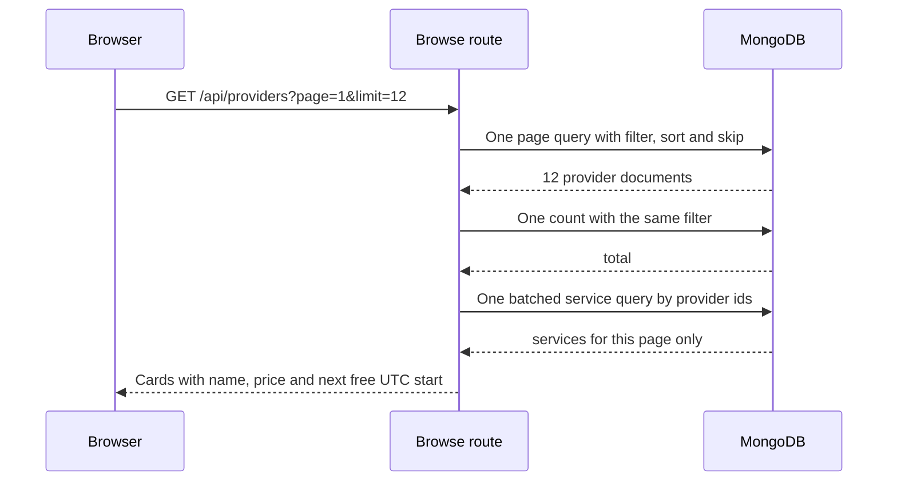

# Browse catalogue gate

This gate asks for three pieces of evidence that a screenshot cannot give you: a query count that stays flat as the page grows, a filter set that returns exactly what it claims, and a response body that a stranger could read without learning anything private. Bring the recorded count, the request URLs and one full response body.

Run the review from a signed-out browser window. The browse page is public, so the review starts where the least trusted reader starts. If the page needs a token to look correct, it is not the page a new client sees.

## The query count

Turn on the counter, then request a page of 6 cards and a page of 24 cards with a seed of at least 40 listed providers. Record both numbers. They should be equal, or differ by at most the count query you chose to run for the total. What must not happen is 6 and 24.

Write the numbers in `docs/browse-decisions.md` with the seeded provider count, the page sizes and the date. Then answer one question beside them: which part of the page would break first if the provider count grew to 5000? The honest answer names either the deep `skip` cost or the count operation, and both are reasons a larger marketplace would move to a cursor.

The sequence shows the four operations a page may legitimately need: page, count, one batched service read, and nothing per card. There is no arrow to the availability engine, because the free time was stored on the write path. If your trace has an arrow inside a loop, the gate is not passed yet.

## Gate checklist

- [ ] `GET /api/providers` returns only providers with `status: listed`, and a draft or suspended provider never appears.
- [ ] The page reads its providers in one query, its services in one batched query, and the recorded count does not grow when the page size grows from 6 to 24.
- [ ] `nextAvailableAt` and `fromPriceMinor` are stored on the Provider and refreshed by `refreshListingFields` at every documented call site.
- [ ] A `nextAvailableAt` in the past is serialized as null, and the card never offers a start that has already gone.
- [ ] Filters for category, location type, service area and maximum price combine, and each unknown value returns `422` with its own code.
- [ ] The default sort puts providers with a free time first, providers with none last, and the `_id` tiebreaker keeps the order stable across requests.
- [ ] Two consecutive pages contain no repeated identifier when four providers share the same `nextAvailableAt`, and `hasMore` matches the total.
- [ ] The public card key list is exactly the allow list, the nested service key list is exactly its allow list, and a recursive check finds no private provider field in the body.
- [ ] No response contains a provider's address, phone number, time off reason, hold, claim or another client's booking.
- [ ] The single provider route returns the profile, the active services, the portfolio images with alt text and the cancellation policy, and still no owner fields.
- [ ] A claim or hold on one provider changes only that provider's stored free time.
- [ ] The recorded query counts, two sample URLs and one full body are committed in `docs/browse-decisions.md`.

Leave a box open rather than describing intent. "The route uses a projection" is not evidence; the committed body with its key list is.

## Test the promise the filters make

Send the same filter twice with the values in a different order and confirm an identical result set, then add a second filter and confirm the set only shrinks. A filter that widens the result when you add a constraint is usually an `or` that was meant to be an `and`, or a price comparison against the wrong field.

Then test the boundary. A provider whose cheapest active service is exactly 3000 must appear when the client asks for a maximum of 3000, because the comparison is inclusive and the client reads it that way. A provider whose only service is archived must disappear from every filtered view, including the unfiltered one. A provider with a service area set and a client filter for a different area must not match, and the same provider must still match when no area filter is sent.

## The privacy review

Print the response body and read it as a stranger. Every value in it should be something you would put on a public page. Then search the body for the six forbidden provider keys and for anything belonging to another client.

The subtler leak is not a field name but a value. A "next free start" that is the second slot of a day tells a careful reader that the first slot is taken, which is acceptable. A start that exactly matches a held booking's expiry, or a count of active holds, tells them something about another client's behaviour, which is not. The card should describe the provider, not the calendar activity.

Compare the public card with the owner view field by field, rather than waiting for a reviewer to find a difference. The owner view exists so the provider can run her practice. Every field it adds over the card is a field someone decided a stranger may not read, and that decision should still look right when you read the two side by side.

## Learning log

1. A page of 12 cards shows up as three reads in your log. Name all three, and explain what would happen to the count if the availability engine ran once per card.
2. A provider adds a time off interval and the refresh helper is not called. What does the browse card show, what does the availability route show, and which one is authority?
3. Why does an ascending sort on a nullable date put the providers you least want first, and what did you do about it?
4. A colleague adds `phone` to the Provider model for the dashboard. Which test fails, and what does the failure force someone to decide?

Answer with the recorded numbers and the exact status codes. If an answer says the browse page should recompute availability to stay accurate, revisit the read and write split in 16.02. If an answer says a stale free time can cause a double booking, reread the claim rule from Module 6 and the checkout plan in Module 19.

## Before you close

Ask the mentor to pick a filter combination you have not tried, then predict the number of results before you send it. A page that returns a different number from your prediction is telling you something about your own data, your sort or your filter parser, and that gap is worth chasing now rather than after a client complains that a tutor disappeared.

Write one defect the review found and the change you made. Then hand the page to Module 17, which adds the day strip and the slot picker that shows each start in both the client's zone and the provider's zone.
