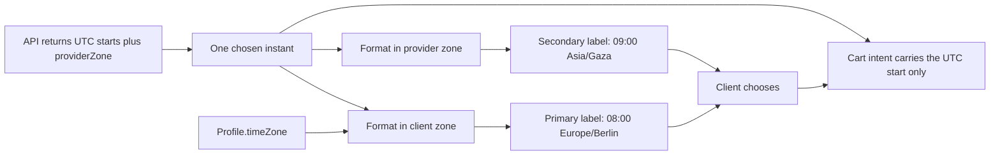

# Two clocks in one picker

Amal in Berlin picks a slot that reads 08:00 on her phone. Layla in Gaza opens her agenda and sees the session at 09:00. Neither is wrong. The API sent one instant, `2026-01-19T07:00:00.000Z`, and each screen formatted that instant in a named time zone. The booking is safe because both screens are describing the same moment.

Now remove one of those labels. Suppose the picker shows only the client's time. Amal books 08:00 and turns up at eight her time, which is nine for Layla, and the lesson works. Suppose instead the picker shows the provider's time, because the page was built from the provider's calendar. Amal reads 09:00 and arrives an hour late. Suppose the picker shows a single number with no zone name at all, and a support agent later has to reconstruct what happened from a database row. Every one of those failures comes from a label, not from the stored instant.

## Why both labels belong on one button

The two labels answer two different questions and the client needs both before she commits. Her own zone answers "when do I need to be free", which is the question she is actually asking at the moment of choice. The provider's zone answers "when is this for the person I am meeting", which she needs to judge whether the time is reasonable for the other side and to name the same time later in a message.

There is a third reason that is easy to miss. The provider's weekly hours are written in her own local clock. A tutoring rule of Monday 09:00 to 12:00 in `Asia/Gaza` produces a window that lands at different wall times for a client in Berlin across the year, because the two zones change their clocks on different dates. Showing the provider's zone makes that structure visible. The client can see that she is choosing the tutor's morning, not a floating hour.

So the picker shows two labels on every slot. The client's zone leads: larger text, first in reading order, and the value the screen reader announces first. The provider's zone follows: smaller but never hidden, always carrying the zone name. A design that reveals the second label only on a tooltip fails the client on a phone and fails a screen reader completely.

## Never a bare hour

A time without a zone name is an incomplete value. "09:00" could be nine in the morning in Berlin, in Gaza, or on the server that wrote the log. Three habits prevent most of the confusion.

First, show the zone name beside the time, using the IANA name so it can be looked up: `09:00 Asia/Gaza`. The IANA name is not pretty, and it is unambiguous, which matters more on a booking screen than on a marketing page.

Second, do not rely on abbreviations. "CST" can mean Central Standard Time in North America, China Standard Time, or Cuba Standard Time, and a client has no way to know which one your app meant. An abbreviation also hides daylight saving, because the same place changes its abbreviation in summer.

Third, if you show an offset, show it beside the zone rather than instead of it. An offset of `+02:00` describes one instant in one place. It is not the identity of the place, because the same place will be `+03:00` in a few weeks.

## Where the two zones come from

The server sends UTC starts. It does not send a formatted label, and it does not decide which zone the client is reading in. That decision belongs to the client's stored profile zone, which was set when she registered and can be changed in her settings.

Do not infer the client's zone from an IP address or from the browser's language. A client travelling for a week still wants her appointments in the zone she thinks in, and a client whose phone reports a different zone from her profile is best served by a question, not a silent switch. Show the mismatch and let her choose.

The provider zone comes from the availability response, which already carries `providerZone`. Use that value rather than re-deriving it from the provider record in the browser, because the response is the object that owns the offer. If the provider changes her working zone next month, the label changes because the response changes, and no client code needs to know why.

## When a clock changes

Twice a year, in most zones that observe daylight saving, a local day is not 24 hours long. In spring the clock jumps forward and a local hour never happens: 23 hours that day. In autumn the clock falls back and a local hour happens twice: 25 hours that day.

Both cases break naive formatting. On the spring day, the picker may show a gap between two adjacent slot labels, and a client who does not expect it will think the page is broken. On the autumn day, two different instants can both read 01:30 in the provider's zone, and if the button shows only the hour, the client cannot tell which one she is choosing.

The rule for this module is simple and testable. Every slot shows its zone offset beside the zone name, and any day whose provider-local length is not 24 hours carries a short note such as "Clocks change today in Asia/Gaza" with the direction. With the offset visible, the two 01:30 buttons read `01:30 +02:00` and `01:30 +01:00`, and a client can choose deliberately. Without it, the picker silently offers the same label twice.

Do not hide a duplicate. Do not merge two instants because their labels match. Do not skip a day because a formatter returned something strange. Each of those three shortcuts turns a rare, well understood calendar event into a booking that nobody can explain afterwards.

Follow the two formatter arrows back to the same node. They are two renderings of one value, and the diagram puts the only authoritative copy in the middle where it can be seen. The arrow into the cart intent starts from that middle node as well, never from a label. That is the rule the build lesson will encode and test.

## Whose clock data is it anyway

The label is produced by the browser's own time zone data, which comes from the runtime rather than from your server. A phone that has not updated its operating system for a year may carry older rules for a zone whose government changed its daylight saving dates. The labels can then disagree with the server by an hour on a handful of dates.

That is not a reason to format on the server. It is a reason to keep the roles straight. The server decides eligibility and stores instants, and it uses its own time zone data for that. The browser formats the instant it received. If the two ever disagree, the server wins, and the client can refresh or update the device. Write this in your decision note, because the first time a client reports a wrong hour you will want to know which side was authoritative before you change code.

There is a practical check you can run in a minute: format the same three instants in the same zone with your server's library and with a browser formatter, and compare. Three dates are enough to start: one ordinary day, one day near a transition, and one day after. Record the comparison. If you later see a one hour difference in production, you already know which values to compare first.

## What a wrong hour actually costs

A missed lesson is the visible cost. There are two others that are less obvious and harder to repair. The first is trust: a client who arrives at the wrong hour does not think "the time zone data was stale", she thinks the marketplace wasted her evening. The second is support labour. Every ambiguous booking turns into a conversation that needs the stored instant, the zones at the time of booking, and a person who can read both, which is why Module 6 keeps zone snapshots on the Booking.

A picker that shows both zones shortens that conversation before it starts, because both sides already saw the same pair of labels when they agreed to the time.

## What this module builds

The build lesson adds a seven day strip, a slot grid, and the two-label formatting rule to the provider page. It also adds the client zone setting that re-renders every label when it changes, a keyboard path through days and slots, and a layout that survives a 360 pixel viewport with one thumb. Selecting a slot produces a cart intent that carries the UTC start and never the label, and Module 18 turns that intent into a cart line.

The gate asks for two screenshots that a mentor can check against a fixed instant, one from a Berlin client and one from a Gaza client, plus a recorded clock change day and a keyboard-only run through the picker.

## Check before moving on

A provider in `Asia/Gaza` offers a slot at `2026-10-24T04:00:00.000Z`. Write the two labels the picker must show for a client in `Europe/Berlin`, then write the single value the cart intent must carry. Check your labels against your own runtime data before you write them down, and if your two labels happen to be the same clock hour on that date, explain why the zones still both need to appear.

The expected answer carries the UTC instant in the payload and both labels on the button, with the zone names attached to each label. A payload that carries "07:00" is the defect this module exists to prevent.

References: [MDN on Intl.DateTimeFormat](https://developer.mozilla.org/en-US/docs/Web/JavaScript/Reference/Global_Objects/Intl/DateTimeFormat), [MDN on time zone names](https://developer.mozilla.org/en-US/docs/Web/JavaScript/Reference/Global_Objects/Intl/DateTimeFormat/DateTimeFormat) and [IANA time zone database](https://www.iana.org/time-zones).
