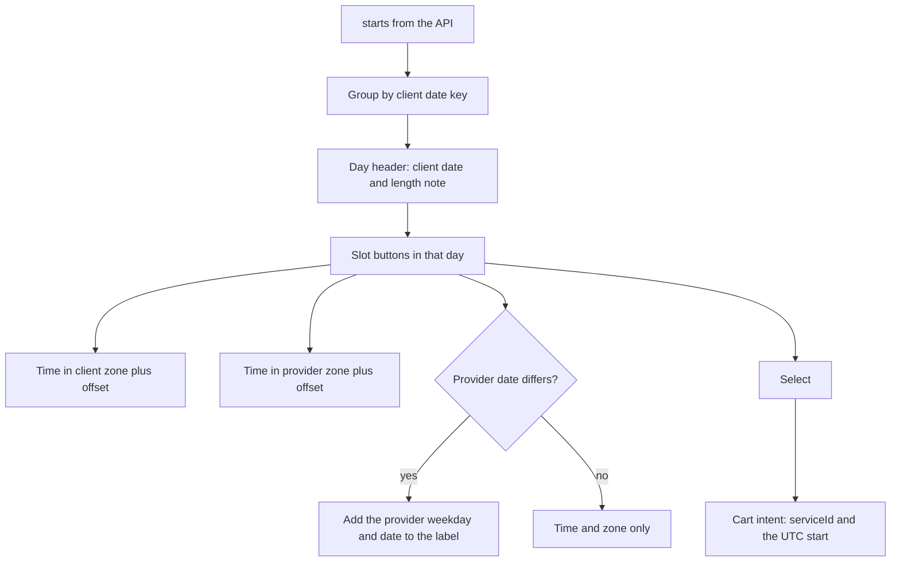

# Slots in the client zone and the provider zone

The provider page now has a service list, a portfolio and a cancellation policy. It has one thing left to add: the decision. This lesson builds the seven day strip and the slot grid, and it makes one rule true everywhere in the component, that a slot is an instant with two labels and never a label with an implied instant.

The data comes from two places you already built. The Module 15 availability route, `GET /providers/:id/availability` under the same `/api` prefix as the rest of your routes, answers with the provider zone and a sorted array of UTC starts. The client's zone comes from her profile, which Module 8 stored at sign-up and Module 10 exposed in settings. Everything else is presentation, and presentation is where the two clocks can drift apart.

## The contract you render from

The availability response is the only source of offers. Do not compute slot times in the browser from the weekly rules, and do not extend the list locally when the client reaches the end of the day.

```ts
export interface AvailabilityResponse {
  providerId: string;
  serviceId: string;
  providerZone: string;    // IANA name, for example Asia/Gaza
  generatedAt: string;     // UTC ISO, the server clock that produced this list
  starts: string[];        // sorted UTC ISO instants
}

export interface SlotView {
  startAt: string;         // the API value, unchanged
  clientLabel: string;     // 08:00
  providerLabel: string;   // 09:00
  clientOffsetLabel: string;   // UTC+01:00
  providerOffsetLabel: string; // UTC+02:00
  clientDateKey: string;   // 2026-01-19, the client's calendar date
  providerDateKey: string; // 2026-01-19, the provider's calendar date
}
```

`starts` is the truth and `SlotView` is derived. Keep the derived object in a memo keyed by the zone pair, so a client who changes her zone re-renders the labels from the same array instead of refetching the offers. Changing a display preference must not cost a network request or change which slots are available.

## One formatter module, two zones

Write the zone helpers in one file. Every component imports them, and no component builds its own formatter with its own options, because two formatters with different options are how one screen ends up showing 24:00 and another showing 00:00 for the same instant.

```js
// client/src/lib/zone.js
function partsIn(instant, zone) {
  const formatter = new Intl.DateTimeFormat('en-GB', {
    timeZone: zone, hour12: false, year: 'numeric', month: '2-digit', day: '2-digit',
    hour: '2-digit', minute: '2-digit', second: '2-digit',
  });
  return Object.fromEntries(formatter.formatToParts(instant).map((part) => [part.type, part.value]));
}

export function offsetMinutes(instant, zone) {
  const p = partsIn(instant, zone);
  const wallAsUtc = Date.UTC(+p.year, +p.month - 1, +p.day, +p.hour % 24, +p.minute, +p.second);
  return Math.round((wallAsUtc - instant.getTime()) / 60000);
}

export function offsetLabel(instant, zone) {
  const minutes = offsetMinutes(instant, zone);
  const sign = minutes < 0 ? '-' : '+';
  const abs = Math.abs(minutes);
  return `UTC${sign}${String(Math.floor(abs / 60)).padStart(2, '0')}:${String(abs % 60).padStart(2, '0')}`;
}

export function timeLabel(instant, zone) {
  const p = partsIn(instant, zone);
  return `${p.hour === '24' ? '00' : p.hour}:${p.minute}`;
}

export function dateKey(instant, zone) {
  const p = partsIn(instant, zone);
  return `${p.year}-${p.month}-${p.day}`;
}
```

The `offsetMinutes` function is the load-bearing one. It formats the instant in the target zone, rebuilds the wall clock value as if it were UTC, and subtracts. The difference is the offset at that instant, which is exactly what you need for a label and for the day length that follows. `hour % 24` handles the runtimes that render midnight as 24 in an `h23` context.

Build one expected label by hand for the test below rather than copying a value out of the component. A test that reads its expectation from the code it is testing agrees with any bug.

## A clock change day gets a note

A provider-local day is 23, 24 or 25 hours long. Compute the length from two local midnights and compare.

```js
export function localMidnight(isoDate, zone) {
  const [year, month, day] = isoDate.split('-').map(Number);
  const naive = Date.UTC(year, month - 1, day);
  let instant = naive;
  for (let pass = 0; pass < 2; pass += 1) {
    instant = naive - offsetMinutes(new Date(instant), zone) * 60000;
  }
  return instant;
}

export function dayMinutes(isoDate, zone) {
  const [year, month, day] = isoDate.split('-').map(Number);
  const next = new Date(Date.UTC(year, month - 1, day + 1)).toISOString().slice(0, 10);
  return Math.round((localMidnight(next, zone) - localMidnight(isoDate, zone)) / 60000);
}
```

Two passes converge for every zone in this course. The function is approximate in the rare zone whose transition happens exactly at midnight, which is why the test below uses a known date and records the runtime version rather than trusting the helper everywhere.

Render the note only when the length is not 1440 minutes: "Clocks go forward in Asia/Gaza today, so this day is 23 hours long." The note belongs to the day header, not to each slot, and it should be plain text rather than an icon, so it survives a screen reader and a screenshot.

## Group by the client's calendar, label the provider's date

The day strip is the client's week, because she is the one who has to attend. Group the starts by their client-local date key, and put the provider's date on any slot where it differs.

That difference is not an edge case in a marketplace that spans zones. A slot at 23:30 on Sunday for a provider in `Asia/Gaza` is 22:30 on Sunday for a client in `Europe/Berlin`, so the dates match. The same slot for a client in `Asia/Qatar` is 00:30 on Monday, so the provider's label is Sunday and the button sits under Monday. Both are correct, and a picker that groups by the provider's date would file that slot under a day the client does not think of as her Monday.



The diagram shows the two places where information is added and the single place where a value leaves the component. Nothing in the cart intent came from a label. That is the invariant to protect with a test.

## Labels, spacing and the two zone names

A slot button shows the client's time at full size, the client's zone name and offset underneath, then the provider's time and zone on a second line. On a 360 pixel card the two lines stack, and at wider widths the provider line can sit beside the client line. Never place the provider's label in a tooltip, an expandable row or a hover card.

Include the offset on both labels, not only on a change day. Two formats are acceptable: `09:00 Asia/Gaza (UTC+02:00)` or `09:00 (UTC+02:00) Asia/Gaza`. Pick one and use it in every place that shows a slot, including the confirmation the client reads after selecting.

Use a 24-hour clock. A 12-hour clock needs an `AM` or `PM` suffix that a tired reader skips, and the `en-GB` locale gives a 24 hour default without extra options. If SkillSlot must support a 12-hour preference, make it an explicit setting and test both, rather than letting the browser locale decide.

## Keyboard and the 360 pixel layout

The picker has two focusable groups. The day strip is a row of buttons with a roving tab index: Tab enters the strip on the selected day, Left and Right move between days, Home and End jump to the ends, and Enter or Space selects the day. The slot grid is a list of buttons: Tab enters on the first slot of the visible day, arrow keys move in two dimensions, and Enter or Space selects the slot.

After a selection, move focus to the action that continues to the cart, and announce the confirmed pair of labels in a live region so a screen reader user hears both clocks. Use `aria-pressed` for the selected slot rather than a colour change alone, and never rely on the background colour to say which slot is chosen.

At 360 pixels, the day strip scrolls horizontally with scroll snap, each day button is at least 56 pixels wide and 44 pixels tall, and the slot buttons are at least 56 pixels tall so a thumb can hit one while walking. Set the primary time at 17 to 18 pixels and the secondary line at 14 pixels, and let the secondary line wrap rather than truncate. Truncating a zone name is worse than wrapping it, because the part you cut is the part that says which clock.

Test the layout by resizing, not by reading CSS. Record a screenshot at 360 pixels wide with the largest text size the browser offers, and check that no zone name is clipped and no slot button overlaps its neighbour.

## Selecting a slot creates a cart intent

Selecting a slot does not hold time and does not write a cart line in this module. It builds an intent and hands it to Module 18, which owns the cart route, the soft check against the current offer and the group by provider.

```ts
export interface CartIntent {
  serviceId: string;
  startAt: string;             // the UTC ISO value from starts[]
  clientZoneAtRequest: string; // the profile zone the client saw
}
```

Module 18 accepts `serviceId` and `startAt` as the body of its add to cart request. It derives the provider, the duration and the price from the Service, so the browser does not send a provider identifier at all. A provider identifier from the browser would be a claim the server must not trust, and the route rejects any field it does not own.

`startAt` is copied from `starts[]` without parsing, rounding or formatting. The client zone stays in the intent as a local snapshot so the cart page can explain which label the client saw when she chose, and it is not sent to the server. If she changed her profile zone between selecting and adding, that snapshot answers the support question without a new request.

Read the intent shape as a small contract. It has no `price`, no `duration`, no `providerId` and no `label`, because a price, a duration or a provider from the browser is a claim the server must not trust, and a label cannot identify an instant. The server recomputes the rest from the service and the offer.

## Write the failing tests first

- `formats_one_instant_in_two_zones` takes a fixed instant and asserts both labels and both offsets for a known pair of zones.
- `duplicate_local_hour_carries_two_offsets` passes two instants an hour apart that read the same local clock time and asserts that the labels differ.
- `day_note_appears_when_the_local_day_is_not_1440_minutes` uses a known transition date for one zone and asserts the note text and the direction.
- `groups_by_client_date_and_labels_a_different_provider_date` includes one start that falls on a different date in the two zones and expects the provider date in that slot's label only.
- `selection_emits_the_utc_start` selects a slot and asserts `intent.startAt` is identical to the string in `starts`, and that the intent carries no provider identifier, price or label.
- `changing_the_profile_zone_reformats_without_refetching` counts fetch calls, changes the zone, and asserts every visible label changed while the count stayed at one.
- `keyboard_reaches_every_slot` tabs to the strip, arrows to the third day, tabs into the grid and arrows to the last slot, then asserts focus landed on the button it names.

```js
test('selection_emits_the_utc_start', async () => {
  const starts = ['2026-01-19T07:00:00.000Z', '2026-01-19T08:00:00.000Z'];
  renderPicker({ starts, providerZone: 'Asia/Gaza', clientZone: 'Europe/Berlin' });
  await user.tab();                     // day strip
  await user.keyboard('{Enter}');       // first day
  await user.tab();                     // first slot
  await user.keyboard('{Enter}');
  assert.equal(onSelect.mock.calls[0][0].startAt, starts[0]);
  assert.deepEqual(Object.keys(onSelect.mock.calls[0][0]).sort(),
    ['clientZoneAtRequest', 'serviceId', 'startAt']);
});
```

That test looks small and it protects the most expensive mistake in the module. A component that passes a formatted label to the cart sends a value that the server has to guess a zone for.

## Verify with two clients

Open the same provider page twice, once with a profile zone of `Europe/Berlin` and once with `Asia/Gaza`, and compare the labels for the same three slots. The instants are identical, the client labels differ, and the provider labels are identical in both windows. Write the three instants and their four labels into `docs/slot-picker-decisions.md`.

Then open a clock change day and check the note. Pick a date far enough ahead that your seeded provider has a rule on it, and confirm that the day header explains the shorter or longer day rather than leaving a gap in the slot list.

Finally, put the phone down and use the keyboard only from the top of the page to a selected slot. If you need a mouse for any step, the picker is not finished.

```quiz
type: mcq
id: services-picker-q1
question: "Two slots read 01:30 on the provider's clock on the same autumn day. What must the picker show so a client can choose deliberately?"
options:
  - "Only the first of the two, because the second is a formatting error"
  - "Both, each with its own offset beside the zone name"
  - "Both, merged into one button that accepts either instant"
  - "Only the later one, because the earlier clock hour has already passed"
correct: 1
explanations:
  - "Both instants exist; hiding one removes a real choice the provider is offering."
  - "The offset is what distinguishes the two instants, so the label carries it."
  - "A merged button would record one instant and promise another."
  - "The local hour has not passed twice; the clock simply went back once."
```

```quiz
type: mcq
id: services-picker-q2
question: "What should the slot button hand to the cart when a client selects it?"
options:
  - "The formatted client label, so the cart can display exactly what the client saw on the picker and avoid another time-zone conversion"
  - "The provider-local time, because the provider's calendar is constrained"
  - "The UTC start from the availability response, with the zone names kept only for display"
  - "The service and provider identifiers only, leaving the server to pick a time"
correct: 2
explanations:
  - "A label cannot identify an instant across zones or across a clock change."
  - "A provider-local string repeats twice a year and needs a zone to become an instant."
  - "The instant identifies the slot, and the labels are rendered from it rather than stored with it."
  - "The client chose a time; a request without it would let the server sell a different one."
```

## What the gate asks for

The gate wants two screenshots of the same three instants from two profiles with different zones, the recorded change day note, a keyboard-only run, and the intent object that a selection produced. Bring the decisions note with the offsets you measured, because next year's rules may differ and a reader needs to know which data produced these labels.

References: [MDN on Intl.DateTimeFormat](https://developer.mozilla.org/en-US/docs/Web/JavaScript/Reference/Global_Objects/Intl/DateTimeFormat), [MDN on formatToParts](https://developer.mozilla.org/en-US/docs/Web/JavaScript/Reference/Global_Objects/Intl/DateTimeFormat/formatToParts) and [IANA time zone database](https://www.iana.org/time-zones).
