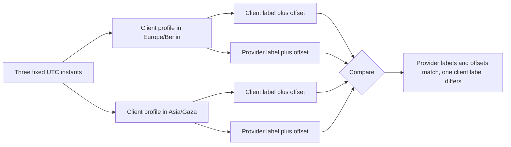

# Slot picker gate

This gate is about one moment seen from two places. You will show the same three UTC starts to a client profile in one zone and again to a client profile in another, and a mentor will compare the four labels you produce. Then you will show what happens on a day when the provider's clock changes, select a slot without touching a mouse, and hand over the intent object that the cart will receive.

Start by choosing the three instants and writing them down before you open the page. Picking them after you have seen the screen proves nothing; you will find three that happen to look right.

## The two screens

Sign in as a client whose profile zone is `Europe/Berlin` and as a second client whose profile zone is the provider's own zone. Open the same provider page and the same service on both. For each of the three instants, record the client label, the provider label and both offsets.

The expected result is that the provider labels and both offsets are identical in the two windows, while exactly one client label changes. If a provider label changed between the windows, the component is formatting the provider time in the viewer's zone. If a client label did not change, the component is formatting the client time in the provider's zone and the client is reading somebody else's clock.

The diagram is the test, drawn. Two inputs, four labels, one comparison. Write the comparison result into `docs/slot-picker-decisions.md` with the runtime version your browser reported, because the labels depend on the time zone data that runtime carries.

## A day when the clock changes

Pick a date inside the provider's booking horizon where her zone changes its offset, then open the picker on that date. The day header must say what happens and how long the day is. On a spring change you will see a shorter day and a gap between two slot labels; on an autumn change you may see the same clock hour twice with different offsets.

Show both sides of that day to the mentor. A picker that looks correct on an ordinary Tuesday and repeats a button on a change day has not passed this gate. If your seeded rules do not produce a slot near the transition, add a rule for that weekday, refresh the provider's listing fields, and reload, rather than hand-editing the response.

## Gate checklist

- [ ] Every slot shows the client's time label, the client's zone name and the client's offset, then the provider's time label, zone name and offset.
- [ ] No slot is rendered without a zone name, and no abbreviation such as `CST` is used as the only zone indicator.
- [ ] The same three instants produce identical provider labels in the two client profiles, and one different client label.
- [ ] A day whose provider-local length is not 1440 minutes carries a plain text note naming the direction and the length.
- [ ] Two instants that share a provider-local clock hour are both shown, each with its own offset, and neither is merged or hidden.
- [ ] Day grouping follows the client's calendar, and a slot whose provider date differs shows the provider weekday and date.
- [ ] Selecting a slot produces an intent holding `serviceId`, `startAt` and `clientZoneAtRequest`, where `startAt` equals the string in `starts`, and no price, duration, provider identifier or label field.
- [ ] The add to cart request sends only `serviceId` and `startAt`, and the server derives the provider, duration and price from the Service.
- [ ] Changing the profile zone re-renders every label and issues no new availability request.
- [ ] Tab, arrow keys, Home and End reach every day and every slot, Enter selects, focus moves to the continue action, and the chosen pair of labels is announced.
- [ ] The selected slot is indicated by `aria-pressed` and text, not by colour alone.
- [ ] At a 360 pixel viewport with the largest text size, no zone name is clipped, no slot button overlaps another, and no horizontal page scroll appears.
- [ ] Two screenshots, the three recorded instants, the change day note and the intent object are committed in `docs/slot-picker-decisions.md`.

A box that depends on "it looked fine" needs a recorded value instead. Write the viewport width, the browser and the runtime version beside every screenshot.

## The intent object is the artifact that survives

Screenshots age. The intent object does not: it is the exact contract that Module 18 consumes, and it is the place where a label would leak into the database if the component took a shortcut.

Print one intent beside the slot it came from, so a reader can compare the two. The `startAt` string must match the availability response character for character, including the trailing `Z`. A value like `2026-01-19T09:00` is a local time with no zone, and a value like `2026-01-19T09:00+02:00` is an instant with a fixed offset that will be wrong for the same provider next month. Only the UTC form belongs in the cart.

Keep the intent as the only value the picker exposes to the rest of the application. Every other useful field on that screen, the two labels and both offsets, is derived from the intent at render time, so a later change to how a zone is described cannot reach the cart or the database.

## Learning log

1. A client in Berlin reads 08:00 on the button and sees 09:00 for the provider. Which single stored value produced both labels, and which field of the booking will hold it after checkout?
2. On an autumn change day two buttons read the same clock hour. Explain why they are two different offers, and what on the button tells a client apart.
3. A colleague suggests formatting the time on the server and sending one label. Name two clients for whom that label would be wrong, and say what the server would have to guess.
4. A client changes her profile zone while the picker is open. What must re-render, what must not be refetched, and why must the selection survive the change?

Answer with the recorded instants and offsets. If an answer says the label is the booking time, revisit 17.01 and the instant rule from Module 5. If an answer says the picker should hide duplicate hours, reread the clock change section and the two offset labels it requires.

## Before you close

Ask the mentor to pick one slot, read the two labels aloud, and then say which value they expect to find in the cart request. They should say the UTC instant. Then have them change one profile's zone and confirm the labels moved while the offers did not.

Write down one defect this review found and the change you made. A picker that has never been read by another person on a phone has not been reviewed.

Module 18 takes the intent and turns it into a cart line. It will repeat the two labels on the cart page, because the moment a client is about to pay is the worst possible moment to show a time that belongs to nobody's clock in particular.
