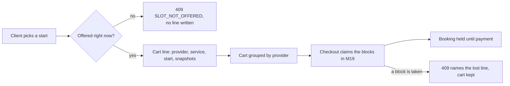

# A cart of requested slots

Amal lives in Berlin and wants two sessions next week: a 45-minute English conversation lesson with Sara, a tutor in Gaza, and a 60-minute design review with Omar, a designer in Doha. She opens both provider pages, picks 15:00 her time on Tuesday for Sara and 18:00 her time on Wednesday for Omar, and adds both picks to one cart. She will pay once at the end. That single cart is the subject of this module.

The cart has one job that is easy to get wrong. It must remember what Amal asked for without freezing either provider's calendar. Sara teaches several clients a week and most carts are abandoned. If adding a start to a cart reserved it, a client comparing three tutors would lock three calendars for as long as her tab stayed open, and a phone left in a bag could hold a Tuesday afternoon until the battery died. A cart line is a request. It becomes a reservation only when checkout claims the blocks, which Module 19 does.

Keep three words apart for the rest of the week. A request is what the cart stores. A hold is a short exclusive claim on a provider's blocks, created at checkout and paid for before a deadline. A Booking is the dated appointment that survives after payment. This module builds the first of the three and nothing else. Almost every cart bug you will debug later comes from letting one of these words do the work of another.



Read the diagram from the top. The only exit that writes a document is the one marked offered, and the check behind it is a read. No arrow in this picture writes a SlotClaim. The claim appears one module later, on a separate user action with a deadline attached, and that separation is the reason an abandoned cart costs a provider nothing.

## A line describes a start, not a count

A slot is either requested for one instant or it is not. There is no field on a cart line holding how many of something Amal wants, because two identical lessons at the same start would be the same 45 minutes sold twice. If she wants two sessions she adds two lines with two start instants, and the cart treats them as separate requests. That difference removes a whole family of bugs. There is no count to decrement, no partial amount to refund, and no arithmetic that can drift when a stored count and the real claim disagrees.

Each line therefore carries the client, the provider, the service, the requested start and the display facts that make the line readable on a phone. The start is a UTC instant, the same value the availability engine returned, not a local clock string. A line saved as `2026-01-14T13:00:00.000Z` can be formatted for Amal in Berlin and for Sara in Gaza without another conversion decision. A line saved as "Tuesday 3pm" is a bug waiting for the first client who travels.

The line also keeps its own identity. Amal removes a line by its id, not by a position in a list, so a refresh that reorders the cart cannot delete the wrong session. Two lines for the same service and different starts are two documents. Two lines for the same service and the same start are one document, and the second add either updates it or returns the existing line, depending on the rule you choose and test.

## Group by provider, because checkout will

A cart can hold services from several providers, and the grouping is not cosmetic. Checkout will create one Order per provider and one Booking per line, because each provider has a separate price, a separate cancellation policy and a separate settlement. If the cart cannot group lines by provider ID, the checkout code invents the grouping under time pressure, and the first mixed cart ends up with two Orders for one provider or one Order spanning two.

Group on the provider identifier and never on the display name. Names change, names repeat, and a provider who edits a spelling after Amal adds a line would otherwise split her cart in two. Sort the groups by identifier before rendering so the same cart looks the same on two loads and a test can compare the response with a fixture. Inside a group, sort lines by start instant, which is the order a client reads her week in.

The subtotal belongs to the group, not only to the cart. Amal should see what she owes Sara and what she owes Omar before she pays, because the two amounts have different policies behind them. If Sara's lesson has a 48-hour free cancellation window and Omar's review has 24 hours, a single combined total hides the fact that the two halves of this purchase behave differently when plans change. Module 22 pays that difference out, but the cart is where the client first sees it.

## The soft check writes nothing

Adding a line still deserves a check, because accepting a start that is already sold leaves a cart that cannot be paid for. When Amal taps 15:00, the route asks the availability engine whether that exact start is offered for that service at that moment. If it is not, the route answers 409 with a code such as `SLOT_NOT_OFFERED` and writes no line at all. Amal sees the message on the slot picker, not four screens later on a payment form.

The check is soft in the only sense that matters: it reads and does not write. It cannot prevent a second client from claiming the same block one second later, and it does not try. Between the cart and the payment form there is a whole checkout transaction that revalidates everything and inserts the claims. The soft check exists to give fast, kind feedback, not to promise exclusivity. A cart built on the assumption that the check reserved anything will disappoint Amal at the worst possible moment.

Say what happens on a stale add twice in your own words, because reviewers ask. The engine says not offered, the route refuses, the client reloads the day strip, and the line that would have failed is never created. Nothing is held. Nothing needs releasing. That is a much smaller failure than a cart line that looks fine and dies during payment.

## Snapshots on the line, authority at checkout

The cart shows a price and a policy, and both can go out of date before Amal pays. Sara can raise her price on Monday, or change her free cancellation window from 48 hours to 24. The cart line therefore stores what Amal was shown: the amount in integer minor units, the currency, and the policy fields that were in force when she added the line. A cart that silently rewrites the price to today's value is showing her a number she never agreed to.

Storing a snapshot is not the same as trusting it. Checkout re-reads the Service, computes the amount again and stores the accepted terms on the Booking. If the price or the policy moved between the cart and checkout, checkout refuses the diff or asks Amal to confirm the new figure, and that decision belongs to Module 19. The cart's copy has two jobs only: render an honest line, and let the interface warn that something changed.

Keep the snapshot small. Four policy numbers and one amount are enough to show a policy sentence and to detect a change. Copying the provider's full document into every line makes the cart heavy on a phone with expensive data, and it invites a later developer to read a stale field as if it were current.

## Stale is a state, not an error

Between one page load and the next, a line can stop being payable. The service can be archived, the start can pass the provider's notice window, or another client's checkout can take one of the blocks the line needs. None of these events should delete Amal's line, because a line that vanishes teaches her that the cart is unreliable. Mark it instead, with a reason code and the start instant still visible, and offer the nearest replacement starts.

Staleness is computed, not stored forever, because a stale line can become valid again if a rival hold expires and releases its blocks. Revalidate on read with one query for the lines' services and one range read for the claims that could intersect them. Do not run a separate availability call per line; a cart with six lines would make six engine runs for one screen.

The distinction between stale and failed is worth repeating aloud. Stale means the request cannot be paid for as written, and the client chooses a new start. Failed means a payment attempt did not complete. Expired means a hold ran out. A cart refresh must never be able to cancel a paid Booking, and a single status field shared across the three ideas will eventually do exactly that.

## A cart belongs to one client

The cart query takes the client from the session and never from the request body or the address bar. Every read and every write is scoped by that value, and a line id from another account is a 404 or a 403, not a silent update. This sounds obvious until you write the first route as `DELETE /cart/items/:id` and forget the second half of the filter.

Two clients may hold lines for the same provider and the same start, and that is correct behaviour at this stage. A unique index on provider and start here would turn shopping into a reservation. The only uniqueness the cart needs is per client and per requested line, so a double tap on a slow connection leaves one line instead of two identical ones.

Test this with two real accounts rather than one account and a hand-edited token. Amal's token must not read Rami's cart, remove Rami's line, or learn anything about Rami's providers from an error body. Write that test before the route is finished, because it is much easier to add the scope filter while the handler is three lines long.

## What the phone shows at 360 pixels

Most fellows read this screen on a phone. Build the cart as one column at 360 pixels wide, with each line showing the service title, the client's own local start, the provider's local start in smaller text, the duration and the price. Do not hide the provider's time behind a tap. The whole point of showing both is that Amal never has to ask which clock a time belongs to.

Give the remove control a 44 pixel touch target and put it at the end of the line rather than at the start, so a thumb scrolling the list does not delete a session by accident. Let long service titles wrap to two lines instead of truncating them with an ellipsis, because "English conversation lesson, 45 minutes" truncated after "English conv" is not readable. Keep the price and the two times on separate rows so neither is squeezed at that width.

Then check the state that matters most: a stale line on a small screen. The warning must appear above the line it describes, not as a banner at the top of the page, and the replacement starts must be reachable without horizontal scrolling. If the only way to recover from a stale line is a control that has scrolled off screen, the client will call the provider instead.

## What the learner will build

The next lesson adds the cart module to the API and the cart page to the client. It extends the CartItem model from Module 6 with the snapshot fields, adds add, list and remove routes scoped to the authenticated client, and groups the response by provider with a subtotal per group. It writes the soft check that refuses an unoffered start, the revalidation pass that marks stale lines, and the warning for two of Amal's own lines that overlap in her day.

The evidence for this module is a cart of two providers that renders grouped, refuses a sold start without writing a claim, and survives a rival claim by marking one line stale. Before you start, write one sentence predicting what the second client sees when Amal adds a slot and walks away with the tab open for three hours. The next lesson tests that sentence, and the gate after it collects the evidence.

```predict
prompt: "Amal adds Sara's Tuesday 15:00 start to her cart and leaves the tab open for three hours. At 15:30 another client opens Sara's page. What should the second client see?"
options:
  - id: blocked
    label: "The 15:00 start is gone, because Amal's cart line owns it"
  - id: offered
    label: "The 15:00 start is offered, because the cart owns nothing"
correctOptionId: offered
explanation: "A cart line is a request. No SlotClaim is written until checkout, so the block is still sellable until someone claims it, and Amal's abandoned cart should cost Sara no teaching time."
allowRetry: true
```
