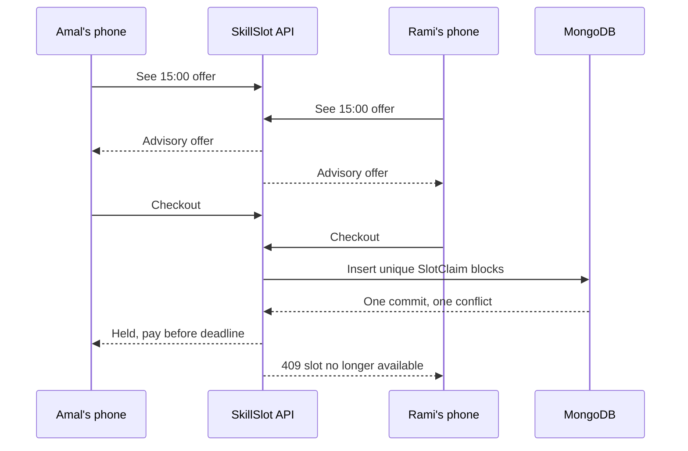

# Two phones, one 15:00 slot

At 14:02, Amal and Rami both see a 15:00 tutoring session with the same provider. Each phone loaded availability a moment ago. Amal adds the session to her cart. Rami adds it to his. Neither cart owns the time. A cart is an editable proposal that can become stale between one screen and the next. If the application treats a green slot card or a cart line as a reservation, it will eventually promise one human's hour to two clients.

At 14:04, both clients press checkout. A fragile implementation reads the absence of a Booking twice. Both requests decide the slot is free, both write a Booking, and both show success. The provider receives two attendance messages. One family may have arranged transport or childcare. A later apology or refund cannot restore the same time. The product promise is stronger than an attractive calendar: only one committed claim may own each provider's occupancy block.

The winning client receives a short hold, not a paid appointment. Her response includes a server-issued `holdExpiresAt` and the provider-local display time. The losing client receives a conflict response that names the exact cart line and start time. The cart remains editable; she can choose another offer. Neither response should say that a card was charged, because this module has not called the payment provider. Payment follows in Module 20. A hold creates a narrow window to attempt payment without another checkout taking the same blocks.

## A day with two providers

Now add a second cart line: Amal wants the tutor at 15:00 and a music teacher at 17:00. The two providers have separate calendars, prices and cancellation policies. She presses one checkout button. The desired outcome is one logical checkout attempt that either holds both lines or holds neither. If the tutor's 15:00 is lost, the music slot must not remain locked for her by accident. Her cart can still show both lines with a clear lost-slot marker. If both claims succeed, the database contains one provider Order for each provider and one Booking for each line, tied to a single checkout attempt.

This distinction matters when a client asks support, "Where did my order go?" The checkout ID identifies the client's one attempt. Provider Orders support later provider settlement and policy accounting. Bookings describe scheduled obligations. SlotClaims protect the occupied 15-minute blocks. A payment may be shared across multiple Orders, but it will be created after the database hold commits. The roles are related, yet none can substitute for another without losing a useful invariant.

Suppose the 15:00 tutoring service lasts 45 minutes with a 15-minute cleanup buffer. It occupies four blocks starting 15:00, 15:15, 15:30 and 15:45. A 15:30 tutoring request overlaps it even if its start time differs. This is why a unique key only on Booking.startAt would be inadequate. The claim key is `{providerId, blockStartAt}` for every occupied block returned by the Module 15 occupancy helper. A request for a different provider may use the same UTC block. A request for the same provider must not share any claimed block.

## What the server can know

The server can know that Amal's authenticated user owns the cart; that the requested Service is still active; that the Provider is listed; that the UTC start is among currently offered starts; and that no live claim wins a unique index collision. It cannot know that her card will succeed before asking the payment provider. It also cannot treat the phone's subtotal, duration or time-zone label as authority. Those values can be stale or modified in transit. Checkout re-reads Service and Provider records, calculates occupancy, and snapshots the commercial terms it is about to offer. The snapshot allows a future receipt to explain what was agreed even when the provider edits tomorrow's price.

The server also must handle imperfect networks. Amal may receive no response after a successful commit. If she presses checkout again with a new identifier, she could create an unrelated attempt or receive a confusing conflict against her own hold. The browser should create one opaque checkout ID for the intended purchase and reuse it for retries of the same request. The server stores that ID, the authenticated client and a canonical payload fingerprint. A retry with the same content returns the same held result. Reusing the ID for a different cart is an error, not an invitation to rewrite a prior purchase.

Walk through a communication failure from the client's view. Amal taps once, sees a spinner, and loses Wi-Fi. The hold succeeds at the database, but the HTTP response never reaches her phone. After reconnecting, the browser sends the same checkout ID. The server reads the committed attempt and returns the original Orders and deadline. The payment screen can continue. The phone need not guess whether to start over. This is a measurable user experience result of an idempotency rule, not merely a backend optimization.

## Holds need a clock and a release path

A held appointment cannot block a provider forever. The product chooses a ten-minute hold window for this exercise. The server records the deadline as an instant, displays a countdown derived from that deadline, and checks the deadline again on every payment-sensitive operation. A browser timer is a hint; a closed tab or a paused phone will not release a claim. A worker later marks an unpaid Booking expired and deletes its SlotClaims as one database transaction. The Booking and Order history remain for support. A delayed worker is possible, so checkout also has a safe expired-claim recovery path instead of assuming that a TTL index cleared a row exactly on time.

Payment changes the story. Once a payment is confirmed by a trusted webhook, the hold becomes a confirmed Booking and its claims remain. If a payment fails or the deadline passes, the payment workflow must decide whether the hold can be released. A late success requires a deliberate reconciliation or refund path; deleting claims while payment may still settle would break the promise again. Module 20 designs those transitions. This chapter establishes the held state and hands off a consistent set of records.

## A review conversation

Ask one learner to play Amal, one to play Rami, and one to play the provider. Amal explains why a green slot did not guarantee ownership. Rami explains what the 409 response should offer him. The provider identifies the single schedule that may now be trusted. Then switch roles and introduce the two-provider cart. The group should be able to point to the exact record that proves one checkout attempt, the records that describe each provider's commercial obligation, and the index entries that stop a double booking.

Write the product promise beside your implementation plan: "A visible offer may disappear; a committed live claim cannot be sold twice; a paid Booking remains an explicit obligation." If your design makes a successful API response before every required claim is committed, the promise is false. If it hides all claim conflicts behind a generic server error, the promise is technically guarded but the client cannot recover. The remaining lessons turn this sentence into database writes and observable tests.

The final demonstration will use two phones and twenty concurrent test requests. The phone demonstration exposes the human impact; the test exposes the race a single developer cannot reliably reproduce by clicking. Both are required. A happy-path video of one checkout alone would leave the most expensive failure mode unexamined.

