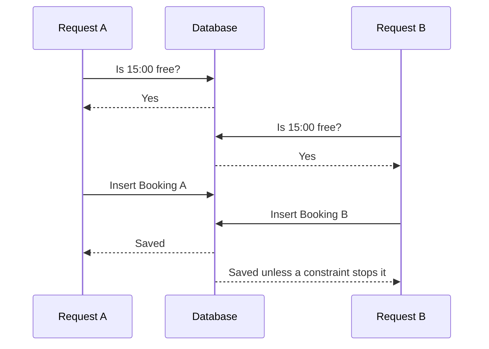

# Check-then-insert is a race

Imagine a server route that runs `Booking.exists({ providerId, startAt })`, then inserts when the answer is false. The route works in a one-person demo. It fails when two requests overlap. Both can read the same empty state before either inserts. The second request does not become correct merely because its read occurred milliseconds later; what matters is whether a conflicting write became visible before its read. An application process lock would only guard one process and would disappear when the service scales to a second instance.

<TraceRequest
  method="POST"
  path="/api/checkouts"
  request='{"checkoutId":"attempt-A","lines":[{"serviceId":"tutor-45","startAt":"2026-11-02T15:00:00.000Z"}]}'
  response='{"status":409,"code":"SLOT_TAKEN","lineIndex":0,"startAt":"2026-11-02T15:00:00.000Z"}'
/>

The trace shows a losing request. It is an expected business outcome, not a failed server. A client may see a 15:00 offer and still lose it before checkout. The response names the line that changed so the browser can offer another start. It must avoid promising that every other line is held. The checkout transaction has rolled them all back.

## Why an availability query is still useful

The Module 15 availability engine filters hours, exceptions, notice, booking horizon, holds and confirmed claims. Its response helps clients choose a plausible slot. Checkout should reuse the same pure occupancy calculation to validate the proposed start and all occupied blocks. Yet the query is a view of a moving calendar. It cannot be the final exclusivity mechanism. Between the last availability read and a write, a new claim may commit. We want both layers: the read gives a humane answer most of the time; the database constraint settles the remaining race.

Consider a 60-minute session with a 15-minute buffer. Request A starts at 15:00, B starts at 15:45. A `Booking.exists` query keyed only by exact start reports no duplicate. The sessions overlap at 15:45 and 16:00. The problem is not only timing. It is also an incomplete conflict model. The occupancy helper expands each Booking proposal into 15-minute block starts. A unique compound index over provider and block start detects every shared block, regardless of which Booking starts first.

At the whiteboard, draw four horizontal rows: the provider's local rule, its resolved UTC offer, the cart's proposed start and the claim blocks. Mark where each row can change. A rule edit can remove future offers. A client can revise a cart. A claim, once committed, occupies UTC blocks until a controlled state transition releases it. Treat these rows as different commitments. A cached availability page can be seconds old; a live unique claim must never be casually overwritten to compensate.

## Transactions do not invent a predicate lock

It is tempting to put the `exists` read and `Booking.create` in a MongoDB transaction and stop there. The transaction will make its own multiple writes atomic, which matters for a cart. It does not by itself guarantee that two concurrent transactions reading an empty range cannot both proceed. Snapshot reads may be stale with respect to another in-progress or newly committed write. The database needs a write conflict on the actual contended resource. Here that resource is a unique SlotClaim key for each occupied block. If both transactions try to insert the same key, only one can commit successfully.

MongoDB's [transaction production guidance](https://www.mongodb.com/docs/manual/core/transactions-production-consideration/) specifically discusses write conflicts and stale reads. The [unique index reference](https://www.mongodb.com/docs/manual/core/index-unique/) states that a compound key combination can appear at most once. Use those statements together. The transaction supplies all-or-nothing creation of attempt, Orders, Bookings and claims. The unique index supplies an exclusivity rule for an occupied block. Neither should be presented as a replacement for the other.

There is another race: the provider edits weekly hours while a client checks out. A checkout that reads yesterday's schedule snapshot might still reserve a start that the provider just closed. Module 13 serializes provider calendar edits by writing `Provider.scheduleRevision` first. Checkout must write the same Provider document before final rule and TimeOff reads, then recompute the offer. This document write establishes a conflict with a concurrent editor. A transient write conflict triggers a whole transaction retry with fresh reads. A mere `Provider.findById` read does not establish that serialization. When the cart spans providers, write their Provider documents in a stable sorted order to reduce conflicting lock order.

The provider write is a fence, not a substitute for claims. Two checkouts might both serialize their provider fence writes and still try to own the same block if the later one uses stale or incomplete claim reads. The unique index is the decisive invariant. Conversely, a unique claim could prevent double booking while allowing a checkout at a newly closed hour if the schedule change is not coordinated. Both races need explicit handling and separate tests.

## Identify each outcome

For two clients chasing the same 15:00 offer, one successful transaction should create the full held purchase and respond 201. The other should respond 409 with `SLOT_TAKEN`, preserving its cart and naming the proposed start. For one client retrying the same request after losing a response, the attempt ID should return the original result, not race against itself. For one client reusing the attempt ID with different lines, the server should reject the request as `CHECKOUT_ID_REUSED`. Those are three distinct conflicts. A generic catch of all database errors as "slot taken" would hide bugs and could make a broken order look like ordinary competition.

Use a dated example to distinguish schedule validity from ownership. The provider lists Monday 15:00 in `Asia/Gaza`. On 2026-11-02 the server resolves that local start to a UTC instant. At 14:02 a TimeOff edit closes 15:00. A cart may still display the old offer. At checkout, after the Provider fence write, the server re-reads TimeOff and returns 409 `SLOT_NO_LONGER_OFFERED`. No SlotClaim is inserted. If instead the offer remains valid but another client claims it first, the response is 409 `SLOT_TAKEN`. The browser can offer alternatives in both cases, while logs preserve the actual reason.

## A small adversarial review

Take the naive pseudocode and ask a partner to place a pause immediately after the free check. Run two requests to the pause, then let both continue. If the route has no unique database constraint, both succeed. Next, add a transaction around the old code and repeat the thought experiment; identify the missing contended write. Finally, add the provider/block unique index and predict the result for a 15:00/15:45 overlap. The exercise should leave no statement such as "we checked first" in the proof of exclusivity.

Record an invariant in the test plan: for each `{providerId, blockStartAt}`, count of active SlotClaim documents is at most one because the collection's unique index rejects a second document. This is stronger than counting Bookings only after a route returns. The next lesson gives the claim its exact shape and addresses what a duplicate key response means.

## Inspect a misleading passing test

Suppose a test sends request A, awaits its 201, then sends request B and asserts 409. That test proves the route can observe an already committed claim. It says little about the interval when both calls have already passed a free check. Add a barrier in a test-only dependency: each request pauses after reading the same offered start, then both continue together. If the code still relies on the read, both may create Bookings. With unique claims, one transaction can commit and the other must abort. The barrier is not production code and should be removed or disabled outside the test environment.

Also inspect the error path after a provider schedule edit. If the UI maps every 409 to "another client booked this slot," the message could blame an imaginary competitor when the provider closed their hours. The endpoint can use `SLOT_NO_LONGER_OFFERED` for a rule or TimeOff change and `SLOT_TAKEN` for a unique claim conflict. Both require a new selection, but support and telemetry need the distinction. A client who repeatedly loses a provider-edited offer may reveal stale cache invalidation; a client who loses a popular slot is experiencing ordinary contention.

As a transfer exercise, apply the same reasoning to an equipment rental with two bicycles and a fixed capacity of two. A unique slot key alone would be too strict because two units can be rented concurrently. The database would need unit-specific claim keys or an atomic capacity counter. This course's SkillSlot provider has capacity one per occupied block, so `{providerId, blockStartAt}` is the correct key. State the capacity assumption whenever you present the index as a general booking pattern.

