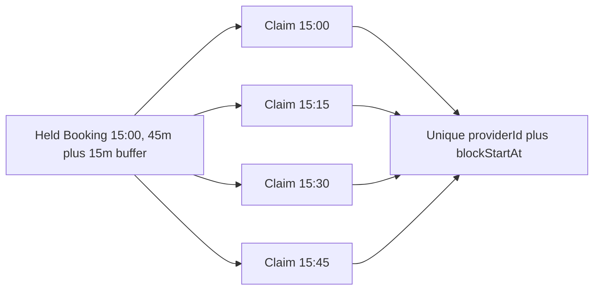

# Claims as database locks

A SlotClaim is a persistent ownership record for one 15-minute UTC block on one provider calendar. Its fields include `providerId`, `bookingId`, `blockStartAt` and `state`. The compound unique index on `{providerId, blockStartAt}` means two live documents cannot occupy the same provider block. `bookingId` identifies which held or confirmed Booking owns it. A claim is not a JavaScript mutex. It works across every API instance connected to the same indexed collection, and it survives an API restart.



<TraceRequest
  method="POST"
  path="/api/checkouts"
  request='{"checkoutId":"try-204","lines":[{"serviceId":"lesson-45","startAt":"2026-11-02T15:00:00.000Z"}]}'
  response='{"status":201,"state":"held","holdExpiresAt":"2026-11-02T14:14:00.000Z","orders":[{"providerId":"teacher-7","bookingCount":1}]}'
/>

The example says a 45-minute service plus a 15-minute buffer occupies four blocks. The exact milliseconds in `startAt` come from the server's validated UTC representation. Do not build block keys from a browser-local string such as `15:00`. That string is ambiguous without a date and named time zone, and a daylight-saving transition may repeat or skip it. Module 5 resolves local intent; Module 15 computes offered starts and occupied UTC blocks. Checkout reuses that function exactly.

## Give the database a rule it can enforce

In the M6 data model, add the index to the SlotClaim schema before accepting checkout traffic. A schema declaration that has not built the actual database index is not a protection. Migration or startup checks should verify that the production collection has the expected unique key. Tests should wait for index creation too. Otherwise a fast concurrency test can produce two claims before the index exists and falsely suggest the route was fixed by later code changes.

```ts
slotClaimSchema.index(
  { providerId: 1, blockStartAt: 1 },
  { unique: true, name: 'unique_provider_block' }
);
```

MongoDB's [unique index documentation](https://www.mongodb.com/docs/manual/core/index-unique/) guarantees uniqueness for the compound key combination. That guarantee is the exact property we need. `bookingId` deliberately is not part of the unique key: adding it would let two different Bookings claim the same block. `state` is also not part of the key. A confirmed claim and a held claim both block the time. When a hold truly ends, release removes the corresponding claim documents in a controlled transaction; it does not leave an `expired` claim in the unique-key collection indefinitely.

The claim documents must be created in the same transaction as the held Booking and provider Order. If a later block collides, the transaction aborts every earlier claim and every Booking from that checkout. A cart with a 15:00 tutor line and a 17:00 music line cannot leave half an order because the tutor's fourth block was taken. Conversely, a Booking without its full claims would falsely look owned to the client while allowing another client to purchase an overlapping start. The transaction maintains this multi-record invariant.

## Translate contention precisely

The database may surface a duplicate-key error when an insert tries a taken block. The route should map a duplicate from the named `unique_provider_block` index to 409 `SLOT_TAKEN`, with a safe representation of the cart line and proposed UTC start. Do not copy raw database error text to the response; it may disclose collection internals. Do not map an unrelated duplicate such as the checkout ID unique index to `SLOT_TAKEN`. That case is an idempotent retry or a reused ID, handled separately. A validation error or a missing transaction session is a server fault, not evidence that another client won.

Write the attempted block list in a deterministic order: provider ID, then start instant. This makes failure logs and tests reproducible. However, index collisions do not promise which of several bad cart lines will fail first under all schedules. If the route wants to identify the lost line, it should retain a mapping from each proposed block to its original line and, after an aborted transaction, recheck the specific attempted slots against current claims. If a provider edit rather than a claim made the offer invalid, use a different response code. The client needs a truthful next action more than a raw key value.

Transient transaction conflicts are different. MongoDB may ask the driver to retry because another transaction touched a document. The retry must re-read provider terms, rules, TimeOff, active claims and hold quota in a new transaction attempt. Replaying a precomputed price or availability result from the first attempt can commit stale business terms. The driver transaction helper may retry the callback; therefore the callback cannot send email, charge a card, or publish an irreversible event. It may only perform database reads and writes that are safe to rerun. MongoDB's [transaction guidance](https://www.mongodb.com/docs/manual/core/transactions-production-consideration/) distinguishes write conflicts and stale reads; [Mongoose's transaction guide](https://mongoosejs.com/docs/transactions.html) warns against parallel operations on one session.

What if a claim's hold deadline passed but its cleanup worker has not run? The unique index still rejects a new document. The checkout path must trigger or coordinate a safe expired-hold release before retrying the claim, and only if payment state allows release. It must not simply ignore the old claim in a read filter while leaving it in the unique index. Nor should it delete a claim solely because a timestamp passed while a payment webhook could be confirming it. Module 20 will define a state transition with the payment outcome. In this module, an expired unpaid hold is eligible for a release service, and the claim remains authoritative until that service commits.

## A concrete block ledger

Create a review table with columns `providerId`, `blockStartAt`, `bookingId`, `state`. Insert a 15:00 45-minute lesson plus 15-minute buffer for provider P. Then propose a 15:45 30-minute appointment on P and one on Q. The P proposal collides at 15:45; the Q proposal is independent. Propose 16:00 on P and it can proceed if the service's own offer rules allow it. The unique index answers occupancy, not business hours. Both checks are necessary.

Ask a partner to inspect the ledger after a failed two-provider cart. They should find no claims, Bookings or Orders created by that attempt. Ask them again after a successful hold: they should find one Booking per line and the complete set of blocks. After confirmation, claim state may change to `confirmed` with the Booking, but the unique key remains occupied. The ledger exercise makes the claim's lifetime explicit before we add expiry and payment.

The next lesson turns the hold deadline into a managed state transition. A timestamp is not a release mechanism. The application needs a consistent way to preserve history, free blocks when safe, and tell a late client that the hold has ended.

## Review an index migration before launch

On an existing development database, the index build can fail if duplicate claims are already present. Do not hide that failure by dropping the collection in production. Run a read-only duplicate aggregation grouped by provider and block start, record every offending Booking, and decide which records were valid under business history. Repair through an explicit migration with backup and review, then create the unique index and verify its name and `unique` option. A test that defines the index in source code but never checks the running database gives false confidence. The deployment gate should stop checkout traffic if the index is missing.

The index key also needs normalized types. One request must not store `blockStartAt` as a Date and another as a string, or use different provider ID representations. M6 schemas should enforce UTC Date values and ObjectId references or another single canonical type. A 15:00 block should have exactly the same stored key regardless of the client's display zone. Validate 15-minute alignment before insertion: a 15:07 instant must be rejected as malformed input rather than rounded silently to 15:00. Silent rounding could move an appointment away from the time the client accepted.

Check a failure where the third of four claims collides. The first two claim inserts happened inside the transaction, but after abort none may remain. Assert this by querying the exact proposed Booking ID and all four keys. If the test only checks the colliding third key, it could miss leaked first and second claims. The same test should check that an unrelated existing claimant's document is unchanged. A conflict handler must never delete the winner's claim while trying to clean up the loser's attempt.

