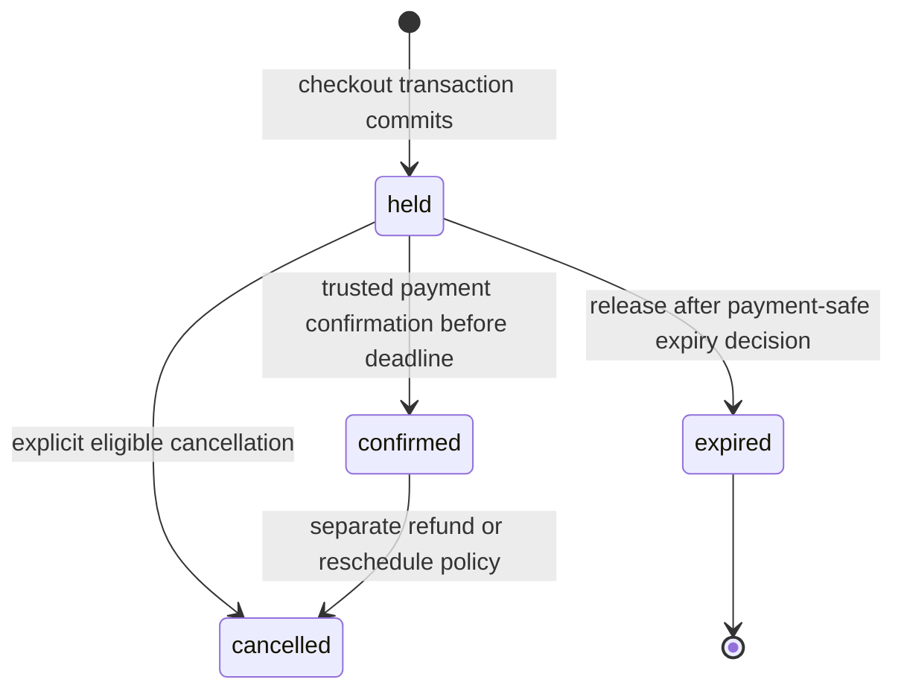

# Holds that expire

At 14:04, Amal claims a 15:00 appointment and opens the payment form. The server records `holdExpiresAt` at 14:14. The deadline is an absolute UTC instant, not ten minutes of browser animation. The phone may sleep, lose connection or have an inaccurate clock. A client-visible countdown helps her decide, but every server transition compares its own clock to the stored deadline. A held Booking owns SlotClaims until a deliberate release or confirmation commits. The deadline alone does not remove a unique index entry.

<TraceRequest
  method="GET"
  path="/api/checkouts/attempt-A"
  request='{"clientId":"authenticated-client"}'
  response='{"state":"held","holdExpiresAt":"2026-11-02T14:14:00.000Z","serverNow":"2026-11-02T14:07:00.000Z"}'
/>

The response returns both deadline and server time so the browser can correct a visibly wrong local clock. It does not let the browser extend the hold. If the client reloads, the attempt lookup can restore the same Orders and remaining time. A retry of checkout with the same ID does not reset the deadline. Otherwise a script could squat on a popular provider calendar by refreshing every nine minutes.

## Preserve the story after a release

A Booking is a business record. It may later explain an abandoned checkout, a payment failure, a provider support question or a refund. Deleting it on expiry destroys that story. Instead, release marks the Booking `expired`, marks or closes the corresponding pending Order state, and deletes the live SlotClaims in one MongoDB transaction. The Booking retains start, end, provider, client, Service snapshot, policy snapshot and the hold deadline. An order history query can now say "hold expired before payment" without implying that an appointment still occupies the calendar.

Do not put a TTL index on Booking as the primary release mechanism. MongoDB's [TTL index documentation](https://www.mongodb.com/docs/manual/core/index-ttl/) says deletion can lag behind expiration. TTL would also delete evidence we need. A queue or scheduled worker can find due held attempts, but it must perform an explicit state transition. Checkout should be able to request safe cleanup when it encounters a due claim, because the worker may be delayed. Both paths call the same release service and compete under database state predicates, so only one wins.

An important boundary remains: payment may still be in progress at the deadline. If a PaymentIntent was created, the expiry worker must coordinate with Module 20's payment state machine. It cannot delete claims merely because `Date.now() >= holdExpiresAt` if a success webhook is being processed or if an external payment succeeded before the deadline but the webhook arrived late. The safe design uses a payment-aware decision, an atomic database transition, and a reconciliation path for late external outcomes. This module implements holds before payment; its release service accepts only an unpaid, eligible held attempt. Module 20 fills in the provider interaction and late-success cases.

## State predicates make repeated jobs harmless

Scheduled jobs are usually delivered more than once. A release transaction should query by checkout attempt ID and current state, then change `held` to `expired` only if its deadline is due and payment state permits it. If another worker already released the attempt, it returns the recorded expired result. If a webhook confirmed it first, it leaves claims intact and reports a no-op. The worker should never delete SlotClaims by provider/time alone, because a later successful Booking might have reclaimed the block. Delete by the exact Booking IDs owned by the attempt, under the same state decision. Record release reason and time for support.

Consider a crash after the worker reads an expired attempt but before its transaction commits. No state changes become visible; the next worker can try again. Consider a crash just after commit but before the queue acknowledges the job. The next worker sees `expired` and does nothing. This is why state predicates and atomic release matter more than exactly-once queue delivery. You can simulate both by calling the release service twice and inspecting the claims after each call.

Expiry also needs an honest API response. A client who presses Pay at 14:15 should receive a stable `HOLD_EXPIRED` result and a path to choose another slot. The browser may still display the old cart line but should not continue to a payment screen that implies ownership. An expired attempt must not be revived by repeating its checkout ID. A new purchase requires a new checkout ID, a fresh offer validation, and a new set of claims. That new attempt may succeed if the slot is still available, but it is a separate decision.

## The multi-provider clock

One checkout can create an Order for each provider. Give the whole attempt one deadline rather than slightly different deadlines per line. If a client holds both a tutor and a music teacher, the payment window should be understandable as one transaction. If payment cannot complete for both, the release service frees both provider calendars together. If one provider changes a rule after the hold, that edit must not retroactively erase the held Booking. Module 13 protects existing commitments and treats schedule changes as changes to future offers.

There is a capacity concern: an attacker can create many short holds and never pay. Expiry eventually releases them, but ten minutes is long enough to harm a busy provider. Module 19.9 adds a per-client active-hold cap and a distributed checkout rate limit. These controls should limit abuse without making a legitimate client who lost network access unable to retrieve their existing attempt. Retrieval by the same checkout ID is a read of a committed purchase state, not a new hold request.

## Walk the timeline

Draw four instants: checkout at 14:04, payment form at 14:07, deadline at 14:14 and cleanup at 14:16. At 14:15, the unique claim may still physically exist because cleanup has not run. Availability should hide it until the safe release commits. It would be misleading to show the block as free based only on the deadline while the unique index still rejects a checkout. Once release commits at 14:16, availability can show a new offer if provider rules still permit it. The difference between deadline and release is intentionally visible in this exercise.

Now move payment success to 14:13 but delay the webhook until 14:17. Do not assert that the worker can blindly release at 14:14. Write the open race in the handoff to Module 20. A robust payment workflow may prevent capture after the deadline, confirm under a database predicate, or reconcile and refund a late success. The exact provider API decisions belong there, but the hold model must reserve a place for them. A simple timestamp comparison without a payment state cannot decide a financial outcome.

The acceptance test for this lesson is state-based: an unpaid due attempt is released once, its Booking and Order snapshots remain, claims disappear together, and a repeated release changes nothing. A confirmed Booking keeps its claims. A payment-pending case is deferred to the explicit Module 20 policy, never silently treated as an ordinary expired cart. This prepares the checkout build for a truthful deadline.

## Decide what a late worker may say

If cleanup runs at 14:16 for a 14:14 deadline, record both `holdExpiresAt` and `releasedAt`. They answer different support questions. The first is when the client's right to complete checkout ended under product policy. The second is when the calendar keys became available again. A report that labels the entire interval 14:14 to 14:16 as bookable would be false while claims still occupied it. Measure that delay, alert if it grows beyond the operational target, and keep the API's offer query aligned with live claim rows.

An attempted release should carry a reason such as `unpaid_timeout`, `client_cancelled` or `payment_failed`. The reason should be recorded on the attempt and relevant Orders without trusting a client-supplied string. Different reasons may matter to support and abuse controls. A client cancellation before payment can free the slot promptly; a payment failure may need to wait for the provider's authoritative final status. Both use the same atomic record transition after eligibility has been established, but their evidence is different.

For a testing clock, inject `now` into the release service rather than monkey-patching global time. Set it to one millisecond before the deadline and assert no release, then to the exact deadline and assert the chosen inclusive expiry rule. Document whether `now >= holdExpiresAt` means due; this module chooses yes for an unpaid hold. A flaky test that sleeps ten real minutes will not help a reviewer understand that boundary and will slow the course unnecessarily.

