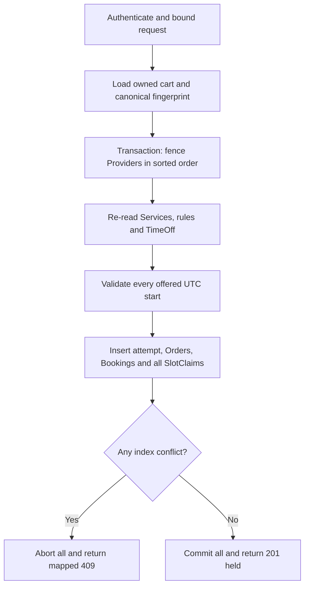

# Checkout all lines or none

Build `POST /api/checkouts` as the first route that turns a cart proposal into a time commitment. The route authenticates the client, accepts a client-generated checkout ID and a bounded list of cart line IDs, and returns held Orders with one common deadline. It must not accept a client-supplied price, provider ID, duration or claim-block list as authority. Those fields are loaded or computed by the server from the cart, Service, Provider and Module 15 occupancy helper. The route's essential contract is all lines held or no line held.



First, define a request schema. The checkout ID is an opaque UUID generated once when the client begins the intended purchase. Cart line IDs are an array with a small product limit, for example eight. Reject zero lines, duplicates, malformed identifiers and an overlarge body before opening a transaction. Load only CartItems owned by the authenticated User and confirm the number loaded equals the number requested. A user must not be able to submit another user's cart item ID and learn whether it exists. A 404 or scoped validation response can avoid disclosing foreign ownership.

Next, prepare a canonical intent: sort line IDs only for fingerprinting, and include their current Service IDs and requested UTC starts as stored in the owned cart. Do not place the user-provided subtotal into this intent. The browser can show a quote, but checkout rebuilds the quote from live Service terms and returns any changed price or policy for explicit review. A server-side fingerprint of the intended line set prevents a checkout ID from being reused with a different purchase. The transaction inserts the CheckoutAttempt with unique `{clientId, checkoutId}`. A concurrent same-ID request must resolve against that unique key and return the committed attempt once visible.

## Fence the provider schedule before validating

Collect every Provider ID from the Service records and sort IDs lexically. Extend the M6 Provider model with an integer `calendarFence` initialized to zero and migrate existing records before enabling checkout. Inside the transaction, write each Provider document in that order using a no-op-resistant increment of this field. Module 13 schedule edits write `Provider.scheduleRevision` on the same document before modifying rules or TimeOff. Both workflows therefore contend on the Provider document. After acquiring the write, re-read the Provider, active Service, current rule set, TimeOff, and live claim range in the transaction. Recompute whether each requested UTC start is still offered, using the M15 adapter and server clock. A transaction conflict must retry this whole sequence with fresh reads. A pre-transaction availability read may improve feedback but cannot authorize the write.

If the provider changed their zone or unpublished since the cart view, return a specific stale-offer conflict. A rule mismatch or new TimeOff is not a `SLOT_TAKEN` index error. Preserve the cart and include a safe `lineIndex`/`startAt` pair so the browser can highlight the line. If an active Service's duration or price changed, decide whether product policy asks for explicit re-acceptance. For this exercise, reject with `QUOTE_CHANGED` and return server-calculated updated terms rather than silently charging a higher price. The next checkout attempt uses a new checkout ID after the client accepts.

```ts
await connection.transaction(async session => {
  for (const providerId of sortedProviderIds) {
    const fence = await Provider.updateOne(
      { _id: providerId, status: 'listed' },
      { $inc: { calendarFence: 1 } },
      { session }
    );
    if (fence.modifiedCount !== 1) throw new StaleOffer(providerId);
  }
  const lines = await loadAndValidateFreshLines({ clientId, cartIds, session, now });
  const attempt = await createAttempt({ clientId, checkoutId, lines, session, now });
  for (const line of lines) {
    const booking = await createHeldBooking(line, attempt, session);
    for (const blockStartAt of blocksFor(line.startMs, line.duration, line.buffer)) {
      await SlotClaim.create([{ providerId: line.providerId, bookingId: booking.id,
        blockStartAt, state: 'held' }], { session });
    }
  }
  await createProviderOrders(lines, attempt, session);
});
```

This is a shape, not copy-paste-ready code. It omits precise model types, hold quota, snapshots and error mapping, which the following chapters add. It deliberately uses sequential `await` within the transaction. [Mongoose's transaction guide](https://mongoosejs.com/docs/transactions.html) says parallel operations on one session are unsupported. Transaction callbacks may be retried; do not send emails, create a PaymentIntent or publish a message from inside this callback. The route returns only after a successful commit, with majority write concern configured for the production transaction policy.

## Bound the transaction

Keep each checkout small: cap cart lines, cap each Service's duration and buffer in M6, cap the booking horizon in M15, and compute block counts before writing. A cart with an unbounded year-long service would create too many claims and hold locks too long. Precreate required collections and indexes during deployment. MongoDB's [production transaction guidance](https://www.mongodb.com/docs/manual/core/transactions-production-consideration/) documents transaction lifetime and write-conflict behavior. The route should retry a bounded number of transient conflicts, then return a retryable service response rather than spinning forever. A slot already taken after a fresh retry remains a 409.

The response should include the checkout ID, common hold deadline, per-provider Order IDs, each Booking's UTC start/end and provider-local display labels, and server time. It must not say paid or confirmed. The database writes should include the exact line order mapping so a conflict can identify the correct cart line even after grouping Orders by provider. Return `Cache-Control: no-store` for private purchase data. Authorization applies on lookup as well as creation.

## Test an abort that occurs late

Seed two providers. Make the first provider's line valid and the second provider's requested block already claimed by someone else. Submit the two-line checkout. Assert 409 and then query by checkout ID: no attempt, Orders, Bookings or SlotClaims from this request exist. Repeat with the first and second lines swapped. If the first line persists in either order, one of the writes escaped the transaction or the route caught an error inside the callback and allowed commit. A transaction callback must throw a business conflict to abort; returning an error object from inside it is not enough.

Add a provider-edit race. Pause checkout after it reads the old rule but before commit. Change the provider's hours through Module 13 in a second session. With the shared Provider-document write policy, one operation conflicts and retries. The final checkout either revalidates under the new rule and rejects, or commits before the edit; in the latter case the edit must report the now held Booking as a conflict rather than move it. Record which order occurred in the test log. Do not merely test two checkouts; schedule changes are an independent source of stale offers.

Finally, inspect a success. Every Booking has claims for exactly its duration plus buffer, and every provider Order belongs to the same CheckoutAttempt and common deadline. No external payment request has happened. This is an intentionally incomplete purchase state with a reliable calendar hold. The next chapter gives the provider Orders and Booking snapshots their exact business meaning.

## Separate validation from transaction failure

Create a response table in `docs/checkout-errors.md`. A malformed checkout ID or repeated cart line is 422 and never opens a transaction. A foreign cart line is a scoped 404. A valid cart line whose provider is now unpublished is 409 `SLOT_NO_LONGER_OFFERED`. A changed Service price is 409 `QUOTE_CHANGED`, with the new server quote for explicit acceptance. A unique block collision is 409 `SLOT_TAKEN`. A quota violation has its own 409 code, and a distributed limiter returns 429. An exhausted database retry or unavailable database is a server-side service failure. The distinction prevents a client from endlessly choosing new slots to work around a broken database.

For each mapped business error, assert zero writes by the failed attempt. Query all four collections using checkout ID or preallocated IDs. Also assert the original cart remains accessible, because failure does not consume the client's choices. A 409 body can identify the affected line and current alternative query URL without exposing another client's Booking or provider-private TimeOff reason. A checkout route that replies with the raw duplicate-key payload may reveal collection names and internal IDs; sanitize it at the boundary and keep structured details in protected logs.

Check transaction session propagation through every repository helper. A model method that forgets `{session}` can write outside the transaction even when its caller is inside a transaction callback. Force a late collision and inspect for an orphan Order or Booking to catch this error. Code review should trace the session argument from route through attempt, Order, Booking, claim and quota writes. If your Mongoose version uses optional transaction context propagation, keep an explicit integration test anyway; a library setting is not evidence that every helper and raw driver call uses the same session.

