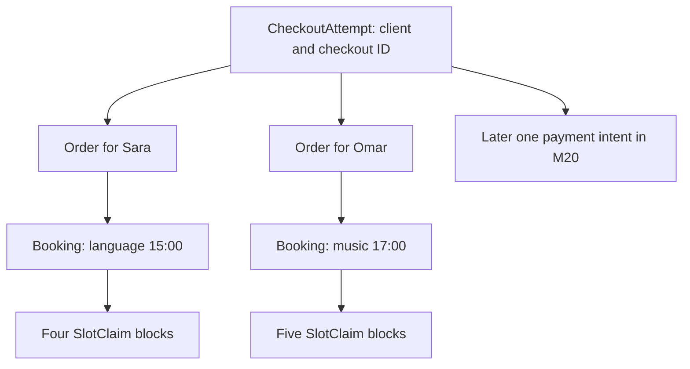

# Split the cart by provider

A checkout can be one client action without being one provider Order. Imagine a cart with a 45-minute language lesson from Sara and a 60-minute music lesson from Omar. Both are paid through one eventual payment flow, but each provider needs an independent record of the service sold, price, policy and scheduled obligation. This chapter groups validated lines by provider inside the same checkout transaction. It creates one pending Order for Sara, one for Omar, and one held Booking for each cart line. The CheckoutAttempt ties them back to the client's single action.



Do not group by provider display name. Names can change and need not be unique. Group by Provider `_id`, then sort IDs for deterministic writes. Two lines from the same provider belong to one Order, but they remain separate Bookings and independent claim sets. If their times overlap, the same checkout must reject itself at validation or unique claim insertion. A client cannot reserve the same provider twice over overlapping intervals simply because both lines are in one Order. The response should list each Order and its Bookings in a stable order so the UI can reproduce the grouped cart.

## Snapshot what the client accepted

Each Booking stores the Service ID for navigation and a purchase snapshot for historical truth: Service title, duration minutes, buffer minutes, price in integer minor units, currency, cancellation policy text or version, provider ID, provider name at purchase, Provider.timeZone, UTC start and end, and client-visible local labels if the product needs them for receipts. The Order snapshots provider subtotal, currency, tax and fee lines according to the product's pricing model. Never recalculate an old Booking's price or duration from a mutable Service document when displaying a receipt. A provider can change tomorrow's price without rewriting yesterday's agreement.

Time needs the same care. The Booking's `startAt` and `endAt` are UTC instants. The provider's named zone and accepted local label explain what the parties saw. If a provider later changes their working zone, the appointment instant and SlotClaims stay fixed. A current display may format the UTC instant in a newly selected zone, but the purchase snapshot can still show the original local representation and zone for dispute resolution. If the client traveled after buying, their profile zone may change too; that must not alter the stored appointment instant.

The occupied end can differ from the client session end. For a 45-minute session starting 15:00 and a 15-minute buffer, the client session ends 15:45 while occupancy ends 16:00. Store both meanings or derive the occupancy boundary from immutable duration/buffer snapshots. Do not show a 16:00 session end to the client if the extra quarter hour is provider cleanup. The SlotClaims still include the 15:45 block. A receipt and a calendar block need different labels for honest communication.

```ts
type BookingSnapshot = {
  serviceId: string;
  serviceTitle: string;
  durationMinutes: number;
  bufferMinutes: number;
  unitPriceMinor: number;
  currency: string;
  cancellationPolicyVersion: string;
  providerTimeZone: string;
  startAt: Date;
  sessionEndAt: Date;
  occupiedEndAt: Date;
};
```

Choose a stable policy snapshot strategy. If the course uses text, copy the exact accepted policy text into the Booking and keep a policy version or hash. If policy text is large, store an immutable versioned policy document and reference it. A mutable pointer alone is insufficient: a future edit could make an old purchase appear subject to terms the client never saw. Record the value used for cancellation calculation and the display value used at checkout. Tests should edit the Service and provider policy after a held purchase, then verify the Booking snapshot remains identical.

## Calculate totals on the server

Use integer minor units for line prices and provider subtotals. Reject carts with mixed currencies unless the product explicitly supports a conversion and settlement policy. This exercise keeps a checkout in one currency; the route returns a `CURRENCY_MISMATCH` response before claiming blocks if providers use incompatible currencies. Sum each provider's line amounts with checked integer bounds, then sum provider Orders to the client total. Do not trust a browser subtotal or use floating-point arithmetic for money. M20 will send the server-calculated total to the payment provider.

An Order state of `pending_payment` says the provider share has been held, not paid. Its Booking children are `held` and share `holdExpiresAt`. SlotClaims are `held`. The CheckoutAttempt is `held`. The state names should align so a support query does not show an Order "complete" while its Booking is unpaid. If expiry releases the attempt, update all pending provider Orders and Bookings in the same release transaction. If payment confirmation wins, Module 20 updates the set coherently and retains claims.

## Ownership and response shape

The client may fetch their own CheckoutAttempt and grouped Orders. Sara may fetch only her Order and associated Bookings, subject to provider authorization and privacy policy. Omar must not see Sara's subtotal, policy notes or client data that does not belong to his service. A platform admin may have a separate audited route. Avoid returning the entire attempt document in a provider dashboard response if it contains other providers' Order IDs and amounts. Projection and ownership checks are part of the data model's practical correctness.

For a two-provider cart, assert two Orders and two Bookings. Add a third line from Sara and assert still two Orders but three Bookings. Inspect that each Booking references its correct Order and provider. Then change Sara's Service price and policy and reload the old Order: the snapshot stays fixed. A current public Service page may show new terms, which is expected; a historical purchase view must not silently update.

Show the provider-side human flow. Sara sees a held 15:00 appointment with an expiry indicator, not a confirmed attendee. Omar sees his separate held 17:00 appointment. If the client pays, both become confirmed; if payment fails and the release decision is safe, both disappear from active availability together while their historical Booking records remain. Neither provider should receive a "paid booking" notification from this module's transaction. Notifications that assert payment belong after Module 20's trusted confirmation transition.

Finish by writing one invariant test per relationship: every held Booking has exactly one pending provider Order, every pending Order belongs to exactly one CheckoutAttempt, every held Booking's claims cover its occupied half-open interval, and all Orders under an attempt use the same deadline and currency. These assertions make later payment and expiry transitions easier to review. A provider split is complete only when the group can be reconstructed without trusting the browser's original cart layout.

## Reconcile totals and a later policy edit

Create a dated fixture: Sara's line is 4,500 minor units, Omar's line is 6,000, and both use the same currency. The attempt total is 10,500. Assert the sum of provider Order subtotals equals the attempt total and the sum of each Order's Booking line snapshots equals its subtotal. Then change Sara's Service price to 5,000 and her cancellation text to a new version. A fresh public quote should change, while the held purchase still reports 4,500 and its original policy. If a lookup recomputes 11,000, the snapshot boundary is broken.

Repeat with two lines from Sara: one 4,500 and one 2,000. Sara gets one Order subtotal of 6,500 and two Bookings with different UTC starts. Omar still gets his separate 6,000 Order. The attempt total is 12,500. This arithmetic exercise is simple enough to inspect manually, which is valuable when payment reconciliation arrives in Module 20. It also reveals a common grouping bug: creating a new Order for each line, then assuming provider settlement can still use one Order per provider.

Finally, verify protected projections. Sara's dashboard can show her 6,500 subtotal and two held time slots, but not Omar's 6,000 subtotal or his private policy note. The client can see both because the authenticated purchase belongs to them. A support role may need broader access with an auditable reason. These are different queries over the same records, so write route tests rather than relying on the object relationships alone to enforce privacy.

