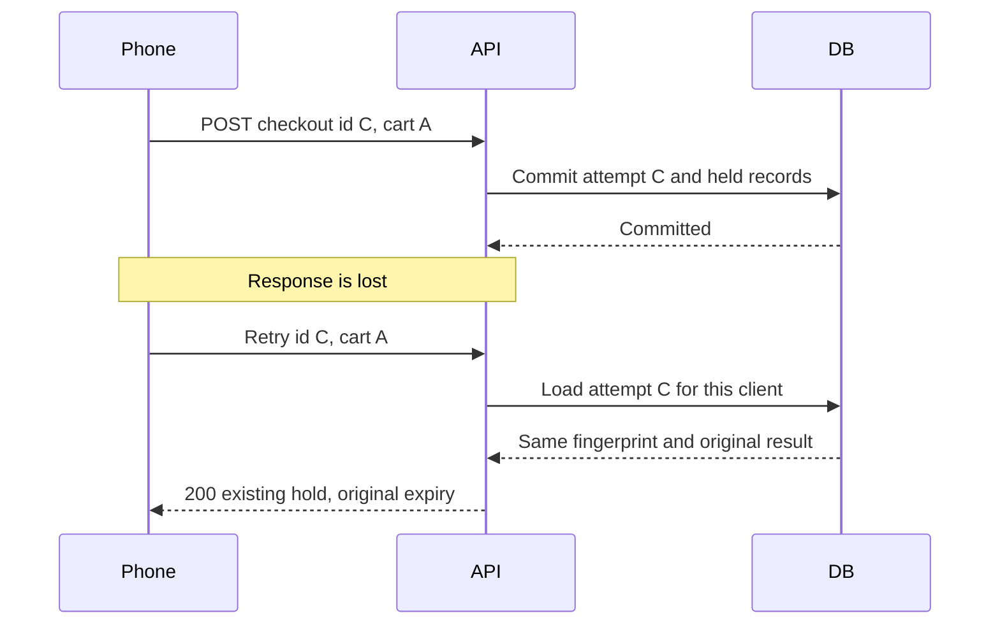

# Make checkout retries idempotent

At 14:04, a phone sends checkout and the database commits both provider Orders. The phone loses connectivity before the response arrives. From the client's view, the button still spins. The server cannot assume that a second HTTP request means a new purchase. This chapter makes a retry of the same intended checkout return the original held result, including the original deadline. It also refuses to let the same identifier be reused for a different cart. Both behaviors are necessary: suppressing duplicates without detecting changed intent can return an unrelated purchase to a confused client.



The browser creates a random opaque checkout ID once when the client commits to the displayed cart and keeps it through network retries or page refresh. It must not generate a fresh ID on every button click. A fresh ID is appropriate only after the user changes cart intent, accepts a changed quote, or starts a new purchase after an expired attempt. Store the ID in the checkout state and clear it only when the state transition is explicit. Do not derive it from a timestamp plus email; use a cryptographically strong random ID from the platform API.

## A checkout-level record

Create a `CheckoutAttempt` with a unique compound index on `{clientId, checkoutId}`. The document contains a server-computed fingerprint, common hold deadline, state, Order IDs and a safe response snapshot. One Order per provider means Order-level idempotency alone cannot protect the whole checkout. If the cart contains two providers and the retry finds only one Order, the client still cannot know whether the other provider was claimed. The attempt is the unit of the button press and of idempotent lookup.

The fingerprint is based on canonical intent, not browser-calculated money. For example, serialize an ordered array of owned cart line IDs with their Service IDs and requested UTC instants, plus the authenticated client ID and schema version. Sort by a stable key before hashing, so a harmless change in display order does not change the meaning. If line quantity or attendees are part of the product, include them too. Use a fixed canonical JSON representation and a server-side hash. Keep the raw intent or a traceable representation for support; a hash alone is hard to explain when a mismatch occurs.

Before opening a new transaction, look up the attempt by authenticated client and checkout ID. If found with the same fingerprint, return its current state and original records. If held, the deadline is the original one. If expired, return the expired state; do not re-create the hold. If confirmed later, return the confirmed result. If the fingerprint differs, return 409 `CHECKOUT_ID_REUSED` and tell the client to start a new attempt after reviewing the cart. Scope the lookup by client ID so one person's checkout ID cannot disclose another person's purchase.

Two identical requests may arrive simultaneously before either lookup finds an attempt. Both then try the transaction. The unique attempt index allows only one insert. After the losing transaction aborts, the route should fetch the committed attempt, compare fingerprints and return it. Depending on timing, it may need a short bounded wait for the winning commit to become visible or return a retryable response. It must not classify the attempt-index duplicate as a slot collision. The unique SlotClaim index protects time ownership; the unique CheckoutAttempt index protects request identity. Their error mapping is distinct.

```ts
const existing = await CheckoutAttempt.findOne({ clientId, checkoutId });
if (existing) return sameIntent(existing, fingerprint)
  ? responseFromAttempt(existing)
  : conflict('CHECKOUT_ID_REUSED');

try {
  return await createHeldAttemptInTransaction(input);
} catch (error) {
  if (isDuplicateOn(error, 'unique_client_checkout')) {
    const committed = await waitForCommittedAttempt(clientId, checkoutId);
    return sameIntent(committed, fingerprint)
      ? responseFromAttempt(committed)
      : conflict('CHECKOUT_ID_REUSED');
  }
  throw error;
}
```

The code is a route outline. `waitForCommittedAttempt` must be bounded; a database outage should not turn into an unending HTTP request. Use the persisted attempt's state to build the response, never a stale in-memory object from an aborted callback. If the driver reports an uncertain commit result, reading by the unique attempt key is the recovery path. Reissuing a whole purchase with a new ID would be unsafe. MongoDB's [transaction documentation](https://www.mongodb.com/docs/manual/core/transactions/) explains that transaction commit and retry behavior deserves explicit handling.

## Test the lost-response story

Call checkout with an ID and suppress the HTTP response in a test client after the server commits. Retry with the same ID and body. Assert the same attempt ID, same Order IDs, same Booking IDs, same SlotClaim count and unchanged hold deadline. The second response can be 200 for an existing attempt while the first was 201, but document that contract and keep the payload structure stable. Advance the fake clock by two minutes before the retry. If the deadline moves forward, the route is granting a hidden extension and the test must fail.

Now mutate one cart line's start and resend the original ID. Assert 409 `CHECKOUT_ID_REUSED` and no new claims. Create a genuinely new checkout ID after the client explicitly accepts the change. If the old hold is still active, the new attempt may conflict with its own previous claims; the UI should guide the client to cancel or complete the old attempt rather than silently abandon it. The idempotency layer does not grant unlimited simultaneous holds to one person.

Test a cross-account lookup. User B submits User A's checkout ID with a plausible cart. Because the unique key is scoped by client and the route reads only owned attempts, B cannot see A's Orders. If B happens to generate the same opaque ID, it is a different key under B. Rate limiting still applies to B's new attempt. Finally, send two identical requests concurrently. Both should return the same logical held purchase, with one physical attempt and one set of claims. This checks the pre-read race, not only the sequential retry path.

The client should show a clear recovery state after a network break: "We are checking whether your time was held." It can query by checkout ID. If held, show the remaining time. If no attempt exists after a bounded retry, offer to submit again with the same ID. If expired, ask for a fresh slot. Avoid a generic "Try again" button that generates a new ID and conceals the outcome of the first request. The same database invariant that prevents duplicate records can make the screen less frightening for a client on a weak connection.

## Distinguish an attempt from a payment retry

The checkout ID protects the database hold creation. Module 20 will have its own payment-provider idempotency key and webhook event IDs. Reusing the checkout ID as an opaque correlation value may be convenient, but it does not make a card operation atomic with MongoDB. A successful attempt may exist before any payment request. A payment request may succeed externally while the HTTP response to the server is lost. Those cases need separate reconciliation. This lesson's guarantee is narrower: repeated requests to create the same held purchase do not create more attempts or extend the same deadline.

Write a test for an attempt that has already expired. Retry its ID and same body. The API should return the persisted expired state and original Order references rather than inserting fresh claims at an old price. Then let the client start a new attempt with a new ID after refreshing availability and terms. The new attempt may select the same UTC start if it has become free, but its Booking and Order IDs and acceptance snapshot are new. This avoids using idempotency as a hidden resurrection path.

Record the canonicalization version on the attempt. If the application later changes how it sorts or hashes cart intent, old retries still need a stable comparison. The server can compare against the stored canonical intent using the recorded version. Without that field, a deployment could make a legitimate retry look like changed intent halfway through a client's ten-minute hold. Exercise one fixture from the previous version in a migration test when the algorithm changes.

