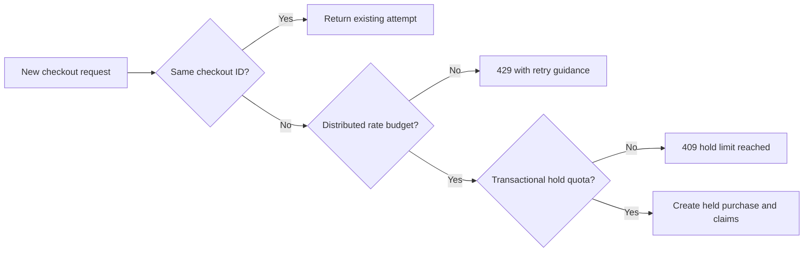

# Limit calendar holds

A ten-minute hold protects a paying client from losing time during a card flow. It also gives a nonpaying client a way to hide a provider's best hours. One account could hold every start it can see, wait for expiry, and repeat. A five-line cart can occupy many 15-minute blocks across providers. This chapter adds two controls: a maximum number of active held Bookings per client, and a rate limit on new checkout attempts. Neither replaces payment-safe release or the unique claim index. They reduce the damage that legitimate hold semantics could cause at scale.



Choose a stated product limit for the exercise: at most five active held Bookings and at most two active CheckoutAttempts per authenticated client. A checkout with three lines consumes three Booking units and one attempt unit. A two-line second checkout fits exactly; a third cannot start until an old hold confirms, expires or is cancelled according to policy. The API response should say which limit was reached and show the client's existing held attempts they can resume. It must not expose another client's holds or imply that a rate limit and a quota are the same thing.

## Make the quota atomic

A naive `countDocuments({clientId, status:'held'})` before insertion is another check-then-write race. Two simultaneous new checkouts could both see room and exceed the cap. Use a per-client `HoldQuota` document with a unique client key and integer counters. In the checkout transaction, update that document with a condition that the new booking and attempt counts remain within policy, then create the attempt and all child records. The write serializes concurrent attempts by one client. When a safe release transaction expires or cancels a hold, decrement the counters with an exact attempt transition guard. When payment confirms, remove the purchase from active held counts in the same database transition. The counters are a performance and concurrency mechanism; add a reconciliation job that compares them to actual held records and alerts on drift.

If adding a separate quota collection is too much for the reference build, a write to a client-owned User control document can be the serialization point. The important property is a real contended document write in the same transaction, followed by a fresh count under that serialization policy. A read-only count does not enforce the limit. For this module's implementation, use `HoldQuota` because it makes the counters and release responsibilities visible and testable. Create the unique index before traffic and handle an initial missing quota document with an upsert that remains safe under concurrent requests.

```ts
const quota = await HoldQuota.findOneAndUpdate(
  { clientId, activeBookings: { $lte: MAX_BOOKINGS - lineCount },
    activeAttempts: { $lt: MAX_ATTEMPTS } },
  { $inc: { activeBookings: lineCount, activeAttempts: 1 } },
  { session, new: true }
);
if (!quota) throw new HoldLimitReached();
```

This outline assumes the quota document exists; initialize it on account creation or use a separately tested first-use upsert path. Do not let a missing document bypass the cap. Store the policy limit centrally, not in browser code. Avoid a global collection scan in every checkout transaction. The claim transaction already touches every provider; the quota update adds one client-level contention point, which is appropriate for limiting one client's own concurrent attempts.

An idempotent retry of an existing checkout does not consume another quota unit. Check for the attempt before consuming a new-creation rate token and before incrementing quota. The browser may need to recover from a lost response several times on a poor connection; rejecting those reads as quota violations would turn a protective control into a broken payment flow. Still authenticate and cap lookup traffic with general API protections. The purchase-specific new-attempt limit applies when a fresh checkout ID is actually attempting new claims.

## Rate limit across instances

Add a distributed token bucket or fixed-window limiter backed by a shared service such as Redis, keyed by authenticated client and a coarsened network signal according to the platform's privacy policy. A simple in-process `Map` is insufficient if two API instances serve the same account. Pick a concrete rule for development, for example six new checkout attempts per minute and a small burst. Return 429 with `Retry-After` and a clear message. Monitor false positives for a shared household connection; the account key is primary. A client can still fetch an already committed attempt through the idempotent lookup path.

The limiter is an availability control, not the database integrity control. If Redis is unavailable, choose and document a fail-closed or bounded fallback policy for new holds while allowing existing attempt retrieval. Do not claim that a rate limit protects the calendar from all abusive accounts. Account creation abuse, payment failures, cancellation patterns and provider-level attack detection need product operations beyond this module. What this build proves is that one authenticated client cannot exceed the stated active-hold cap through concurrent requests, and cannot submit unbounded new attempts across API workers.

## Test quota transitions

Start with an empty quota. Submit a three-line checkout, then a two-line checkout from the same client. Assert counters five Bookings and two attempts. Submit a third one-line checkout and expect a hold-limit response with no new SlotClaims. Retry the first checkout with its original ID; it must return the original attempt despite the full quota. Release the first attempt through the payment-safe release service and assert counters become two Bookings and one attempt, while its old Booking history remains. Then a new three-line checkout can fit if the slots are otherwise free.

Run two one-line checkouts in parallel when only one quota unit remains. Exactly one may commit. The other receives a quota response or a bounded transaction retry, but the counter must never exceed the cap. Repeat with two API processes if the test environment supports it. A local unit test of a pure `if (count < max)` branch would not exercise the race. Also test a transaction that increments quota then collides on a SlotClaim: the aborted transaction must roll back the quota increment. If the counter remains high after a failed cart, clients will be blocked by a ghost hold.

For the rate limiter, use a shared test backing store and two server instances. Alternate requests across the instances under one client ID. The total accepted new-attempt budget should match the configured rule, not double because each instance has its own memory. Make sure a repeated same-ID lookup of a committed hold still works when the new-attempt budget is exhausted. Record the limit in product copy and tests so support can explain a 429 without suggesting a provider's calendar is full.

These controls should be measured in production. Count active held Bookings, release latency, quota reconciliation drift, checkout 409 by reason, 429 responses and conversion from held to confirmed. A sudden rise in holds without payment can justify investigation; a rise in 409 after provider edits may indicate stale availability caching. The metrics do not alter the atomic ownership rule, but they tell the team whether the chosen ten-minute window and quota are fair to providers and clients.

## Make quota recovery visible

Suppose the release worker crashes after committing expiry but before acknowledging its queue message. On retry, it sees an expired attempt and must not decrement quota a second time. A negative counter could let a client exceed the intended cap. Include the attempt state transition and counter decrement in one transaction, guarded by the old `held` state. Test two workers receiving the same release job concurrently and assert exactly one state change and one decrement. Then run the reconciliation query and confirm the counter equals the number of still held Booking records.

Also decide how a partially paid external flow will interact with quota. A hold in `payment_pending` may still occupy claims and should count against active hold capacity until confirmation or safe release. Module 20 must not decrement quota merely because a payment request was sent. The counter describes occupied temporary calendar time, not whether the client has opened a card form. Put this invariant in the payment handoff so a future webhook implementation cannot accidentally grant unlimited additional holds during a slow payment response.

