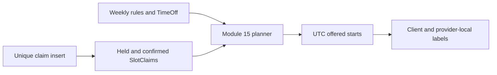

# Hide held blocks from new offers

When Amal's checkout commits a hold, Rami's next availability refresh should no longer show starts that overlap it. The Module 15 engine already accepts occupied block keys; this chapter connects its claim query to the new `held` state. The query should include all live SlotClaims, whether the owning Booking is held or confirmed. A displayed offer is still advisory because another checkout can win between refresh and click. Hiding held time reduces predictable conflicts and gives the provider a calendar that matches the purchase state.

Reuse `blocksFor(startMs, durationMinutes, bufferMinutes)` from Module 15 for both candidate filtering and checkout insertion. If the planner filters only session minutes but checkout claims buffer minutes too, it may show a start the database will always reject. If it filters an extra end block that checkout does not claim, it hides a legitimate adjacent appointment. The half-open interval convention should be tested with a 45-minute service plus 15-minute buffer and an adjacent 16:00 start. There is no benefit to two subtly different occupancy algorithms.

## Query one bounded range

For a seven-day availability page, collect provider claims whose `blockStartAt` lies within the expanded search range needed for the Service duration and buffer. Query by provider and UTC range once, then pass a Set of occupied block keys to the pure planner. Confirm the supporting index allows the range query. Avoid a database query for every candidate start. A busy provider may have hundreds of candidate starts in a week; an N+1 claim query turns a simple calendar view into a slow endpoint. Module 15's adapter and performance exercise already establish this pattern.

Do not filter `state: 'confirmed'` only. Held claims must disappear immediately after the checkout transaction commits. Do not filter held claims by `holdExpiresAt > now` inside the availability read and call old claims free. An expired attempt may still have its unique claim physically present until the safe release transition commits. Showing it as free would make every attempted checkout fail until cleanup catches up. The observable rule is simple: any live SlotClaim in the unique-key collection blocks that key. Release removes it when the payment-safe state transition says it can be freed.

What if availability is cached? Invalidate or refresh a provider's cached offer list after a claim commits or releases. A short cache time alone can leave a freshly held slot visible for seconds. The UI can receive a 409 and recover, but the common case should be more responsive. If cache invalidation fails, correctness still comes from the unique claim write. Record stale-offer 409 frequency; it reveals a performance or invalidation issue rather than double booking. A cache should never be the only record of ownership.

## Read consistency and response wording

The API should say "available when checked" or simply show selectable starts, without promising reservation until checkout responds held. A green pill could otherwise be interpreted as a guarantee. After a 409, invalidate that provider day in the browser and reload alternatives. Keep the client's selected time and cart line visible with an explanatory state, rather than silently moving the appointment. On a successful hold, show the common deadline and a payment action. This lets the same calendar screen move honestly from possibility to commitment.

Use the server's fixed clock and Provider.timeZone from the M15 adapter. A held Booking on 2026-11-02 at a UTC instant may display at different client local times, but its claim block keys are the same everywhere. A Berlin client and a Gaza client should see the same slot disappear after one hold, though their labels differ. Do not key a browser cache only by the text `15:00`; include provider, UTC date range, Service terms and relevant zone display context. The server's claim query remains UTC.

The provider dashboard can show held time with a distinct state from confirmed time. It should not reveal client details from a speculative cart. A held Booking is more than a cart proposal, but it may expire without payment. The provider can plan around the occupied blocks without receiving a false "paid booking" notification. If the hold releases, the calendar becomes available again and the history remains in the protected Order view.

## Test the immediate transition

Seed a provider with a 15:00 offer. Call the availability endpoint and verify the candidate appears. Commit a held checkout for a 45-minute Service plus 15-minute buffer. Call availability again from a different authenticated client and verify 15:00, 15:15, 15:30 and 15:45 conflicting candidates are removed as appropriate for their own Service lengths. Verify an adjacent start at 16:00 can remain if the weekly rule and notice permit it. Use actual SlotClaim rows and the endpoint adapter, not a manually constructed Set alone.

Then release the unpaid hold through the safe release service. Query availability again and verify the start returns. Confirm the old Booking and Order still exist with expired state. Repeat the query before release after advancing the clock past `holdExpiresAt`: the start should remain hidden while its live claim exists. This deliberately tests the lag between deadline and release. A page that shows it early will produce an avoidable 409 and reveal a mismatch between display and database ownership.

Add a concurrent request test where Rami loaded the page before Amal's hold. Rami submits checkout after Amal commits. He receives 409 even though his screen still shows the old card. The UI marks the line stale and presents alternatives. This test demonstrates the two layers together: availability usually reflects current holds, but the unique claim transaction remains the final arbiter under race. A test that only refreshes after a hold cannot prove the stale-screen path.

Finally, examine index and query metrics with a week containing many held and confirmed Bookings. The range query should remain bounded by provider and time; the planner should not load every claim in the database. The output should show only starts whose whole duration and buffer are unclaimed and valid under provider rules. A claim is necessary for exclusion, but rules, TimeOff, notice and horizon still govern whether a free block is actually offered.

## Check a cancellation boundary

Create one held Booking for 15:00 and open two browser views. In the first view, the client cancels the unpaid attempt through an eligible release transition. In the second, another client has an availability response from before the cancellation. After the release commit, the next refresh should show 15:00 again if no new claim or TimeOff blocks it. The stale second view might still show the old unavailability until refresh, which is a usability delay rather than a double booking. A new checkout can use the unique index once the release has physically removed the claims.

Now reverse the order: a third client claims 15:00 immediately after release, before the second view refreshes. The next refresh should hide it again. Do not force the availability UI to display a guaranteed sequence of "free" and "taken" states just because a cancellation occurred. It shows the current server result at each query. The Booking history tells the full sequence; the claim collection tells current ownership. This is a good case for a server response timestamp and a client loading state, so a slow response cannot overwrite a newer result without the UI noticing.

If the platform later offers a provider with capacity greater than one, the claim model must evolve. This module's unique provider/block key assumes one appointment occupies the provider during a block. A group class with ten seats would need separate capacity or seat claims. Do not try to make held claims invisible to accommodate a class; that would also permit an ordinary one-to-one appointment to double book. Document the one-provider-one-appointment assumption alongside the M15 occupancy helper and M19 unique index.

