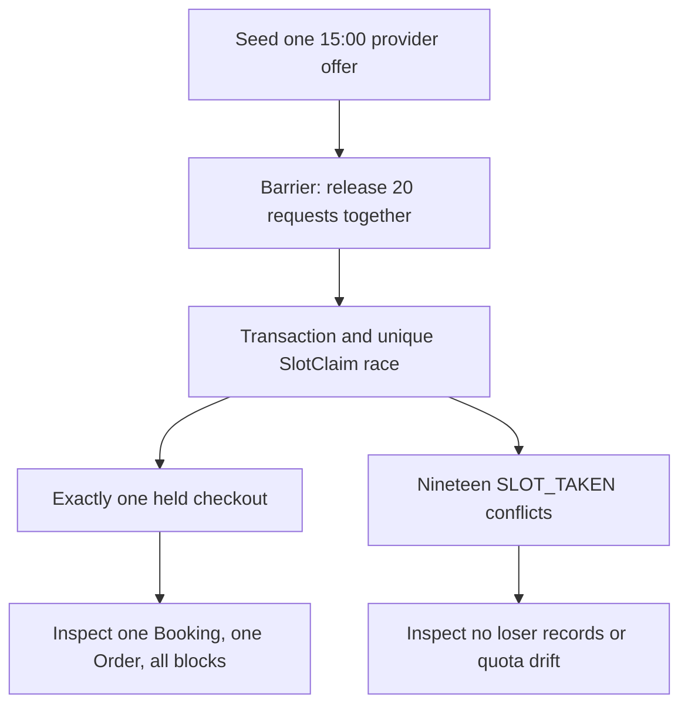

# Prove one winner under parallel checkout

A sequential test that checks out once and then expects a second request to fail does not exercise the dangerous interval where both callers saw the slot as free. This chapter launches twenty checkout requests at the same offered start. Each has a different authenticated client and checkout ID so idempotency and per-client quota do not collapse them into one attempt. The expected result is exactly one 201 held purchase and nineteen 409 `SLOT_TAKEN` responses. The database must contain one complete set of Booking, Order and SlotClaim records for the winner, and none for the losers.



Use a MongoDB replica set in the integration environment. Standalone MongoDB does not support the multi-document transaction used here, and a mocked repository cannot reproduce database index contention. Build the unique indexes before starting requests; verify the `unique_provider_block` and `unique_client_checkout` names through a setup check. Seed the Provider, Service, weekly rule and required TimeOff state, then request a real M15 availability result to choose the test start. This proves the test is using an offered slot rather than merely sending a convenient UTC string.

Create twenty distinct client accounts or auth fixtures with one cart line each. All point to the same Service and UTC start. Keep hold quotas and new-attempt rate limits configured so each client is within policy. Use a barrier to release HTTP requests together after all clients are ready. A `Promise.all` in the test harness is appropriate; [Mongoose's transaction guide](https://mongoosejs.com/docs/transactions.html) warns against `Promise.all` inside one transaction session, which is a different context. Each incoming checkout gets its own request and session.

```ts
const clients = await seedTwentyClientsWithSameOfferedStart();
const results = await Promise.all(clients.map(client =>
  postCheckoutAs(client.user, {
    checkoutId: client.checkoutId,
    cartLineIds: [client.cartLineId]
  })
));
expect(results.filter(r => r.status === 201)).toHaveLength(1);
expect(results.filter(r => r.status === 409 && r.body.code === 'SLOT_TAKEN'))
  .toHaveLength(19);
```

The code illustrates the assertion, but do not stop at HTTP counts. Query `CheckoutAttempt`, Order, Booking and SlotClaim by the twenty checkout IDs and client IDs. There should be one committed attempt, one provider Order and one held Booking. The number of claims should equal the occupied block count from `blocksFor`. Every claim references that Booking and the expected provider. No loser has an attempt, Order, Booking or claim, and every loser quota counter remains at zero. A route that returned nineteen 409s after accidentally committing partial records still fails.

## Make contention deterministic enough to learn

The exact winner can vary. Do not assert that request zero wins because it was placed first in the JavaScript array. You can add a server test hook just before claim insertion to make the requests overlap more often, but keep the hook disabled in production and do not depend on a specific scheduling order. Run the test several times in CI if the environment is stable; one successful iteration is evidence, repeated runs reveal timing bugs. Log the winning checkout ID and each database error category to aid diagnosis without dumping sensitive client data.

Handle transient transaction errors with bounded retries and fresh reads. After one request commits, a retrying loser should see the claim and map the outcome to 409. A raw 500 from a write conflict would mean the route is correct about exclusivity but poor at conflict handling. If a retry is exhausted because the database is unavailable, the response should be a distinct retryable service error, not a false slot conflict. The test's expected nineteen 409s is intentionally strict under a healthy test database.

## Add an overlapping-start case

Repeat with half the clients requesting 15:00 and half requesting 15:45 for a 45-minute service plus 15-minute buffer. These starts share the 15:45 block. Exactly one checkout still wins across the whole group. A unique Booking.startAt index would allow one winner at each start and fail this test. Then try 16:00 as the second start; it sits at the first booking's excluded end and can win independently if the provider rule permits. This pair verifies the half-open occupancy boundary rather than only exact-start duplication.

Add a two-provider cart abort case. The first provider is free, the second provider's chosen block is already claimed. Submit checkout and inspect both calendars. No claim for the free first provider should remain. Reverse the provider order in the input and get the same result. Sorted provider fence writes should make the transaction's behavior less sensitive to cart display order. The test should identify the second provider's lost line in the 409 response while leaving the entire cart available for correction.

## Exercise a schedule edit in the race

Start a checkout for a previously offered 15:00 and concurrently close that time through Module 13's provider rule or TimeOff API. Both operations write the Provider document: the editor increments `scheduleRevision`, and checkout increments `calendarFence` before re-reading rules. One must retry or wait. If checkout commits first, the edit may proceed but must surface the existing held Booking as a conflict; it cannot delete claims. If the edit commits first, checkout's fresh validation rejects the stale offer. Run both orderings with a test barrier and assert that no checkout commits at a start invalid under the ordering it observed. This test is separate from the twenty-client claim collision.

Finally, test the lost-response retry. Take the winning checkout ID and resend the exact same request. It returns the same held purchase with unchanged deadline and claim count. Resend with a changed cart line and expect `CHECKOUT_ID_REUSED`. This confirms the winner can recover safely from a bad connection. A concurrency suite that only checks losers would leave a real client stranded after a successful but unseen commit.

Commit the test command, replica-set setup instructions, index verification and test output. Record the twenty response statuses and post-run document counts. If the test is flaky, keep it visible and investigate rather than changing the assertion to "at most one success". Zero successes under healthy conditions would be an availability failure. The required product outcome is one complete winner and nineteen clear conflicts for one contested slot.

## Diagnose a surprising result

If two requests return 201, inspect the actual collection indexes before changing route code. Check whether one claim used a string block key and the other used a Date, whether provider IDs were normalized, and whether both requests used the same database. Then inspect whether the route returned success before transaction commit. A unique index over correctly typed identical keys cannot permit two committed documents; a double success means the asserted key or response boundary differs from the design.

If no request returns 201, inspect the seeded offer and transaction setup. A draft Provider, missing weekly rule, expired date, too-short notice window or already claimed block can make every request correctly reject. A standalone MongoDB test instance can make every transaction fail. The test should assert a clean M15 offer before launching the barrier and should print classified failure codes without leaking private data. That preparation turns a red test into a useful diagnosis rather than a mysterious concurrency failure.

If one request returns 201 but some losers return 500, inspect error classification and retry limits. A duplicate from `unique_provider_block` should become a client 409 after the transaction aborts. A transient write conflict should retry with fresh provider and claim reads. A database outage should remain a service error. Do not flatten all three into 409 to satisfy a status-count assertion; that would hide infrastructure failure as ordinary slot competition. The healthy race test should still yield nineteen truthful `SLOT_TAKEN` responses.

Use a separate test for the idempotent same-client case because its expected status pattern differs. Twenty requests with the same client and checkout ID should converge on one logical attempt, not produce nineteen slot conflicts. This distinction protects the semantics of a retry after a lost network response. The main race test deliberately gives each request a different client and ID so it measures competition for one provider block.

