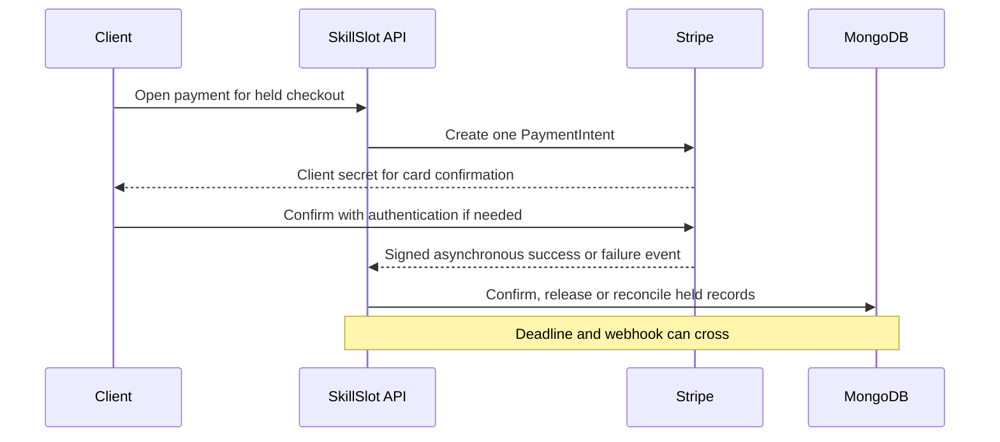

# Pay before the hold ends

Amal holds a tutor at 15:00 and a music teacher at 17:00. Her checkout has one deadline at 14:14, two provider Orders and two held Bookings. She opens a card form at 14:09. At 14:13, the card flow asks for additional authentication. Her phone is slow. At 14:14, the server clock reaches the hold deadline. At 14:15, a payment success event may arrive. Which appointment should the provider expect? Which amount should the client keep paying? A countdown in the browser cannot answer either question.

The payment provider and MongoDB are separate systems. A database transaction can atomically change the CheckoutAttempt, Orders, Bookings, claims and quota. It cannot include a Stripe request in the same atomic commit. If the API calls Stripe inside a transaction callback and MongoDB retries the callback, it may make the external call more than once. If Stripe succeeds but the database write fails, rolling back MongoDB does not refund the card. This module designs the boundary rather than pretending there is one global transaction.

The product promise starts with Module 19's hold: while live SlotClaims exist, another client cannot buy those occupied blocks. A PaymentIntent is an attempt to collect the snapshot total for that held checkout. A signed webhook reports Stripe's outcome. Only after a trusted success and a successful database confirmation transition should the application tell both providers the appointments are paid. A browser redirect, success animation or client-submitted payment ID does not carry that authority.

## Four endings to one payment screen

In the ordinary path, Amal confirms the card before 14:14. Stripe reports success and the webhook changes both provider Orders to paid and both Bookings to confirmed in one database transaction. The claims stay in place and change to confirmed state. The client sees two paid appointments; each provider sees only their own Booking and Order share. A duplicate webhook later makes no second charge and no second confirmation. The common PaymentIntent ID ties the one payment to the attempt.

In a declined-card path, Stripe reports that another payment method is required. The hold remains active until its original deadline. Amal can retry a different card against the same PaymentIntent if its status permits it. The server does not extend the deadline because of a decline. At 14:14, an expiry coordinator must decide whether Stripe can be cancelled safely, then release claims and mark records expired. The browser should say whether the hold still exists, not infer it from the card field's error message.

In an authentication path, Stripe may require the client to complete an additional step. The PaymentIntent can be in a state that is neither successful nor a final failure. An expiry worker must not assume that a temporarily unanswered webhook means no money can move. It should move the checkout into an explicit resolving state, attempt a permitted cancellation outside the database transaction, inspect the authoritative provider result, and release only when a late success is ruled out by the chosen policy. This may hold the calendar briefly past the advertised deadline; explain that honestly as payment finalization rather than showing the slot as free while its unique claim remains.

In a late-success path, a success event arrives after claims were already released. Ideally the cancel-before-release protocol makes this rare, but operations can still encounter prior data, manual interventions or delayed external outcomes. The application must not mark a Booking confirmed without owning its blocks. It must reconcile: try to re-claim each Booking's original occupied blocks atomically, then confirm recovered lines and arrange a refund for lines whose blocks are no longer free. The client must be told exactly which appointments were retained and which amount is being refunded. Module 20.8 works that case in detail.

## A multi-provider purchase is still one card payment

The two provider Orders are accounting and fulfillment shares. The client confirms one PaymentIntent for the sum of accepted snapshot amounts in one currency. This avoids two separate charges where one succeeds and the other fails before checkout can explain the result. A single PaymentIntent still leaves separate provider obligations and separate Booking records. The PaymentIntent metadata can carry the opaque checkout attempt ID for reconciliation. It should not include private lesson notes or addresses.

Every amount comes from the accepted Booking and Order snapshots created in Module 19. If Sara changes the tutor price while Amal types a card number, the held purchase retains the accepted amount. If a quote had changed before the hold, Module 19 should have required explicit acceptance. A browser-sent total is never a safe charge amount. The server verifies the Order sum equals the attempt total before creating the PaymentIntent and records the currency and amount next to its ID.

## Trace the deadline in one place

Write four timestamps in `docs/payment-timeline.md`: checkout commit, PaymentIntent creation, hold deadline and webhook receipt. Add a fifth for the provider's actual success time. These times can arrive in an unintuitive order. A webhook received after the deadline might describe a success that occurred earlier. Conversely, a payment form shown before the deadline can complete only afterward. State the product policy for which time governs confirmation, and keep the state transition safe even when clocks or delivery order disagree. For this exercise, the server uses its stored hold deadline and a trusted current Stripe status to decide the normal confirmation path; a truly late success enters reconciliation rather than being silently treated as timely.

The learner should be able to answer a provider's question without guessing: "Is this 15:00 appointment paid, held, expired or under reconciliation?" They should be able to answer the client's money question too: "Was my card charged, and if one appointment cannot be restored, which amount will be refunded?" A green checkout button cannot carry those distinctions. Persisted states and a reconciliation log can.

Before building, draw a boundary around every operation that can be retried. Database transaction callbacks, HTTP requests to Stripe, webhook deliveries and expiry jobs can all repeat. Each needs its own stable ID and state predicate. The next lessons map one PaymentIntent to many provider records, configure a safe test environment, and then build the transitions. The aim is a calendar and payment story that remains truthful even when the response sequence is inconvenient.

## A support call after a failed connection

Imagine Amal saw the card spinner and then lost mobile data. She asks support whether she should try another card. The support tool should show the CheckoutAttempt ID, original hold deadline, PaymentAttempt ID, current Stripe PaymentIntent ID and status, and the local state of both Bookings. It should not ask Amal for full card details or trust her browser screenshot as payment evidence. If the Intent succeeded but webhook processing is delayed, support can say the payment is being reconciled while keeping the claims. If the Intent never existed, the tool can explain the original hold's remaining time or expiry.

The same call from Sara, the tutor, needs a narrower view. Sara should see whether her own 15:00 Booking is held, confirmed, expired or under reconciliation. She should not see Omar's music Order amount or Amal's card error. A single PaymentIntent spanning providers makes this projection important. The payment record belongs to the client's checkout and platform reconciliation; each provider's commercial view comes through their own Order and Booking state.

Write a short statement the UI can use at each transition: "Time held until 14:14," "Payment needs another method; time still held until 14:14," "Payment status is being resolved; this time is temporarily unavailable," "Appointment confirmed," and "Appointment could not be restored; refund pending." These sentences expose the difference between calendar ownership and money state. Test them with a screen reader and a phone width, because a color-only badge or a truncated provider name could hide the very distinction this module is trying to protect.

