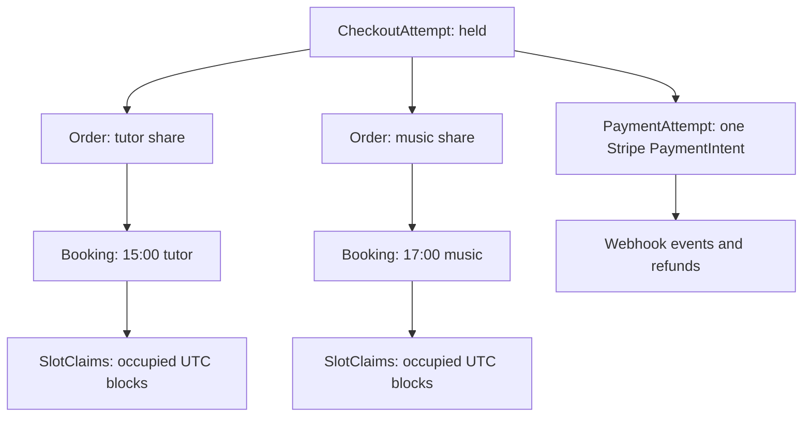

# One payment, many provider orders

Module 19 created one CheckoutAttempt for Amal's button press, an Order for each provider and a Booking for each line. Payment should attach to the attempt, not be created independently by each provider Order. The client accepted one total and wants one clear card operation. Each provider Order still needs an amount and state so the platform can explain what that provider is owed and what happens if a single Booking later needs a refund. The mapping must be stored, not reconstructed from a mutable cart after purchase.

<TraceRequest
  method="POST"
  path="/api/checkouts/attempt-A/payment"
  request='{"checkoutId":"attempt-A"}'
  response='{"paymentState":"requires_payment_method","amountMinor":10500,"currency":"usd","holdExpiresAt":"2026-11-02T14:14:00.000Z"}'
/>

The trace omits the client secret because it is sensitive and should only be returned to the authenticated client through the intended payment flow. A provider dashboard receives neither client secret nor the other provider's Order total. The route loads the attempt by authenticated client, checks that it is still held or in an allowed payment state, and derives 10,500 minor units from the persisted provider Order snapshots. It does not accept a request body amount.

## Choose identities for each retry boundary

The client-generated checkout ID addresses the held purchase in SkillSlot. The server creates a PaymentAttempt ID with a unique reference to the CheckoutAttempt. The PaymentAttempt stores Stripe PaymentIntent ID, amount, currency, creation state and reconciliation state. Stripe API calls use a stable idempotency key derived from that PaymentAttempt ID and operation kind, for example `payment-intent:create:<paymentAttemptId>`. A webhook event has Stripe's event ID and is stored once under a unique key. A refund for one Booking has its own RefundRecord and stable refund idempotency key. These IDs should not be conflated merely because they point to one purchase.

Stripe's [PaymentIntent guidance](https://docs.stripe.com/api/payment_intents) recommends one PaymentIntent per order or customer session. Here the customer session is the CheckoutAttempt spanning provider Orders. Its `amount` uses integer smallest-currency units. The provider Order subtotal sum must match that amount and currency. If the data disagree, stop and alert rather than charging whichever value was loaded first. The client should see the accepted snapshot total before card entry.

Store the Stripe ID after creation without assuming the response can never be lost. A call may create a PaymentIntent successfully while the API connection breaks. Retrying the same Stripe creation with the same idempotency key can recover the same result within Stripe's key retention behavior. Persist the PaymentAttempt record before the external call, then update it after the call. A background reconciler can query or retry if it remains in `creating`. Do not create the PaymentIntent inside a MongoDB transaction callback. Stripe's [idempotent request reference](https://docs.stripe.com/api/idempotent_requests) explains both safe retries and the fact that keys are not a permanent database substitute; keep your own attempt identity and state.

## Snapshot the allocation for partial recovery

Suppose Amal's tutor Booking carries 4,500 minor units and the music Booking carries 6,000. A late success could find the tutor block reclaimed by someone else while music remains free. The roadmap calls for refunding the lost Booking's amount. Record each Booking's charged allocation at checkout: base price, its share of any fee or discount under a documented rule, and a final `chargedAmountMinor`. The allocations must sum exactly to the PaymentIntent amount. If a promotion spans lines, choose and test a rounding rule before payment. Without stable allocations, a partial refund after a policy or promotion edit is guesswork.

There is a business decision hidden here: one card payment can settle multiple providers but may later need one provider share refunded. This course uses a platform-collected PaymentIntent in test mode and records provider Order shares for later settlement. It does not claim to implement automatic provider transfers. If the production product requires Stripe Connect or marketplace settlement, that integration must be designed separately with its own reconciliation. This module's claims are about charging the client and confirming Booking ownership.

## Read the state matrix

While payment is not yet successful, CheckoutAttempt is `held` or `payment_pending`, provider Orders are `pending_payment`, Bookings are `held`, and claims are `held`. After a trusted timely success and one database confirmation transaction, the attempt is `paid`, Orders are `paid`, Bookings and claims are `confirmed`, and active hold quota is released. A declined card may move PaymentAttempt back to `requires_payment_method` while the hold records remain held. An expired unpaid attempt moves Orders and Bookings to expired and removes claims only after payment-safe cancellation or final status check. A late success after release enters `reconciling`, not ordinary paid state until its blocks or refunds are resolved.

These names should be written in a table in the implementation's design note. A state combination such as `Order: paid`, `Booking: expired`, `claim: deleted`, `refund: absent` is not a harmless intermediate state to present publicly. It represents charged money without an appointment or refund action. If an external refund is pending, record that pending obligation and show it honestly. A database transaction can make internal state changes atomic; an outbox or durable RefundRecord makes the external action retryable after commit.

Check authorization at each projection. The client sees the whole payment and all provider Orders. A provider sees only their Order share and Bookings. The payment webhook route is public to Stripe but accepts only correctly signed raw payloads and links the PaymentIntent ID back to a known PaymentAttempt. No client may post `paymentState: succeeded` to mark their own Booking paid. A trusted payment status is not a display field submitted from the browser.

For a transfer exercise, add a third Booking from the tutor provider. There are now three Bookings but still two provider Orders and one PaymentIntent. Sum all three charged allocations, then group by provider and confirm each Order subtotal. Ask a peer to point to the field that answers "which amount is refundable if this one Booking cannot be restored?" If they must reload a current Service price or divide the total equally, add the missing snapshot before writing webhook code.

## Work a discount allocation by hand

Suppose the client receives a 500-unit checkout discount across a 4,500-unit tutor line and a 6,000-unit music line. If the product allocates discounts proportionally, calculate each line's share in integer units and assign the rounding remainder by a deterministic rule, such as ascending Booking ID. Store the final charged allocations on the Bookings before creating the PaymentIntent. The sum is 10,000, regardless of later coupon edits. A partial refund for the tutor line uses its recorded post-discount charged allocation, not the 4,500 list price. Keep the provider Order subtotal aligned with its line allocations.

The choice of who economically funds a discount is a product policy. A platform-funded coupon may leave the provider's payable amount different from the client's charged amount. If the reference build does not implement such promotions, reject or omit them from this payment exercise and keep the arithmetic simple. Do not claim a client charge allocation is automatically the provider settlement amount. The model can record both fields with clear names when the product grows. For this module, use a zero-discount fixture in the primary gate and add the proportional example as a design check.

Now consider a Service cancellation-policy version changing while payment is processing. The provider Order and Booking retain the accepted policy snapshot from Module 19. A refund due to an impossible late recovery is not an ordinary client cancellation penalty; it returns the charged allocation because SkillSlot could not deliver the appointment. The reason belongs on the RefundRecord. Keeping policy and reason separate prevents a later support process from accidentally applying a cancellation fee to a platform failure.

