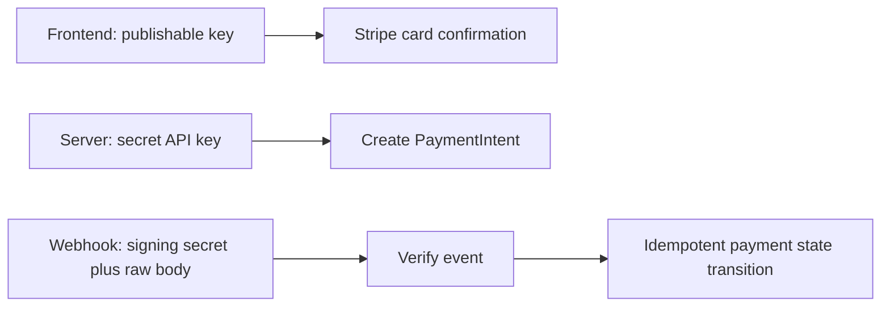

# Set up Stripe test mode

Use a Stripe sandbox or test mode for the payment module. Test keys and test payment methods let learners exercise the entire state machine without moving real money. Keep the secret key only on the server and the publishable key in the client configuration. The webhook signing secret is a third value, used to verify event delivery; it is not interchangeable with either API key. Place all three in environment variables appropriate to their runtime and keep them out of committed files and screenshots.

<TraceRequest
  method="POST"
  path="/api/webhooks/stripe"
  request='{"type":"payment_intent.succeeded","id":"evt_test_example"}'
  response='{"received":true}'
/>

The trace is illustrative, not a payload a client can send to confirm a Booking. The real route verifies Stripe's signature over the exact raw request body before parsing and processing it. If generic JSON middleware changes the bytes first, signature verification may fail or the integration may incorrectly accept a reserialized body under an unsafe custom check. Use Stripe's official library and the endpoint secret supplied for that webhook destination. Return a 2xx after the event is durably accepted, not after a fragile chain of side effects that cannot be replayed.

## Local setup with distinct secrets

Document `STRIPE_SECRET_KEY`, `STRIPE_PUBLISHABLE_KEY` and `STRIPE_WEBHOOK_SECRET` in an example environment file with placeholders, not live values. The server startup check should fail with a clear configuration error if payment is enabled but a required server secret is missing. A local Stripe CLI listener can forward test events to the development webhook URL and prints a listener-specific signing secret. That secret may differ from the secret configured for a deployed Dashboard endpoint. Never copy the local listener secret into production by assuming all webhook deliveries share one value.

The Stripe CLI is useful to observe `payment_intent.succeeded`, `payment_intent.payment_failed` and other events as the learner confirms test cards. It can also trigger fixture events, but a generic CLI-triggered event may not reference the CheckoutAttempt in the learner's database. For end-to-end confirmation, create a PaymentIntent through the SkillSlot route, confirm it with a test payment method, and inspect the event that references that exact PaymentIntent ID. Keep the CLI output and server event log in a private test evidence file after removing secrets and client personal data.

Stripe's [webhook documentation](https://docs.stripe.com/webhooks) describes signature verification, duplicate deliveries and the possibility that events arrive out of order. Build a unique event-ID record and process state transitions conditionally. A duplicate event should be acknowledged with no second confirmation, notification or refund. An older failure event arriving after a success must not regress a paid Booking to held. The current PaymentIntent status may need to be retrieved from Stripe outside the database transaction when an event conflicts with local state.

## Select test cases by outcome

Use a successful test card or official PaymentMethod fixture for the ordinary path. Use a decline fixture so the UI can show a usable error while keeping the hold until deadline. Use an authentication-required fixture, such as the card listed in Stripe's [testing guide](https://docs.stripe.com/testing), to exercise `requires_action` and a return to the app. Record the expected PaymentIntent status and local Booking state after each step. Avoid copying a card number into source code or a production log; the fixture belongs in test instructions and test mode only.

The UI must not claim success immediately after a card component resolves if the webhook has not yet reconciled the database. It can show "Payment processing" and poll the owned CheckoutAttempt state. If the webhook confirms, show paid Bookings. If it fails, show the remaining hold time and a retry path. If it stays unresolved near the deadline, show an explicit resolving state rather than switching to an expired screen while claims and money are uncertain. The test fixture should verify the visible text for each state as well as the database records.

## Use raw-body routing deliberately

Put the Stripe webhook route before ordinary JSON parsing for that path, or configure a route-specific raw-body parser with the content type expected by Stripe. Pass the raw Buffer and `Stripe-Signature` header to `stripe.webhooks.constructEvent`. Reject a missing or bad signature before looking up any PaymentAttempt. Do not trust metadata alone as proof of payment. A signed event still needs to match a known PaymentIntent ID, amount and currency, and the linked attempt's expected state. Metadata helps locate an attempt; it is not a substitute for matching the provider object.

Write tests with a correctly signed fixture, a body changed by one byte after signing, a missing signature and a valid signature for an unknown PaymentIntent. The first enters the event processing path once. The two invalid signatures receive 400 and create no event record. The unknown ID is durably reported for investigation without marking any Booking paid. Then send the same valid event twice and assert one event record and one internal transition. This covers the security boundary and the delivery-repeat boundary separately.

## Keep environment claims honest

A passing unit test with a fake Stripe client can prove local state mapping but cannot prove the webhook middleware preserved raw bytes or that test card authentication works. Use three levels of evidence: pure state tests with an injected clock, signed webhook integration tests against the running server, and a manual or automated test-mode run using a real PaymentIntent created for a known checkout. Do not load-test Stripe test mode with the twenty-client race from Module 19; that race tests MongoDB claims and can use a fake payment boundary. Stripe's [testing guidance](https://docs.stripe.com/testing) notes that sandbox APIs have limits and test values simulate payments.

At the end of setup, a reviewer should see a local command to start the listener, an example server configuration without secret values, the webhook URL, and a table of three test outcomes. They should be able to point out which secret signs an event, which key creates a PaymentIntent, and which key a browser may receive. If those are unclear, pause payment route implementation. A secret in the wrong place can turn a technically correct state machine into an unsafe integration.

## Verify the configured destination

A webhook secret belongs to one endpoint configuration. If a team has separate development, staging and production destinations, record the intended host and mode for each without recording secret values. A test-mode event delivered to the production database would be a serious configuration error even if its signature verified against a mistakenly copied secret. Check `livemode`, destination and environment before applying a payment transition. Keep the test and live databases separate, and make the server reject an event whose mode does not match its configuration.

The event's metadata should identify the local attempt, but metadata can be incomplete or stale. The stored Stripe PaymentIntent ID is the primary link. During local development, a CLI `trigger` command may create an event for an unrelated synthetic Intent; the handler should record it as unknown rather than searching for any attempt with the same metadata string and marking it paid. This is a useful negative test. A valid Stripe signature proves origin and integrity of bytes, not that the event references a purchase your application created.

Practice rotating the webhook signing secret in a local environment. During a planned overlap, the verifier may accept an explicitly configured current and previous secret for a short period, then retire the previous one. The implementation should not fall back to "skip verification if no secret matches." Log only which configured key version matched, never the secret itself or the raw body. This exercise makes key rotation an operational procedure rather than an excuse to weaken verification when a test event starts failing.

