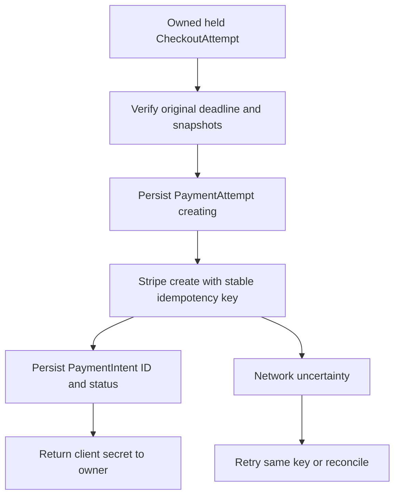

# Create payment from held snapshots

Build `POST /api/checkouts/:checkoutId/payment` for the authenticated client. It loads the CheckoutAttempt created in Module 19 and checks ownership, state and deadline. It sums provider Order snapshots and Booking charged allocations in one currency, then creates or retrieves one Stripe PaymentIntent for that total. The endpoint returns the client secret through a private response so the browser can use Stripe's payment component. It does not return the server secret key, raw provider Order documents or another client's payment data.



Use a unique `PaymentAttempt.checkoutAttemptId` index so two tabs cannot create unrelated payment attempts for one hold. The record has its own ID, expected amount and currency, Stripe idempotency key, optional PaymentIntent ID, state and last reconciliation time. Create it in a short database transaction or conditional upsert before calling Stripe. If a second request finds it, it follows the same creation or retrieval path rather than generating a new random key. Stripe's [idempotent request reference](https://docs.stripe.com/api/idempotent_requests) says an identical POST with the same key can return the original result after a connection failure. Keep a durable local key because Stripe's key retention is not your lifetime purchase identity.

Validate the snapshot arithmetic before the external call. Every provider Order under the attempt must be `pending_payment`; every Booking must still be `held` and have its complete SlotClaims; the attempt must not be expired or reconciling; each line's charged allocation must sum to its Order amount, and Orders must sum to the attempt total. Currency must be identical across all shares. If any invariant fails, stop and log a repair-needed condition. Charging a plausible amount is not enough when the held records disagree about what was purchased.

The server should reject a payment setup request at or after `holdExpiresAt` with `HOLD_EXPIRED` or `PAYMENT_RESOLVING` as appropriate. A PaymentIntent created one second before the deadline does not make the hold infinite. The browser displays the server deadline and remaining time. The payment route may decline to start a new card flow if too little time remains for a reasonable authentication step; that is a product policy to document. The exercise keeps the fixed ten-minute deadline and does not extend it merely because a PaymentIntent exists.

```ts
const attempt = await loadOwnedHeldAttempt(clientId, checkoutId);
assertBeforeDeadline(attempt.holdExpiresAt, clock.now());
const total = verifySnapshotAllocation(attempt.orders, attempt.bookings);
const payment = await getOrCreatePaymentAttempt(attempt.id, total);
const intent = await stripe.paymentIntents.create({
  amount: payment.amountMinor,
  currency: payment.currency,
  metadata: { checkoutAttemptId: String(attempt.id) },
  automatic_payment_methods: { enabled: true }
}, { idempotencyKey: payment.createKey });
await attachIntentIdConditionally(payment.id, intent.id, intent.status);
return { clientSecret: intent.client_secret, holdExpiresAt: attempt.holdExpiresAt };
```

The code shows the external call between local writes, deliberately outside a database transaction callback. In a real implementation, the selected payment method integration may require different PaymentIntent parameters. Never log `client_secret`. Do not blindly recreate an Intent when `attachIntentIdConditionally` fails because the local database was unavailable. Retry the same external key and reconcile against the existing PaymentAttempt. If a second tab already attached an ID, compare it to the returned ID and raise an operational alert if they differ.

## Handle a race with expiry

Payment setup and the expiry worker can start at nearly the same instant. Both should use a state transition on the CheckoutAttempt or PaymentAttempt to coordinate. A payment setup request first marks the attempt `payment_pending` under a condition that it is still held and before deadline. Expiry may move a due attempt to `expiring`. Only one state transition wins. If setup wins just before deadline, expiry still must contact Stripe or wait for a final status before releasing. If expiry wins, setup cannot start a new PaymentIntent and returns a resolving response. A pre-read of the deadline without this state coordination is another check-then-write race.

Once Stripe returns an Intent, persist its ID and status. If its status is `requires_payment_method`, the browser can present card entry. If it is `requires_action` or `processing` after confirmation, the browser should show the corresponding state and await the trusted outcome. The route should not set Orders paid based on the PaymentIntent creation response. The [PaymentIntent status reference](https://docs.stripe.com/api/payment_intents) separates creation and successful payment states. Only the signed webhook processing path changes held Bookings to confirmed.

## Test the uncertain network

Inject a Stripe client whose first create call succeeds remotely but throws a simulated network error locally. Retry the payment endpoint. Assert both calls used the same idempotency key, the fake Stripe service has one Intent and the local PaymentAttempt eventually stores that ID. Then call the endpoint from a second tab and assert it returns the same Intent client secret without creating a new one. Change the provider's current Service price after the hold; the Intent amount must remain the accepted snapshot total.

Advance the injected clock past the deadline and submit a fresh payment setup request with no existing Intent. It must not create a new external object. If an Intent already exists, route the request to the resolving or existing-status view, not a new creation. Finally, have another authenticated client request Amal's checkout ID and verify no PaymentIntent ID or client secret is disclosed. These tests establish authority, amount stability and retry behavior before the webhook can confirm an appointment.

## Choose a stable external key

Write the PaymentAttempt `_id` before calling Stripe, then derive a key from that stable ID and the operation name. Do not derive the key from an in-memory request counter, because a process restart would change it. Do not reuse the create key for cancellation or refund; each distinct operation needs a distinct key. Store the exact key or deterministic derivation version on the record. Stripe may prune idempotency keys after a documented minimum period, so a much later reconciliation should first retrieve the known PaymentIntent ID or search carefully by recorded metadata and internal state rather than blindly replaying creation forever.

If Stripe returns a validation error before executing creation, persist a safe error category and let the client or operator correct the underlying issue. A currency mismatch or unsupported amount is not a network uncertainty that should be retried in a tight loop. If Stripe returns a transient network error after request submission, leave the PaymentAttempt `creating` and retry with the same key. Distinguish those cases in the worker and logs. A route that treats every error as "card declined" would wrongly blame the client before they have entered a card.

## Prevent two-tab state confusion

Open the payment page in two tabs for the same client. Both request the existing CheckoutAttempt payment endpoint. They should receive the same PaymentIntent client secret under the one PaymentAttempt. If one tab confirms the card and the other remains open, the second tab's next status poll should show paid rather than offering a new confirmation. If the second tab attempts to submit after payment succeeded, Stripe and the server should reject or return current status without creating another Intent. The local unique PaymentAttempt key prevents two separate card flows for one held purchase.

Test a stale cart price from before Module 19's hold. The payment endpoint should use the held Order snapshots, which already reflect explicit acceptance. It must not compare against current Service prices and silently change the amount at this late stage. If the platform discovers a serious pricing inconsistency, it should stop and send the attempt to support or safe cancellation, not mutate an existing Intent amount after the client begins authentication without a clear consent flow.

The private response should include an expiry and a server state in addition to the client secret. The browser can stop card entry when the hold is resolving, and an accessibility announcement can explain why. Apply `Cache-Control: no-store` and ensure the client secret does not appear in analytics events, URL query strings or crash logs. Authorization tests should include both another ordinary client and a provider who owns one Order but not the checkout payment authority.

