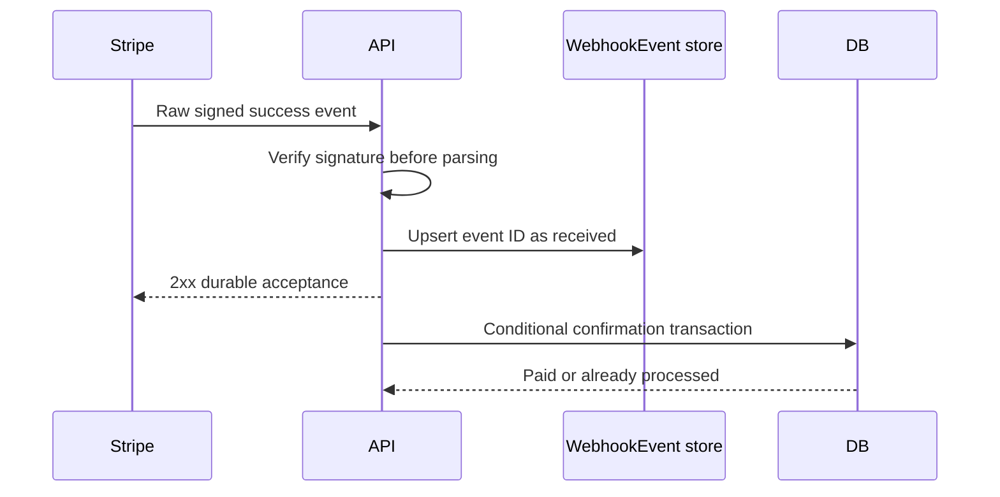

# Confirm holds from a signed webhook

A browser may report that the card component finished, but only a trusted payment-provider result can authorize a paid Booking. Build a Stripe webhook endpoint that receives the raw request bytes, verifies the `Stripe-Signature` header with the configured endpoint secret, and records each event ID durably. For `payment_intent.succeeded`, find the PaymentAttempt by Stripe PaymentIntent ID and confirm the CheckoutAttempt, provider Orders, Bookings and SlotClaims in one MongoDB transaction if the hold is still eligible. The response to Stripe acknowledges delivery after durable acceptance so a worker can finish processing if the API crashes.



Implement a route-specific raw-body parser before generic JSON middleware. Use Stripe's official `constructEvent` helper with the exact raw Buffer and endpoint secret. A valid JSON object with a fabricated `type: payment_intent.succeeded` is not a valid event. A reserialized body may have the same semantic fields but a different signature. The [Stripe webhook guide](https://docs.stripe.com/webhooks) covers raw-body verification and delivery behavior. Test both the valid signed bytes and a one-byte mutation after signing.

The event store has a unique Stripe event ID, event type, PaymentIntent ID, receipt time, processing state and safe error summary. Insert or upsert `received` before acknowledging. A worker can claim received events for processing, mark them processed after a successful local transition, and retry failed ones. Do not use a single `processed: true` write before the transaction and then acknowledge forever: a crash after that write would lose the payment confirmation. Do not perform an irreversible provider notification inside a retryable database transaction. Write an outbox message in that transaction, then deliver it idempotently afterward.

## Validate the link and amount

From the signed event, read the PaymentIntent ID and status. Load the PaymentAttempt by its stored provider ID, not by metadata alone. Compare event amount and currency with the expected snapshot total. Metadata's CheckoutAttempt ID is a helpful cross-check, but a mismatch is a reconciliation alert, not permission to relink money to another cart. An unknown PaymentIntent should be recorded for investigation and should not update any Booking. Avoid returning private details to the webhook sender; logs carry the diagnostic record.

In the normal path, the CheckoutAttempt is held or payment_pending, its common deadline has not been surpassed under the chosen policy, and all Bookings still own their SlotClaims. The confirmation transaction changes attempt to `paid`, all provider Orders to `paid`, all Bookings to `confirmed`, and all their SlotClaims to `confirmed`. It decrements active hold quota once, records Stripe PaymentIntent ID and paid time, and writes provider/client notification outbox items. The transaction uses state predicates so a duplicate success event or retry sees `paid` and does not decrement quota or notify twice.

```ts
await connection.transaction(async session => {
  const attempt = await CheckoutAttempt.findOneAndUpdate(
    { _id: payment.checkoutAttemptId, state: { $in: ['held', 'payment_pending'] } },
    { $set: { state: 'paid', paidAt: eventTime } },
    { session, new: true }
  );
  if (!attempt) return; // already paid or requires late-success reconciliation
  await confirmProviderOrders(attempt.id, session);
  await confirmBookingsAndClaims(attempt.id, session);
  await releaseActiveHoldQuota(attempt, session);
  await enqueuePaidNotifications(attempt.id, session);
});
```

The code is an outline. Before changing state, the handler must verify amount, currency, full claim coverage and deadline policy. If the attempt is `expiring` or `expired`, route the success to late-success reconciliation rather than letting this conditional update silently discard it. If it is already `paid`, acknowledge without another mutation. Because the transaction callback may retry, every helper must receive the session and all writes must be safe to repeat under the state predicate. [Mongoose's transaction guide](https://mongoosejs.com/docs/transactions.html) warns against parallel operations within one session.

## Events may arrive twice or out of order

Stripe may retry a webhook until it receives a successful response. It may also deliver events in an order different from their creation order. A `payment_intent.payment_failed` event arriving after `payment_intent.succeeded` cannot regress a paid attempt. Process events according to current state and, where needed, retrieve the current PaymentIntent status from Stripe outside the database transaction before choosing a transition. A signed event is authentic evidence of an event, not necessarily the latest status. Record contradictory transitions for reconciliation rather than overwriting them to make the handler appear simple.

A failed card attempt should leave the hold intact until deadline and allow another payment method. The webhook can update PaymentAttempt's last failure detail to a safe code without copying raw card data. The client sees a useful message from Stripe's client flow and the original remaining hold time. A second success event for the same PaymentIntent may be a duplicate event ID or a distinct event object reporting the same status; conditional local state prevents two paid transitions in either case.

Test a valid signed success event against two provider Orders and several Bookings. Assert every Order and Booking changes together, claims remain and become confirmed, quota decrements once, and one set of outbox notifications exists. Send the exact event twice; the counts remain unchanged. Send a different event ID for the same successful Intent; the attempt remains paid and no second outbox set appears. Send a prior failure event afterward; nothing regresses. Run a failed-signature request and assert no event record or Booking change. These cases prove much more than a single happy-path webhook response.

Finally, demonstrate a crash after event acceptance but before processing. The event worker must retry and eventually confirm the records. A 2xx webhook response is a promise that the application durably owns the event, not proof that every notification already reached a provider. The client may briefly see `payment_processing`; the owned status endpoint should transition to paid after the worker commits. Record processing latency and stuck received events as operational signals.

## Verify claim coverage before paid status

For each held Booking, calculate the required block starts from its immutable duration and buffer snapshots. Compare that set with live SlotClaims whose `bookingId` matches. If even one block is missing, do not mark the Booking confirmed from a normal success event. Put the attempt into reconciliation and investigate why a supposedly held checkout lost ownership. This guard is especially useful during migration from an older release or after manual database repair. A PaymentIntent success is real money, but it does not make a missing calendar claim appear.

The event timestamp and webhook receipt time are different. Store both, along with the server's confirmation time. A success event received after the deadline might describe a charge that succeeded earlier. The normal confirmation policy should use a trusted provider status and the stored deadline decision, not an untrusted browser time. If the hold was already released, follow late-success recovery regardless of how plausible the earlier event time looks. The current unique claim state is the decisive calendar fact.

## Keep delivery and notification separate

Create notification outbox records in the same transaction that confirms the Bookings. Each outbox item has a unique semantic key, such as `booking-confirmed:<bookingId>`, so worker retries do not send duplicate emails or push messages. A provider notification can say the confirmed start, Service title and provider-local time; it must not include another provider's share. The client notification can list all confirmed lines and total paid amount. Do not let an email failure roll back the payment confirmation or ask Stripe to resend a webhook until a mail server works.

In a test, make the notification worker fail after sending the first provider message. Retry it and assert the outbox state or provider API idempotency prevents a duplicate message. This test is distinct from duplicate webhook handling: the event processor may run once while the notification worker runs twice. Both need stable identities. Record each side effect's completion separately so operations can repair a stuck notification without editing Booking status.

Keep a protected audit row with the Stripe event ID, local attempt ID, transition result and worker attempt count. That row lets support explain why a repeated webhook was acknowledged without changing an already paid Booking.

