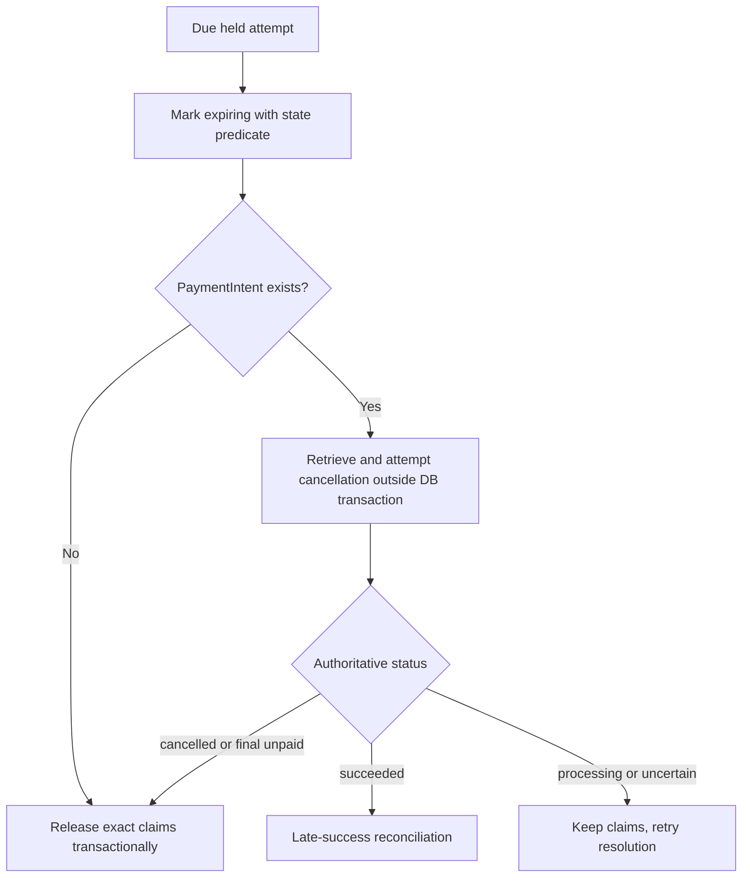

# Expire and release safely

The hold deadline has passed, but a SlotClaim remains in the database until a safe release transition commits. Build an expiry coordinator that treats the PaymentIntent status as a real input. If no Intent was ever created, it can release an unpaid due attempt through the M19 transaction. If an Intent exists, it must ask Stripe whether payment can still complete, cancel it when allowed, and only then free the provider blocks. This coordination happens across two systems, so the job needs durable intermediate states and repeatable steps.

The first database step changes a due CheckoutAttempt from `held` or `payment_pending` to `expiring` with a conditional update. A normal success webhook that races this step must either commit confirmation first or observe `expiring` and route to reconciliation. The worker must not delete claims while a success transaction is in progress. Its state predicate and the webhook's state predicate should share the same attempt document. The external cancellation follows after this local claim of work, outside the MongoDB transaction.

Stripe's [PaymentIntent cancellation reference](https://docs.stripe.com/api/payment_intents/cancel) lists statuses in which cancellation is allowed; a succeeded Intent cannot be cancelled as if it were unpaid. A rare processing case may allow cancellation, but the API result, not a guess from the local deadline, decides. Use a stable idempotency key for the cancellation request and persist the result. If the call times out, retrieve the Intent or retry safely. Do not free blocks merely because the cancel HTTP call did not return. A success webhook may arrive during the uncertainty.

When Stripe reports cancelled or otherwise definitively unpaid under the chosen payment method policy, execute M19's exact release transaction. It marks the attempt and pending provider Orders expired, Bookings expired, removes only the SlotClaims referenced by those Booking IDs, decrements active hold quota once, and records `releasedAt` and reason. It does not delete the historical Order or Booking snapshots. Two workers racing to release use the old state predicate so one transition wins and the other is a no-op. A duplicate queue delivery cannot decrement quota twice.

Some payment methods settle asynchronously over longer periods than a ten-minute card hold. This course's exercise should restrict the enabled payment methods to ones whose confirmation behavior fits the hold and cancellation policy, or extend the product policy with an explicit longer reservation. `automatic_payment_methods` without a reviewed method list can expose an asynchronous method that cannot be safely resolved by the short deadline. Record the allowed methods and status transitions in `docs/payment-policy.md`; test them. The mere existence of a PaymentIntent does not prove a method fits the booking product.

## Release on demand without bypassing payment

When checkout encounters a unique claim owned by a due hold, it can request that the expiry coordinator process that attempt and retry the new checkout after a safe release commits. It must not delete the old claim directly or ignore it in availability. The new checkout should wait only a bounded time. If Stripe status remains uncertain, return a truthful 409 or retry-later result and keep the block hidden. The priority is not to sell a block twice, even if a delayed external payment decision costs a few minutes of availability.

There is a subtle identity check here. The new checkout's collision returns a provider and block key. The server looks up the old SlotClaim and its Booking, then the owning CheckoutAttempt. It must confirm that the attempt is due and that the claim still belongs to it before asking for release. Between lookup and release, a webhook may confirm the old Booking. The release transaction's state predicate then fails safely. After the coordinator returns, the new checkout reruns full availability and unique claim insertion from fresh state; it does not reuse an old validation result.

## Test each status branch

Use an injected Stripe client and clock. For a due hold with no PaymentIntent, assert one release transaction and preserved history. For a due hold with a cancellable Intent, assert Stripe cancellation is called outside the transaction, then claims release. For an Intent already succeeded, assert no claim deletion and route to late-success processing. For `processing` or a network timeout, assert the attempt stays `expiring`, claims stay live, and a retry job is scheduled. For an already paid attempt, assert expiry is a no-op. These tests should inspect external calls and database state separately.

Crash injection is useful. Stop after marking `expiring` but before calling Stripe; the next worker should resume from that state. Stop after Stripe cancels but before database release; the next worker should retrieve the cancelled status and finish release. Stop after release commit but before job acknowledgment; the next worker sees expired and does not repeat quota changes. This is a practical saga: each step is durable and retryable, but the two systems are not one transaction.

Check an exact deadline boundary with an injected server clock. At one millisecond before `holdExpiresAt`, the job does not begin. At the deadline, an unpaid hold becomes due. The browser may have displayed a slightly different countdown because of clock skew, but the server's stored UTC instant is the authority. Return `serverNow` in client status responses to keep the UI useful without making it authoritative.

The gate evidence should include one state trace with timestamps: `held`, `expiring`, external cancellation result, `expired`, claim deletion and quota decrement. A reviewer should see why a block remained hidden while payment was uncertain. If the implementation jumps directly from deadline to claim deletion without consulting an existing PaymentIntent, it has not met the payment-safe release requirement.

## Inspect a webhook crossing cancellation

Pause the expiry worker after it sets `expiring` but before it calls Stripe. Deliver a signed success event. The webhook should recognize the resolving state and avoid the ordinary "before deadline" confirmation path. It can retrieve authoritative status, then begin late-success handling while claims are still present. In this case all original claims may still be owned by the attempt, so reconciliation can confirm them without re-inserting. The expiry worker's later cancel call should observe that Stripe is already succeeded and must not release the claims. The final state is paid with no refund if every Booking remains owned.

Reverse the order. Let Stripe cancellation complete, but pause the worker before database release. Deliver a stale failure event or a duplicate old success-looking event that does not reflect current Stripe state. The handler should not confirm from a contradictory stale event; it retrieves the current Intent status and sees cancelled. The worker can then release. Record both event IDs and the fetched authoritative status in the audit log. This exercise shows why event arrival order and provider state cannot be reduced to a single local `if (event.type)` branch.

Keep an operational upper bound for the resolving state. If Stripe remains `processing` longer than expected, alert support and continue polling according to the payment method policy. Do not use a hard timeout that deletes claims while funds may still settle. If the product cannot tolerate such long uncertainty, restrict the payment methods further. A provider calendar that stays blocked temporarily is an availability cost, but a paid client who lost the time is a more severe correctness failure.

The status endpoint should expose a clear resolving reason and a support reference without exposing Stripe's raw internal error. A provider sees that the calendar is temporarily occupied; the client sees that payment is being checked.

