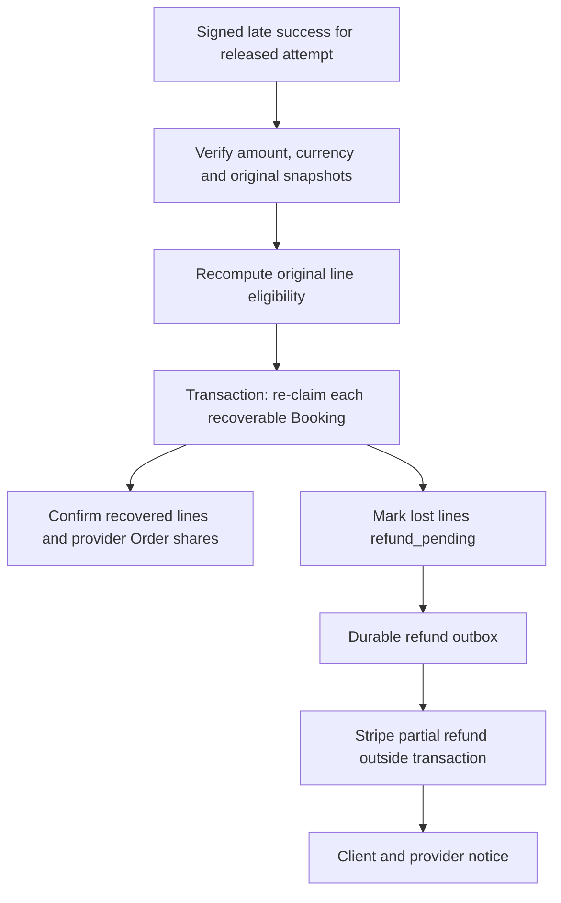

# Reconcile a late successful charge

The normal expiry coordinator cancels or resolves a PaymentIntent before releasing its claims. Still, a late success can reach a system with older records, an operational mistake or an external outcome observed after a local release. A charged client must not be left with expired Bookings and no explanation. This chapter handles that exceptional state explicitly. SkillSlot's policy is line-by-line recovery: try to restore each original Booking's occupied blocks; confirm the lines that can be safely restored; refund the charged snapshot allocation of each line that cannot. This differs from a full-checkout refund policy and must be visible to the client before production use.

Consider a 10,500 minor-unit payment: tutor 4,500, music 6,000. The tutor's 15:00 blocks were taken by a different client after the old hold released; music at 17:00 is still valid under its provider's rules. Never delete the new tutor claimant to recover the old sale. The reconciliation transaction tries the original claims for each line. Music's claims can be inserted and its Booking confirmed. Tutor's cannot, so its Booking moves to `refund_pending`, its provider Order share records zero retained revenue and a 4,500 refund obligation. The attempt remains `reconciling` until the partial refund reaches a final observed state. The original PaymentIntent remains one successful 10,500 charge with a 4,500 refund record.

If an Order contains several Bookings for the same provider, its final state may be partially fulfilled. Record per-line charged allocations and refunded amounts, then derive the provider Order's retained amount as the sum of confirmed lines. Do not mark the whole Order paid or expired without those distinctions. A line-level state can be `confirmed`, `refund_pending` or `refunded`; the Order can be `partially_refunded` when both retained and refunded lines exist. A provider dashboard should show only the confirmed appointment and the amount associated with it, not a fictional appointment for a lost line.

## Do not re-claim blindly

Before inserting claims, revalidate that the Provider and Service still allow the original UTC start under the chosen exceptional recovery policy. A provider may have added TimeOff or suspended their listing since the hold expired. The old Booking snapshot preserves what was bought, but it does not grant the right to override a later explicit closure after release. Write the same Provider-document fence used in M19, in stable provider order, then re-read rules and TimeOff. An existing confirmed Booking or new hold owns its unique blocks. A duplicate claim is an unavailable line, not an invitation to force a reschedule.

The recovery transaction needs a deliberate partial strategy. A duplicate-key error aborts the whole transaction, so a loop that catches it inside the same transaction and continues is unsafe. Preflight each line under provider fences, choose a recoverable set, then insert those claim sets transactionally; if an insertion collides because another checkout won after preflight, abort and retry the whole reconciliation with a fresh set. Bound retries and leave the attempt `reconciling` for a worker if contention persists. A line marked lost must have no active claims from this attempt. A recovered line must have its complete claim set, not a partial interval.

## Refund outside the database transaction

After local classification commits, create one durable RefundRecord for each lost Booking with its `chargedAmountMinor`, currency, PaymentIntent ID and stable idempotency key such as `refund:late:<bookingId>`. An outbox worker calls Stripe's refund API outside the MongoDB transaction. Stripe's [refund API](https://docs.stripe.com/api/refunds/create) supports partial amounts in the smallest currency unit, up to the unrefunded charge amount. Do not calculate the amount from today's Service price. The RefundRecord stores requested, provider-reported and final states so a network timeout can be retried without creating a second refund.

If the Stripe refund API fails temporarily, the Booking remains `refund_pending` and the client sees that money is being returned. Alert operations and retry with the same key. Do not label the refund complete because an HTTP request was queued. If Stripe reports a terminal refund failure, escalate with an explicit support case. An outbox notification should tell the client exactly which Bookings were recovered and which are awaiting refund. It should not claim that a pending refund has already settled to the card; provider settlement timing and bank return timing are separate.

## Keep one payment ledger balanced

Let `chargedTotalMinor` be the original PaymentIntent amount, `retainedTotalMinor` the sum of confirmed recovered Booking allocations, and `refundRequestedMinor` the sum of lost allocations. The invariant is `chargedTotalMinor = retainedTotalMinor + refundRequestedMinor` until refunds complete, then `chargedTotalMinor = retainedTotalMinor + refundedMinor`. If tax or platform fees were allocated, include them in each line's charged allocation by a documented rounding policy from Module 19. Two independent refunds must never sum beyond Stripe's remaining refundable amount. The database should enforce one RefundRecord per lost Booking and payment operation kind.

Test four outcomes: all lines recover, no lines recover, one of two recovers, and a claim collision after preflight. For the mixed case, assert one confirmed Booking with full claims, one `refund_pending` Booking with no claims, a 4,500 refund record, and provider Orders whose retained/refund amounts add to 10,500. Retry the same signed success event and refund worker; no extra claims or refund requests should appear. Simulate a Stripe refund timeout after remote creation and verify the same idempotency key recovers the one refund.

Keep this path rare but inspectable. A dashboard or audit command should list attempts stuck in `reconciling`, refund records pending too long, and mismatches between Stripe charge amount and local allocations. A learner may prefer to ignore late success because the normal protocol tries to prevent it. That would be a mistake: the client-money promise must cover the exceptional state that distributed systems can still expose. The recovery path is complete only when calendar ownership and financial obligation both have explicit outcomes.

## State the SkillSlot policy to the client

SkillSlot deliberately allows partial recovery of a multi-provider purchase after a truly late successful charge. The client is told that any original appointment whose time remains valid can be restored, while an appointment whose time was taken or closed will be refunded by its charged allocation. This is a product policy, not an automatic property of Stripe or MongoDB. It differs from a product that chooses to refund the entire checkout if any line is lost. Record the policy in checkout terms and in `docs/payment-policy.md`; a client should not discover partial fulfillment only after a rare race occurs.

If all lines recover, the one PaymentIntent is fully retained and every provider Order can become paid. If none recover, all line allocations become refund obligations, and the attempt is refunded after the full amount is observed returned. If only some recover, the attempt has a mixed outcome; each provider Order's retained and refunded amounts are explicit. Do not force the CheckoutAttempt state to simply `paid` or `expired` in that case. A `partially_recovered` or `reconciling` state with child-line detail helps support explain why one provider expects the client while another does not.

The client notification must distinguish a requested refund from a completed refund. It should name the lost Service and original UTC or local start, show the amount requested, and provide a support reference. A provider whose line was lost should not receive a paid booking notification. A provider whose line recovered should receive confirmation only after the claims commit. This communication follows persisted state, not the order in which external refund API calls happen to finish.

