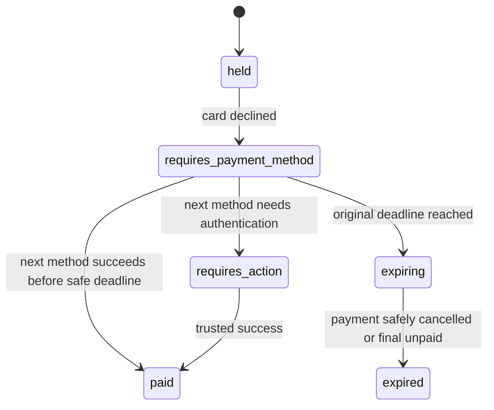

# Keep the hold after a card decline

A declined card is not the same as an expired appointment. Amal tries one payment method at 14:08 and receives a decline. Her tutor and music Bookings are still held until the original 14:14 deadline. The UI should explain the payment problem and let her choose another method while the calendar hold remains live. If the application releases claims on every `payment_intent.payment_failed` event, another client may take the time even though Amal was promised a ten-minute window to complete payment. This chapter preserves the distinction between a failed attempt and a final hold transition.

The local PaymentAttempt can store the latest safe failure category and Stripe status, while CheckoutAttempt remains `payment_pending` or `held`, provider Orders remain `pending_payment`, Bookings and SlotClaims remain `held`, and active quota remains consumed. Do not store full card numbers, CVC or unneeded error details. Stripe's PaymentIntent [confirmation reference](https://docs.stripe.com/api/payment_intents/confirm) says a failed confirmation may return to `requires_payment_method`, where another method can be supplied, or may cancel after a confirmation limit. Handle the actual status rather than assuming every failure is retryable.

The browser gets the original `holdExpiresAt` and `serverNow` with the failure response. It must not reset its countdown when the client changes card details. A retry uses the same PaymentIntent when Stripe permits and the same CheckoutAttempt. It should not call the SkillSlot checkout route with a new ID to get another hold. If the old attempt is already expired, the UI offers a fresh availability check and new purchase attempt. A retry of the old payment endpoint after expiry returns `HOLD_EXPIRED` or `PAYMENT_RESOLVING`, not a new Intent.

## State updates need precedence

A failure webhook can arrive after a success webhook. The handler may record its event ID for audit, but it must not move a paid attempt back to `requires_payment_method` or change confirmed claims to held. If a failure event arrives while the local attempt is `expiring`, the expiry coordinator should retrieve or confirm Stripe's current status before release; the event may be stale. If Stripe has already cancelled the Intent, release can proceed under that authoritative state. This is why payment event handlers use conditional state transitions and current provider status where event order matters.

An authentication-required status is neither a decline nor a success. The client may need to return from a challenge flow. Keep the held claims while time remains. If the challenge does not complete before the deadline, expiry enters resolving and follows the cancel-or-reconcile policy. Do not automatically label the card "declined" simply because the browser navigated away. The status endpoint should tell the client whether the hold is still active, processing, expired, paid or under reconciliation.

## Test two attempts within one hold

Use Stripe test mode or an injected provider fixture: first confirmation returns `requires_payment_method`, second succeeds before the original deadline. Assert one PaymentIntent ID, one CheckoutAttempt, unchanged Order amounts, unchanged deadline and one final paid transition. The SlotClaim documents should persist across the decline and change to confirmed after success. The first failure event may be delivered before or after success; neither order should result in released claims or duplicated provider notifications.

Then decline a card one second before the deadline and wait until the exact deadline. The UI should not promise that a fresh authentication flow has unlimited time. The expiry coordinator takes over, cancels or resolves Stripe status and releases only when safe. A decline does not itself delete claims; the due hold transition does. Finally, simulate a PaymentIntent that Stripe has cancelled after too many confirmation attempts. The local coordinator should observe the terminal status and safely release without offering another retry on that same Intent.

The product copy matters. "Card declined; try another method before 14:14" is actionable. "Booking failed" could make Amal abandon a still-held slot. "Payment succeeded" after only a client-side callback could mislead her if the webhook and database confirmation have not finished. Test the visible states alongside API and database states at phone width and with screen reader status text. A payment error should not erase the provider and start labels the client chose.

Record in `docs/payment-policy.md` how many payment method retries the UI encourages within the fixed window and which Stripe statuses are considered retryable. The server should always enforce the deadline and provider result, even if the UI offers a button due to stale data. This module does not change the hold duration; it makes the already promised short window usable after one ordinary card problem.

## Compare three failure messages

Use a test fixture for insufficient funds, a malformed payment method and a network timeout. An insufficient-funds decline is a provider result that may let the client choose another card while the hold remains. A malformed method can be caught before confirmation and should not call the provider repeatedly. A network timeout leaves outcome uncertain; the server should retrieve the existing PaymentIntent before telling the client to try again. If the UI renders all three as "card declined," a client might submit a second method while the first is actually processing. That can complicate reconciliation even if Stripe prevents duplicate charges on one Intent.

For each message, include the original deadline and a safe next action. "Use another method before 14:14" fits a declined card. "Check the card details" fits a local validation error. "Checking your payment status" fits an uncertain network result. The API should return a structured code rather than a free-form Stripe error copied directly to the browser. Keep sensitive provider details in protected logs and avoid exposing raw card metadata.

## Preserve the same purchase identity

After a decline, reload the page. The client still has the same CheckoutAttempt ID, provider Orders and Booking snapshots. The status endpoint can return the existing PaymentIntent's safe state and `client_secret` only when appropriate for the authenticated owner. It should not rebuild the cart and recalculate current prices. A provider may have changed their Service while the card form was open; that edit affects new offers, not the accepted held purchase. The held SlotClaims continue to block other clients until confirmation or safe release.

Try a second tab with the same checkout. If tab one receives a decline and tab two has stale success-looking UI state, both should refresh from the server's attempt status. Neither tab gets authority to set `paid`. If tab two confirms a different method while tab one still displays the old error, the webhook decides the final state and both tabs eventually show the same result. A local component state is not the payment ledger.

At the deadline, do not allow an unlimited sequence of failed attempts to squat on the provider calendar. The quota from Module 19 still counts this active hold, and the fixed deadline does not move. A failure event does not release early, but it also does not extend late. The expiry coordinator handles the terminal transition after checking or cancelling the PaymentIntent. Tests should assert the same stored deadline after every decline and authentication retry.

As a final transfer check, ask a learner to compare a card decline at 14:08 with a webhook delivery failure at 14:08. The first is a known payment-method result and can show "try another method" while the hold continues. The second is an infrastructure uncertainty; the browser should poll the owned payment status and avoid asking for another charge until the existing Intent is reconciled. Both may appear to a client as an error, but only one supports an immediate new card action. Have the learner identify the Stripe status, local PaymentAttempt state and next server operation for each.

