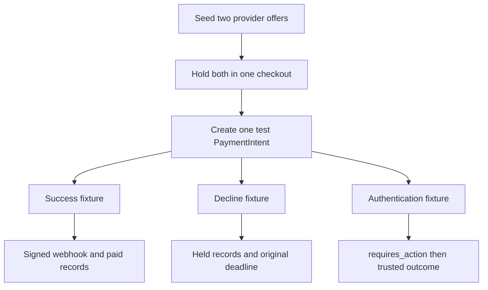

# Verify payment test paths

Use a real SkillSlot test-mode PaymentIntent for a held multi-provider checkout. The test route should produce one PaymentAttempt and one external Intent for the accepted snapshot total. A card component then exercises success, decline and authentication-required cases from Stripe's [testing guide](https://docs.stripe.com/testing). Capture the webhook event IDs and inspect the corresponding CheckoutAttempt, provider Orders, Bookings, claims and quota after each case. A screenshot of a Stripe success page is not evidence that the local calendar and provider shares were updated correctly.

Start with a test sandbox, local webhook listener and a fresh seeded database. Verify the endpoint secret is the one printed for this listener, without pasting it into evidence. Verify the database indexes for SlotClaim, CheckoutAttempt, PaymentAttempt and WebhookEvent. Use two Services in one currency with charged line allocations that add to an easy-to-check total, such as 4,500 and 6,000 minor units. Confirm the PaymentIntent amount is 10,500 and its metadata references the expected attempt. Do not use the twenty-client MongoDB race to load-test Stripe's test API.

## Success case

Create a hold, confirm payment using an official success test method, and wait for `payment_intent.succeeded` through the signed webhook. Assert one Intent, one paid CheckoutAttempt, two paid provider Orders and two confirmed Bookings. Claims should remain for every occupied block but have confirmed state. The active-hold quota should decrease exactly once. The client should see the two appointments and provider-local labels; each provider should see only their own Order share. Deliver the success event again from a saved signed fixture or Stripe retry mechanism and verify no second state change or notification.

Record the timing. If the browser completed its card action before the webhook reached the local server, the UI may briefly show `payment_processing`. It should not say the appointments are paid until the local status endpoint confirms the database transition. A webhook delivery delay is a normal distributed-system condition. The client can refresh without starting a second PaymentIntent. A test that only checks the final result misses whether the intermediate screen told the truth.

## Decline and retry case

Create a fresh hold and use a test method that produces a card decline. Record the Stripe status and local payment failure category. Assert Orders remain `pending_payment`, Bookings and claims remain held, and `holdExpiresAt` has not moved. Change to an allowed successful test method before the deadline on the same PaymentIntent. The eventual signed success confirms the original Bookings. If the integration creates a second PaymentIntent after the decline, or inserts new SlotClaims, the test fails. A card retry is part of the payment attempt, not a new calendar checkout.

Try a second decline near the deadline and advance the injected server clock to expiry in an integration fixture. The expiry coordinator should resolve or cancel the external Intent before releasing. A fake provider client can exercise exact clock boundaries and network timeouts deterministically. The live Stripe test run verifies the basic status transitions, while the injected client verifies races that a manual test card flow cannot time to the millisecond. Keep both evidence types and label them clearly.

## Authentication case

Use the authentication-required test method documented by Stripe. Confirm the frontend displays the additional action and keeps the same held checkout visible. Complete the action within the hold window, then wait for the signed success webhook and assert the normal paid state. Repeat with the challenge abandoned or delayed until the deadline. The UI should show resolving while the server determines whether cancellation is possible. It must not delete claims based solely on a client navigation event or a stopped countdown.

Test a valid event after a simulated local expiry release to exercise the exceptional recovery worker. In a two-provider fixture, make one original block unavailable and leave the other free. The late-success policy should confirm the recoverable Booking, create a refund obligation for the lost Booking's charged allocation, and keep the attempt reconciling until the partial refund is observed. Confirm that the sum of retained and refunded amounts equals the original charge. This case is most controllable with signed webhook fixtures and an injected Stripe client; do not force a real card flow into an unsafe late-success state just to stage a demonstration.

## Security and duplicate paths

Send an unsigned JSON body that claims `payment_intent.succeeded`. It must receive 400 and create no local state change. Change one byte of a correctly signed body and verify the same rejection. Send a correctly signed event for an unknown Intent ID and verify no Booking changes, with an operational record for investigation. Send a valid failure event after the success event and verify the paid state does not regress. Send the same valid event twice and verify one WebhookEvent identity and one transition.

Create two concurrent payment setup requests for one held attempt. They must converge on one PaymentAttempt and one Stripe Intent idempotency key. Simulate an external creation that succeeds but whose HTTP response is lost; the local retry must recover the same Intent. Then have another account request the client secret and assert authorization denies it. These tests cover payment creation boundaries that test cards alone do not exercise.

## Evidence table

In `docs/payment-evidence.md`, record for each scenario the checkout ID, amount/currency, redacted PaymentIntent ID, event type, expected local states, observed local states, claim count and quota delta. Omit API keys, client secrets and personal data. Include the exact command used to run signed webhook integration tests and the Stripe CLI listener command. A reviewer should be able to find the one mismatched scenario if a gate fails, rather than scanning a terminal transcript with unrelated events.

Finish with a reconciliation query: no paid attempt has a held Booking; no expired unpaid attempt retains claims after safe release; no refund-pending line is shown as a confirmed appointment; no successful PaymentIntent is unlinked to a local attempt or documented support case. If the query finds a discrepancy, keep the module gate open and repair the transition or evidence. Payment correctness is a relationship among money, Orders and occupied time, not a green card form alone.

## Inspect a test failure without hiding it

Suppose the success card produces a Stripe success but the local attempt remains `payment_processing`. Check whether the CLI forwarded to the intended server port, whether the webhook signature matched the correct local endpoint secret, whether the event ID was stored as received, and whether the event worker failed after acceptance. Do not press Checkout again with a new ID to make the demo pass. That would create another purchase intent while the first money event remains unresolved. Repair the event path and replay the durable record.

Suppose the decline test unexpectedly expires the hold. Compare the original `holdExpiresAt` with server time and inspect whether the failure handler called release directly. A late test run may legitimately reach the deadline; repeat with a fresh hold and a fixed test clock. A failure before deadline should preserve claims. A failure after deadline should hand off to payment-safe expiry, not claim that a decline itself frees the time.

Suppose the mixed late-success test refunds the correct amount but marks both provider Orders paid. Inspect Order retained/refunded allocation fields. A one-PaymentIntent charge does not mean every provider share was fulfilled. Fix the projection and state transition before presenting provider dashboards. The test should catch inconsistent provider balances as well as total client amount.

Save the observed status query after each test step so a reviewer can compare the visible client state with the persisted state at that instant.

